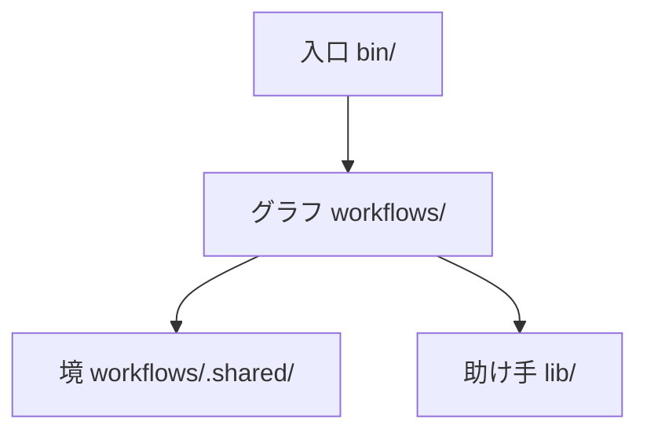

# works-factory

works-factory は、どのリポジトリにも使える修正の工場。直してほしい事（修正依頼か GitHub の issue）を渡すと、確かめ済みの変更と報告を返す。工場は、まず何が問題かを判定し、直し方を計画し、その計画を別の目に審査させる。直す前には、落ちるテストで欠陥を示す（赤の証明）。前から落ちていたテストと今回の欠陥を分ける。互いに触らない直しは別々の作業ツリーで並べて進める。対象のプロジェクト自身の確かめ（テストや CI）を走らせる。最後に、直しの経緯を知らない別の審査役が、目的だけから白紙で作った設計と突き合わせて判定する。人に聞くのは、決めた承認ノードの所だけ。

GitHub の About: A dev factory on Archon that turns a fix request into a verified change for any repository: plans are reviewed before code is written, red tests are proven before fixes, every agent claim is checked against quoted evidence, and independent reviewers judge blind. Japanese only for now.

今は日本語だけ。

## 約束すること

- 事実は機械が確かめる。テストが落ちたか・通ったか、何件か、どのファイルが変わったかは、AI の申告でなく機械が見る（テストの結末の JUnit XML・git の差分など）。
- 判断には引用の証拠を要る。AI が「この理由で落ちた」「ここが原因」と言う時は、根拠の文を引かせ、その引用が実物に在るかを機械が照らす。判断の正しさは別の目が見る。
- 持ち主の決めは言葉のまま記録し、工場に戻す。人が承認ノードで答えた事・方針として決めた事は `docs/owner-decisions.md` に言葉のまま残り、次の判断と次の run の材料になる。同じ事を二度聞かない。
- 承認ノードを通らなかった物は取り込まない。人が最後の承認ノードで見た差分は封じられ（hash）、取り込む時に照らす。違えば止まる。

## 流れ

1. 判定: 依頼の前提を実測し、目的を 1 文に固め、同じ種類の問題を世の中がどう解いているか（定石）を当たり、根本の欠陥を単位に切る。
2. 計画: 単位ごとに直し方・触ってよい範囲・受け入れのテストを決める。
3. 事前審査: 書く前に計画を叩く。別の役が目的の文だけから独立に設計し、計画と比べる。
4. 修正: TDD（先に落ちるテストを書き、直して通す）。互いに触らない単位の組を、別の作業ツリーで並べて直す（Archon の `fan_out:`）。
5. 試験の関門: 対象のプロジェクトの確かめを走らせ、赤の原因（今回入れた・元から・環境）を分け、緑を作業ツリーの指紋つきで認証する。
6. 独立の目: 4 つの観点（最小か・独立設計と合うか・全体の整合・見えていない範囲）を、経緯を知らない別の会話の審査役が判定する。
7. 報告: 結末・単位ごとの記録・人への問い・次に回す事。

承認ノードは、始める時・直す前（聞く必要がある時）・最後の 3 か所が基本。無人で回す方針も選べる。

## 使い方

入口は殻 1 本 `bin/works-factory` で、人は Archon の命令をそのまま打つ（`bin/works-factory <Archon の CLI の引数>`。旗は命令の後ろに置く）。殻は認証と置き場の隔離を整え、ASF の止め（`factory/pack.json`）の版の Archon の源を取り、そこから `bun` で起こす。グラフは Archon の家に置かない。メイングラフ `works-factory-line`（`workflows/line/`）が 8 つのサブグラフ（`workflows/<名>/`）を順に include する（作りの順は `docs/design.md`）。

1. 入れる: Python 3.12 以上と git の在る機械で、このリポジトリを clone して `bun` を入れ、借りるプラグイン（`lib/borrow/borrow.json` の物）を Claude Code に入れる。足りなければ、殻が入れる命令を 1 行ずつ出して止まる。
2. 始める: `bin/works-factory workflow run works-factory-line --cwd <対象> --input request=<依頼のファイル> [--input test_cmd='<1 行>']`。依頼のファイルの形は下の「依頼のファイル」、`test_cmd` は「test_cmd と作業ツリー」、run の作業ツリーがどこから切られるかは「作業ツリーの起点」。
3. 答える: `bin/works-factory workflow respond <run> approve|stop [一言] --cwd <対象>`。家（Archon の DB）は対象ごとなので、対象の外から打つ時は `--cwd` が要る。`WORKS_FACTORY_HOME` で始めた run は、答える時も同じ値を付ける（承認ノードの文の答えの行がその形で出る）。
4. 見る: `bin/works-factory workflow status --cwd <対象>`・`workflow get <run> --cwd <対象>`。
5. 当てる: `bin/apply <run> --cwd <対象>`（中身は `bin/_lib/apply.py`）。封じた hash を照らしてから対象へ当てる。
6. CI の赤を次の依頼へ運ぶ: run の外の CI が赤と言った試験の id（1 行に 1 つ。`-` なら標準入力）を、前の run の報告が書いた次の依頼の下書きの `prior_failures` に足す: `python3 -I lib/carry.py carry-ci --request <next-request.json> --failed <試験の id のファイル> --out <next-request.json>`（同じ行は 2 度足さず、依頼の形が違えば何も書かずに終了の値 2）。

- 周をつなぐ（周の鎖 `works-factory-chain`、`workflows/chain/`）: `bin/works-factory workflow run works-factory-chain --cwd <対象> --input rounds=<1〜5> [--input budget_usd=<USD>] --input request=<依頼>`。1 周がメイングラフの子の run 1 本で、残りが在れば次の依頼にして次の周を起こし、止めの語（`lib/chain.py` の `STOPS`）で止まる。`budget_usd` を付けると、次の周で上限を越えうる時と費用が読めない周が在る時に止まる。周の中の承認ノードは子の run で止まるので、答える `<run>` は子の run の id（`workflow status` で見る）で、答えると親が続く。`--no-worktree` では起こせない（周の結果を run の作業ツリーの枝へ commit するため）。当てる時は `bin/apply <鎖の run>` で、元の基から採る周（最後の周から戻って止まっていない最初の周）までの最後の差分を当てる。止まった周の差分は採らずに鎖の run の置き場に残し、周ごとの表と合計と一緒に置き場の `chain.md` に名指す。
- 止める: 承認ノードで `workflow respond <run> stop <一言>` と打つと、メイングラフが後ろを飛ばして報告を出す（`workflow reject <run>` も同じ）。承認ノードの間で走っている run は `bin/works-factory workflow cancel <run> --cwd <対象>` で止まるが、報告は出ない。`<run>` は根の run（周の鎖なら鎖の run）の id。Archon の cancel は AI のノードのプロセス（ノードごとの Claude Code と、それが起こしたプロセス）を止めないので、殻が cancel の後に、その run の持ち主から辿れるプロセスを子の run の分も含めて止め、止めた本数と、それでも残った物（pid とコマンドの名）を 1 行ずつ出す（`docs/polyfills.md` の P13）。前で起こした run（`--detach` の無い `workflow run`）は Archon の cancel が拒むが、殻が持ち主ごと止める。その run は failed になり、`workflow resume <run>` で続けられる。前の命令を Ctrl-C で止めると AI のノードのプロセスが残るので、止める時は cancel を打つ。子の run の id だけを cancel すると、Archon が子の run を止めるが、AI が起こしたプロセスは残りうる。
- 自分のグラフ（`workflows/`）を Archon に渡すのは `workflow run` の時だけ。`trigger`・`chat` には渡らない。
- run は始めに `workflows/` だけを写し取るので、走っている間にこのリポジトリの `lib/` を変えると、その run に効く。
- 選べる道は環境変数で渡す（どれも無ければ Claude Code と gh のログインのまま動く）: `WORKS_FACTORY_HOME`（家の置き場。絶対パス。家・対象・Archon の源の取り置き（`XDG_CACHE_HOME`）が実パスで `/tmp/claude-*` の下なら、役の sandbox が書ける置き場なので拒む。家がこの checkout の下でも、読むだけの役の書き込みの柵が checkout を丸ごと禁じて役が家に書けないので拒む。checkout の外を選ぶ）・`WORKS_FACTORY_KEYCHAIN_ITEM`（Claude のアカウントを keychain の項目の名で選ぶ）・`WORKS_FACTORY_NO_AUTH=1`（認証の要らない道）・`CLAUDE_BIN_PATH`（隔離した設定にプラグインを入れ、役を起こす本物の claude の絶対パス。無ければ `PATH` の絶対の置き場から探す。殻は役との間に書き込みの柵の包みを置く。殻を起こす env に置く。起こす場所・`--cwd`・対象の根の `.env`・`.env.local`・`.env.development`・`.env.production`・`.archon/.env` か、Archon の家の `.env` が名指すと、包みが外れるので殻は止まる。同じファイルが包みの記録 `WORKS_FACTORY_FENCE_RECORDS` を名指しても止まる）・`WORKS_FACTORY_COLDWRITE_MARKETPLACE`・`WORKS_FACTORY_COLDWRITE_MARKETPLACE_REPO`（coldwrite を借りる時）・`WORKS_FACTORY_ALLOW_TESTCMD=1`（対象の手元を走らせる形の `test_cmd` でも run を止めずに進める。下の「test_cmd と作業ツリー」）。
- 対象の試験・受け入れ・TDD の試験のコマンドは、いつも利用者の HOME・XDG で走る（隔離した置き場ではない。道具が設定・信頼・キャッシュ・認証を見失わないため。Archon・役の Bash・工場の script 自身は隔離のまま）。AI が書いた試験のコードを、あなたの権限（利用者の HOME・XDG）で走らせる。書く物も利用者の家に入る。守りが要るなら工場ごとコンテナか VM の中で回す。実行する run を起こすたびに、殻が標準エラーへ同じ告知を 1 行出す。
- 対象のリポジトリが頼れる印: 役の claude と、その子（役の Bash が起こす対象のテストなど）には `GRAPHLOOPS_ENGINE_CHILD=1` が立つ。対象の重い一式（e2e など）はこの値で AI の役からの起動を見分けて拒める。メイングラフの最後のテストなど script ノードが走らせる物には立たない。
- ログインの資格は数時間で切れるので、長い run は `claude setup-token` で作ったトークンを `CLAUDE_CODE_OAUTH_TOKEN` に置いて殻を起こす。

Claude Code からは `/works`（raiki61/claude-plugins の works プラグイン）で同じ事ができるようになる。

### 依頼のファイル

`--input request=<パス>` は、直してほしい事を書いた JSON のファイルのパス。相対のパスは run の作業ツリーの根から読む（並びは対象の根と同じ）。対象の中に置いた commit していないファイルも、下の「作業ツリーの起点」の包みで run の作業ツリーに入るが、run の起点の commit に依頼が混ざらないよう、対象の外に置いて絶対パスで渡すとよい。

形は 2 つのどちらか。

- 所見（findings）の配列だけ
- `findings`・`pr`・`issue`・`answers`・`prior_failures`・`constraints` を鍵に持つ object（どの鍵も省ける。知らない鍵は拒む）

所見の行は `where`（どこか）と `text`（何が起きているか）が要り、`mechanism`（なぜ起きるか）・`measured`（どう測ったか）・`false_positive_if`（どうなら誤報か）を足せる。`pr`・`issue` は番号の配列。`answers` は前の run が聞いた問い（問いの key か、測れていない確かめの名。例: CI の `local_checks`）への答えで、行は `question`・`text`（命令と出力で答える時は `command` と `output` を両方）。`prior_failures`・`constraints` は前の run の報告が書いた次の依頼の下書き（`next-request.json`）が運ぶ物で、手で書く事は少ない。

```json
{
  "findings": [
    {"where": "stats.py", "text": "mean([1, 2, 3]) が 2 でなく 3 を返す", "measured": "手元で mean([1, 2, 3]) を呼んで 3 を見た"},
    {"where": "stats.py", "text": "clamp(15, 0, 10) が 10 でなく 0 を返す"}
  ],
  "answers": [
    {"question": "local_checks", "text": "手元で CI の一式を走らせ、全部通った", "command": "make ci", "output": "ok"}
  ]
}
```

### test_cmd と作業ツリー

`--input test_cmd='<1 行>'` は、対象のテストを走らせる 1 行。run の作業ツリーの根で走る。run の作業ツリー（と、修正の段が並べて直す単位の作業ツリー）は commit から切るので、git が無視する物（依存の置き場・仮想環境・ビルドの出力・`.env` など）が無い。作業ツリーの中で環境を作ってから試験を走らせる 1 行にし、元の clone を絶対パスで指さない。対象のコマンドは利用者の HOME で走るので、`~`・`$HOME` で元の clone を指す形も同じ（run の中でも元の clone を指す）。

メイングラフの頭のノード（`testcmd`。`lib/testcmd_check.py`）が、AI を起こす前に `test_cmd` の形を確かめる。

- 止める形（行の頭「止める（test_cmd）」）: 対象の手元（元の clone と、`git worktree add` で作ったほかの作業ツリー）を絶対パスか `~`・`$HOME`・`${HOME}`（利用者の HOME に展開してから見る）で指す・対象を editable で入れた外の仮想環境を絶対パスか `~` などで指すか立てたまま起こす。run の試験が直しでなく手元のコードを走らせ、直しの正誤に関わらず緑になりうる。run は頭で止まり（Archon の cancel。`workflow status` に止めの理由の行が出る）、AI は起きない。止める時は run と作業ツリーを作ってから cancel するので、作業ツリーは残る。形を知った上で回すなら `WORKS_FACTORY_ALLOW_TESTCMD=1` を殻を起こす env に置く（行の頭が「注意（test_cmd）」になり、止めずに進める）。確かめそのものが落ちた時も同じに止める。
- 注意の形（行の頭「注意（test_cmd）」）: git が無視する物を相対のパスで指す（`cd sub && .venv/bin/<試験>` など）。作業ツリーに無いので走らないが、頭では止めずに注意の行を残す。その語が `test_cmd` の最初の語なら、試験を起こす前の確かめ（`lib/tree_run.py` の `prove_launchable`）が起こさずに止め、修正の前の試験が 1 段も走らずに判定の前で止まって道具の誤りの文を見せる（下の `setup` の段落と同じ止め）。最初の語より後ろの語はその確かめが見ないので、試験は起きて落ち、赤として判定へ進む。
- 止めずに進めた run の注意の行（許しの時の行と、注意の形の行）は、報告の冒頭（3 行と人が決める物の下）に 1 行ずつ載る。

`test_cmd` を省けば、対象の宣言 `.review-checks.json` で走らせ、それも無ければ CI の任せ先の役が対象の CI の定義から走らせ方を探す（役の緑は自己申告なので、緑の認証には数えない）。

準備が要る道具（新しい作業ツリーを信頼しない道具など）は、宣言 `.review-checks.json` の `suite` の横に `setup`（argv の並び。例: `"setup": [["<準備のコマンド>", "<引数>"]]`）を足す。作業ツリーごとに最初の対象のコマンドの前に 1 度、利用者の HOME・XDG で走る。書く物は作業ツリーの外か `.gitignore` の下にだけ（作業ツリーに書いた物は、最初の対象のコマンドが書いた物として数えられる）。落ちたら対象のコマンドは起こさず、修正前の試験が 1 段も走らなかった run は、その誤りの文と案内を出して判定の前で止まる。`test_cmd` だけの対象も、`suite` に同じ argv を書けば `setup` を使える。

### 作業ツリーの起点

自分のグラフの新しい run では、殻が対象の今の姿を Archon に `--from <commit>` で渡し、Archon がそこから run の作業ツリーを切る（`bin/_lib/startpoint.py`）。

- 汚れていない対象は `HEAD`。PR の枝を checkout して頼めば、その枝から始まる。
- commit していない変更か未追跡のファイル（git が無視する物は除く）が在れば、それを包んだ commit（親は `HEAD`）。包みは一時の index で作り、対象の作業ツリー・index・枝は動かさず、ref も付けない。殻は包んだファイルを 1 行で出す。
- `--from <版>`・`--from-branch <枝>` を名指せば、それが勝つ。`--base <枝>`（作業ツリーの切り元と PR の基）か `--branch <枝>`（`-b`。run の枝の名）を名指した時も足さず、切り元は Archon が決める（既に在る枝の名は、切り元へ戻さずにその枝の頭のまま使い、在る作業ツリーもそのまま使う。remote にだけ在る枝は remote の頭で取り出し、手元が remote より遅れていれば進める。手元と remote が食い違うと、取り出す前に止まる）。名指した枝を対象の今の姿から切るなら `--from` も一緒に名指す。`--no-worktree`・`--folder`・`--container`・`--adopt`・`--dry-run` を付けた時と、git の木でない・commit の無い対象にも足さない。
- remote の無い対象は Archon が直し方の 1 行を出して拒む。
- 依頼が `pr` を名指す時は、その PR の head を checkout し、汚さずに頼む（包んだ commit は PR の head と違うので、run の始めで拒まれる）。

## 作り



- 入口 `bin/`: 人が打つ口。止めた版の Archon の源を取り寄せ、そこから Archon を起こす。
- グラフ `workflows/`: この工場のエッセンス。どの確かめと役が在り、各々が何をし、どの順でつながり、どこで人に聞くかを、Archon の書き方で書く。メイングラフ（サブグラフを並べた 1 本の流れ）と、判定・計画・事前審査・修正・試験の関門・独立の目・報告・取り込みのサブグラフ。各サブグラフは YAML・役の指示書・ノードの script を持ち、サブグラフの間で渡す物の型は Archon の `output_format` で表す。YAML は手で書き、変換せずに Archon に渡す。
- 境 `workflows/.shared/`: Archon との出入りの口と、Archon に無い物を補う小さな部品だけ（`docs/polyfills.md` に全部載る）。
- 助け手 `lib/`: script ノードが呼ぶ Python のモジュール（引用の照らし・TDD の赤の判定・元から赤の見分け・範囲の照らしなど）。Archon を知らない。

グラフを回すのは止めた Archon（ASF と同じ開発中の源。`docs/design.md` の「語」）。ASF のグラフはその源の `.archon/workflows/sdlc/` に在り、グラフの名で選び分けて見比べられる。別の実行の道具へ移る時は、グラフをその道具の書き方で `docs/design.md` から書き直す。役の指示書と `lib/` はそのまま持っていける。

AI 向けの決まりは各階層の `AGENTS.md`（根の物から辿る）、設計は `docs/design.md`。

## リポジトリの中の見方

根には、この工場の物と、ASF の取り付け命令が置いた物が並ぶ。名前で見分けられる。

- この工場の物: `bin/`・`workflows/`・`lib/`・`tests/`・`docs/`・`pack.json`・`MISSION.md`・`AGENTS.md`（各階層）・`engineering.md`（ASF の役が読む入口。`AGENTS.md` を指すだけ）・`README.md`・`.github/`。グラフの名は `works-factory-` で始まる。
- ASF の物: 名前が `factory`・`FACTORY`・`.factory` で始まる物（`factory/`・`FACTORY.md`・`FACTORY_RULES.md`・`.factory/`）。ASF がこのリポジトリを作る時に使う。ASF の命令がこの場所と名前を決め打ちで読むので、動かさず名前も変えない。中身も手を加えず、ASF が書けと言うファイル（`.factory/holdout/HOLDOUT.md` など）だけを書く。起こす物の無くなった取り付け物は外した（持ち主の決め `asf-installer-in-repo`）。
- Archon に読ませるグラフ: この工場の物はこのリポジトリの `workflows/`、ASF の物は Archon の源の `.archon/workflows/sdlc/`（名前は `archon-` で始まる）。どちらも Archon の家には置かず、`--workflow-source` で読ませる。
- 置き場の木の全部と、名前の決まりは根の `AGENTS.md` の「リポジトリの形」と E18。

## 関係

- Archon: AI の処理をグラフにして YAML で書き、機械が順に回す道具。作者は coleam00（[coleam00/Archon](https://github.com/coleam00/Archon)）。works-factory はその上で動く。
- ASF（AI software factory）: Archon の作者が作った、作業の受け付けから merge までのグラフの束。作りの型（出力の形・緑の認証・取り込みの計画の封印・守りのパスなど）を読んで学んだ。学んだ型と違いは `docs/asf-notes.md`。この工場の層（`bin/`・`workflows/`・`lib/`）には ASF のコードを写さない。ASF の取り付け命令が置いた物は、ASF がこのリポジトリを作るために置いたまま使う（上の「リポジトリの中の見方」）。
- 今の works（raiki61/claude-plugins の `works/`）: この工場の前の形。graphloops プラグインのレビューと修正のループ（review-graph）から育った。works-factory は今の works の能力を 1 つも落とさずに作り直した物で、同じ能力に届いたら置き換える。置き換えた後、claude-plugins には `/works` の薄い入口だけが残る。

## 文書

- `MISSION.md`: 目的と範囲の外
- `AGENTS.md`（各階層）: AI 向けの作りの決まり（コードを書く前と審査の前に読む）。`engineering.md` は ASF の役のためにそこを指すだけ
- `docs/design.md`: 層・メイングラフ・サブグラフ・能力の棚卸し・作りの順
- `docs/owner-decisions.md`: 持ち主の決め（言葉のまま）
- `docs/polyfills.md`: Archon に無い物を補う部品の名簿
- `docs/asf-notes.md`: ASF から学んだ型
- `docs/plans/`: 実装の計画

## 今の状態

作っている途中。入口の殻 `bin/works-factory`・メイングラフ `workflows/line/`・8 つのサブグラフ・周の鎖 `workflows/chain/`・`lib/`・層の試験が在り、メイングラフは本物のサブグラフと組んだ筋書き（Archon の `workflow test`。役は起こさない）で確かめている。小さな対象のリポジトリに 1 つの依頼を本物の役で通す段 1 の歩く骨組みはまだ。土台は ASF に作らせている。修正の工場として今使えるのは、今の works（raiki61/claude-plugins の works プラグイン）。作りの順と進みは `docs/design.md` の「作りの順」。
