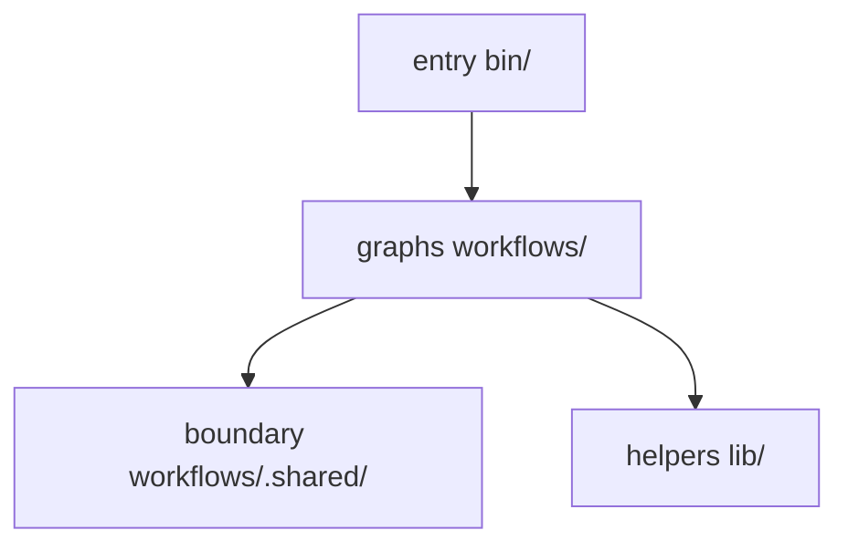

# works-factory

> **Status: under construction.** The whole flow already runs with real AI roles on a request (stage 1, the first stage of the build order, issue [#154](https://github.com/raiki61/works-factory/issues/154)), but the factory has not yet caught up with the tool it replaces, the current works (see "Related projects"), and known failures remain: for example, the part of the report that an AI writes currently fails (issue [#712](https://github.com/raiki61/works-factory/issues/712)). Everything except this README is in Japanese. If you need a fix factory you can rely on today, use the current works. More in "Current status".
>
> Before trying it, check "Requirements". Words such as run, node, and approval node are explained in "Terms" at the end.

works-factory is a fix factory you can point at any repository. Hand it what you want fixed (a fix request or a GitHub issue) and it returns a verified change and a report. The factory first works out what the problem is, plans the fix, and has the plan reviewed by a separate reviewer. Before fixing anything, it shows the defect with a failing test (the red proof). It separates tests that were already failing from the defect at hand. Fixes that do not overlap proceed side by side in separate worktrees. It runs the target project's own checks (its tests or CI). At the end, a separate reviewer who knows nothing about how the fix was made judges it against a design they drew up from scratch, given only the goal. A human is asked only at the approval nodes you chose (the points where a run pauses for a human; see "Choosing the approval nodes"). The factory runs on Archon, and borrows build patterns from ASF; both are described in "Related projects".

GitHub About: A dev factory on Archon that turns a fix request into a verified change for any repository: plans are reviewed before code is written, red tests are proven before fixes, every agent claim is checked against quoted evidence, and independent reviewers judge blind. Japanese only for now.

For now the factory works in Japanese only: its role prompts, its messages and its reports are in Japanese, and so is every other document in this repository (`AGENTS.md`, `MISSION.md`, `docs/`). This README is the one English document. Everything you need to install, run, answer, and apply is written here; the documents it points to, marked "(Japanese)", are background you can skip.

## What it promises

- Facts are checked by machine. Whether a test failed or passed, how many, and which files changed are read by the machine (the tests' JUnit XML results, the git diff, and so on), not taken from what the AI reports.
- Judgments need quoted evidence. When the AI says "it failed for this reason" or "this is the cause", it has to quote the text it relies on, and the machine checks that the quote exists in the real thing. Whether the judgment is right is checked by a separate reviewer.
- The owner's decisions are recorded word for word and fed back into the factory. What a human answered at an approval node, and what was decided as policy, stay word for word in `docs/owner-decisions.md` (Japanese) and become input to the next judgment and the next run. The same question is not asked twice.
- The factory applies nothing that did not pass the approval nodes. The diff a human saw at the last approval node is sealed (hashed) and checked when it is applied. If it differs, the factory stops.

## Flow

1. Judge: verify the request's assumptions by measuring them, state the goal in one sentence, look up how this kind of problem is usually solved (the established practice), and split the problem into root-cause defects ("units").
2. Plan: for each unit, decide how to fix it, what it may touch, and the acceptance tests.
3. Plan review: attack the plan before writing code. A separate role designs independently from the goal sentence alone and compares with the plan.
4. Fix: TDD (write a failing test first, then fix and make it pass). Groups of units that do not overlap are fixed side by side in separate worktrees (Archon's `fan_out:`).
5. Test gate: run the target project's checks, sort the causes of red (introduced this time, already there, environment), and certify green together with a fingerprint of the worktree it was measured on.
6. Independent eyes: reviewers in separate conversations who know nothing of the history judge from 4 viewpoints (is it minimal, does it match the independent design, is the whole consistent, what is out of view).
7. Report: the outcome, a record per unit, questions for the human, and follow-up work to hand on to the next run.

By default a run asks you at the start and at the end, and in between only when something needs asking (before fixing, and when a plan has to change during fixing). You choose how often you are asked with run inputs, down to a run nobody answers; see "Choosing the approval nodes" under "Usage".

## Requirements

The entry script checks Python, `bun`, Claude Code and the plugins when it starts; if one is missing, it prints what to install (one line each) and stops.

- Python 3.12 or later (the entry script `bin/works-factory` refuses older versions).
- git.
- `bun` (https://bun.sh). The script uses it to start Archon.
- A clone of this repository: `git clone https://github.com/raiki61/works-factory`.
- Network access to GitHub on the first start: the script clones the Archon source at the pinned commit (`factory/pack.json`) into a cache and reuses it after that.
- Claude Code (the `claude` command), logged in. Your normal login is used; for long runs see `CLAUDE_CODE_OAUTH_TOKEN` under "Usage".
- The Claude Code plugin `pr-review-toolkit` from the `claude-plugins-official` marketplace (`anthropics/claude-plugins-official`), installed in your normal Claude Code: `claude plugin marketplace add anthropics/claude-plugins-official`, then `claude plugin install pr-review-toolkit@claude-plugins-official`. The script copies it from there into the isolated settings the roles use.
- Optional: the GitHub CLI `gh`, logged in. Needed when a request names a PR or an issue (the run reads them with `gh`). Without it, the run cannot read them and records them as not read; the check for other open PRs is then left to an AI role.
- Optional: the Claude Code plugin coldwrite (a document check from raiki61/claude-plugins; you can skip it). It is used only when you set `WORKS_FACTORY_COLDWRITE_MARKETPLACE` and `WORKS_FACTORY_COLDWRITE_MARKETPLACE_REPO`; otherwise the script prints one line and goes on without it.
- A target repository that is a git repository with at least one commit and a remote (Archon refuses a target without a remote; see "Worktree start point").
- Budget for the model usage. For scale: the stage 1 runs on a small target cost about 7 to 10 US dollars each and took about 15 minutes, not counting time waiting at approval nodes (run records: "作りの順" (build order) in `docs/design.md`, Japanese).
- Be aware that test code the AI wrote runs with your own rights (your HOME and XDG). If you need protection, run the whole factory inside a container or VM (details under "Usage").

You do not install superpowers yourself: the factory carries a pinned copy of the skills it uses (`lib/borrow/superpowers/`). The list of what is borrowed is `lib/borrow/borrow.json`. Running this repository's own tests (not needed to use the factory) also needs `uv` (see `tests/AGENTS.md`, Japanese).

## Usage

The entry point is a single shell script, `bin/works-factory`, and you type Archon's commands as they are (`bin/works-factory <Archon CLI arguments>`; put flags after the command). The script sets up authentication and an isolated home (a separate state directory), fetches the Archon source at the version pinned by ASF (`factory/pack.json`), and starts it from there with `bun`. The graphs are not placed in Archon's home (its state directory). The main graph `works-factory-line` (`workflows/line/`) includes the 8 subgraphs (`workflows/<name>/`) in the order of "Flow" above, plus merge, which seals the diff and leaves it in the run's directory for `bin/apply`.

1. Install: clone this repository and install what "Requirements" lists. If anything is missing, the script prints the install commands one per line and stops.
2. Start: `bin/works-factory workflow run works-factory-line --cwd <target> --input request=<request file> [--input test_cmd='<one line>']`. The request file format is in "Request file" below, `test_cmd` in "test_cmd and worktrees", and where the run's worktree is created from in "Worktree start point".
3. Answer: `bin/works-factory workflow respond <run> approve|stop [a short note] --cwd <target>` (which approval nodes you get is in "Choosing the approval nodes"; how to stop a run is in "Stopping a run"). Archon's home (its DB) is per target, so you need `--cwd` when typing from outside the target. A run started with `WORKS_FACTORY_HOME` needs the same value when you answer (the answer line in the approval node's text comes out in that form).
4. Watch: `bin/works-factory workflow status --cwd <target>` and `workflow get <run> --cwd <target>`.
5. Apply: `bin/apply <run> --cwd <target>` (the implementation is `bin/_lib/apply.py`). It checks the sealed hash, then applies the change to the target. For a run stopped at the last approval node add `--allow-stopped`; for a run whose main-graph output cannot be read because a node after the seal failed, add `--allow-failed` (it checks against the sealing node's output).
6. Carry CI failures into the next request: add the test ids that CI outside the run reported as failing (one per line; `-` reads standard input) to `prior_failures` in the next-request draft the previous run's report wrote: `python3 -I lib/carry.py carry-ci --request <next-request.json> --failed <test-ids-file> --out <next-request.json>` (the same line is never added twice; if the request has the wrong shape it writes nothing and exits with 2).

- Opening a PR (only when you choose it; by default the run only leaves the diff and writes nothing to the target): add `--input deliver=pr`. After the last approval node, the checked diff is committed as one commit onto the run's branch (the target's commit hooks are not skipped), and Archon's bundled `archon-pr` pushes that branch and opens a PR against the target's default branch (a draft by default). If the run's branch has the same name as the target's default branch, it stops without pushing. It does not merge (that is left to the target's review and rules). The second line of the report says where the PR is, why it stopped without opening one, or why it could not confirm that one was opened. The PR is opened with your gh login, under gh's current account (the active account in `gh auth status`), so switch gh to an account that can open PRs on the target repository before the run. The push is a plain `git push` and uses only the credentials git finds in the run's environment (the entry script does not pass git credentials, so if none are found, no PR is opened and the report says it could not confirm one). The AI roles, and gh as called by the target's commands such as its tests, get a read-only gh. In a round chain, the child runs open no PR; the chain run opens a single PR from the final diff (`deliver` in the chain's output `result`).
- Chaining rounds (the round chain `works-factory-chain`, `workflows/chain/`): `bin/works-factory workflow run works-factory-chain --cwd <target> --input rounds=<1-5> [--input budget_usd=<USD>] --input request=<request>`. Each round is one child run of the main graph; if anything remains, it becomes the next request and starts the next round, and the chain stops on a stop word (`STOPS` in `lib/chain.py`). With `budget_usd`, it stops when the next round could go over the limit and when a round's cost cannot be read. Approval nodes inside a round stop in the child run, so the `<run>` you answer is the child run's id (see it with `workflow status`); once you answer, the parent continues. It cannot be started with `--no-worktree` (it commits each round's result onto the branch of the run's worktree). To apply, use `bin/apply <chain run>`; it applies the cumulative diff from the original base through the round it takes, which is the last round that did not stop (searching back from the final round). Diffs of stopped rounds are not taken; they are left in the chain run's directory and named in that directory's `chain.md` together with a per-round table and the totals.
- This factory's graphs (`workflows/`) are passed to Archon only for `workflow run`. They do not reach `trigger` or `chat`.
- A run copies only `workflows/` at its start, so changing this repository's `lib/` while it runs affects that run.
- Optional settings are environment variables (with none set, it runs on your existing Claude Code and gh logins):
  - `WORKS_FACTORY_HOME`: where Archon's home lives; an absolute path. If the home, the target, or the cache of the Archon source (`XDG_CACHE_HOME`) resolves under `/tmp/claude-*`, that is a place the roles' sandbox can write to, so it is refused. A home under this checkout is also refused: the write fence of the read-only roles forbids the whole checkout, so the roles could not write to the home. Choose a place outside the checkout.
  - `WORKS_FACTORY_KEYCHAIN_ITEM`: choose the Claude account by keychain item name.
  - `WORKS_FACTORY_NO_AUTH=1`: skip the authentication setup.
  - `CLAUDE_BIN_PATH`: the absolute path of the real claude that installs the plugins into the isolated settings and starts the roles; if unset, it is searched for in the absolute entries of `PATH`. The script puts a write-fence wrapper between itself and the roles. Set this variable in the env that starts the script. If it is set in the `.env` of the directory you start from or of `--cwd`, in the target root's `.env`, `.env.local`, `.env.development`, `.env.production` or `.archon/.env`, or in the `.env` in Archon's home, the wrapper would be bypassed, so the script stops. It also stops if the same files set the wrapper's record `WORKS_FACTORY_FENCE_RECORDS`.
  - `WORKS_FACTORY_COLDWRITE_MARKETPLACE` and `WORKS_FACTORY_COLDWRITE_MARKETPLACE_REPO`: when borrowing coldwrite.
  - `WORKS_FACTORY_ALLOW_TESTCMD=1`: go ahead without stopping the run even when `test_cmd` runs the target's local checkout; see "test_cmd and worktrees" below.
- The target's test, acceptance, and TDD test commands always run with your HOME and XDG (not the isolated home, so that tools do not lose their settings, trust, caches, or credentials; Archon, the roles' Bash, and the factory's own scripts stay isolated). Test code the AI wrote runs with your privileges (your HOME and XDG), and whatever it writes goes into your own home directory. If you need protection, run the whole factory inside a container or VM. Every time it starts a run that executes such commands, the script prints the same notice once to standard error. It is in Japanese and says the two sentences above: `AI が書いた試験のコードを、あなたの権限（利用者の HOME・XDG）で走らせる。書く物も利用者の家に入る。守りが要るなら工場ごとコンテナか VM の中で回す`
- Kept TDD runners: when a run omits the input `tdd_suite`, a TDD runner that passed the check is kept once per user, keyed by the text of `test_cmd`, and reused across targets. It lives in `<home>/suites/` when you pass `WORKS_FACTORY_HOME`, otherwise in `${XDG_STATE_HOME:-~/.local/state}/works-factory/suites/`. To drop them, delete the folder (the next run has the AI write a runner again).
- A marker the target repository can rely on: the role's claude and its children (such as the target's tests started by the role's Bash) get `GRAPHLOOPS_ENGINE_CHILD=1`. A target's heavy suites (such as e2e) can use this value to recognize a start from an AI role and refuse. It is not set for what script nodes run, such as the main graph's final tests.
- Login credentials expire after a few hours, so for long runs put a token made with `claude setup-token` in `CLAUDE_CODE_OAUTH_TOKEN` when starting the script.

From Claude Code, the same will be possible with `/works` (the works plugin of raiki61/claude-plugins).

### Choosing the approval nodes

You choose the approval nodes with run inputs (`--input <name>=<value>` on `workflow run`). The main graph has 4 approval nodes:

1. Start: before any AI work, it shows what the run will do. It opens in every run that a human answers.
2. Before fixing: after plan review. It opens only when there is something to ask: the plan reviewer left a question for you, one of its 4 checks failed, or the plan review got stuck. `--input design_only=true` always opens it (use it to see the plan before any fix is made).
3. Plan change: during fixing, when a unit's plan has to change. It opens when the change alters what you approved (such as the files the unit may touch or its acceptance tests) or the reviewer of the new plan asks you. In an unattended run (below), a change that only lets the unit touch more files goes ahead without asking.
4. Last: after the test gate and the independent eyes, once the diff is sealed (and before the run places it for `bin/apply`). `--input final_gate=<value>` sets when it opens:
   - `always` (the default when a human answers the run): every time.
   - `when_needed` (the default in an unattended run, below): only when there is a reason, such as final tests that are not green or a question a role left for you. Otherwise the reasons are only listed at the top of the report. (This does not change the start node, which still opens in a run a human answers.)
   - `protected_only`: only when the fix touched a protected path (plus the reasons below that open it under any setting). A protected path is a file the target lists in `.works-protected.json` at its root, or that file itself. The file has the same shape as the factory's own list, `lib/protected.json`.

   Whatever you choose, the last node always opens for these reasons (this is the full list; the code is `needs` in `workflows/line/scripts/ask_final.py`):
   - The fix touched a protected path, or whether it did could not be checked.
   - The fix changed a test that it had been given permission to rewrite during the fix, so a human checks the rewritten test.
   - A role passed a disagreement to you, or the record of disagreements could not be read.
   - The fix stage's side records could not be read, so the run cannot count what a fixer handed to you or where a fixer's claim and the machine's recount disagree.
   - The acceptance tests changed after you approved them (only with `--input spec=on`), or this could not be checked.

   A question a role left for you (such as a question from the independent eyes' R4) is different: it is only a `when_needed` reason. A disagreement is passed to you only when the ruling role (the role that rules on a disagreement a fixer raises) could settle it in none of its ways (instructions to the fixer, the scope of the tests, a plan change, judging again), so the diff was sealed with it unsettled; the run does not place that diff for `bin/apply` until a human has seen it at the last node (an unattended run stops there instead). A role's question is not answered at the last node: the node shows it as recorded and says your answer here does not answer it, and the question goes to the top of the report and into the draft of the next run's request, where you answer it.

`--input unattended=true` is a run nobody answers. The start node is skipped. At the other nodes:

- Each point a node would ask you about can carry a recommendation from the role that raised it (go ahead, or stop). If every point recommends going ahead, the run takes that as the answer and goes on without opening the node.
- Otherwise the run stops without asking, with the stop reason `needs-human`. What the stopped run leaves depends on the node; see "What a stopped run leaves" under "Stopping a run".
- At the last node there is no recommendation, so if it would open, the run stops there with `needs-human` and nothing is applied. That is why an unattended run leaves `final_gate` at `when_needed` when you do not set it: a run with no reason to ask goes on to the end. If you set `final_gate=always` yourself, every unattended run stops at the last node.
- It cannot be combined with `--input spec=on` (an optional stage that writes a spec for you to approve before judging).


Which to choose:

- First runs, or a target you do not know well: the default.
- You trust the checks and want to be asked only when something went wrong: `final_gate=when_needed`.
- Runs while you are away (overnight, or many rounds of the round chain): `unattended=true` (its default is `final_gate=when_needed`; with `final_gate=protected_only` it stops at the last node only for the reasons that always open it), and expect some runs to end with `needs-human`. Read the report, then answer in the next run, either attended or with the answers in the request's `answers` (see "Request file").

### Stopping a run

- At an approval node: answer `workflow respond <run> stop <note>` (`workflow reject <run>` does the same). The main graph skips the rest and still writes the report.
- Between approval nodes: `bin/works-factory workflow cancel <run> --cwd <target>`. No report is written. `<run>` is the id of the run you started (not one of its child runs); for a round chain, the chain run (cancelling it also stops its round runs). `bin/works-factory workflow runs --cwd <target>` lists runs one per line as the first 8 characters of the id, the status, and the graph name; take the 8 characters on the `works-factory-chain` line (if there are several, the running one; the age is at the end of the line). Cancel accepts those 8 characters as well as the full id (`workflow status` shows the full `ID:` of running runs).
- After a cancel, a run started with `--detach` is `cancelled`. Archon does not resume a cancelled run (`workflow resume` takes only failed or paused runs); to do the work again, start a new run. `workflow abandon <run> --cwd <target>` on it only removes the worktrees Archon made for the run and its child runs (Archon refuses it for a cancelled run that has no such worktree).
- A run started in the foreground (`workflow run` without `--detach`) is refused by Archon's cancel, so the script stops the process that started it (see below). Archon records that interrupted run as `failed`, not `cancelled`. To continue it, `workflow resume <run> --cwd <target>`; to give it up, `workflow abandon <run> --cwd <target>`.

What a stopped run leaves (whether you answered `stop` or an unattended run stopped with `needs-human`):

- At the start node or the before-fixing node: nothing has been fixed yet.
- At the plan change node: the units fixed before the plan change stay in the run's worktree as uncommitted changes, but they go no further: no test gate, no independent eyes, no seal. `bin/apply` refuses them, and its refusal line gives a one-line `sh -c` command that applies them to your target without any of those checks. The fix stage writes the units' changes into the run's worktree without adding them to git's index, so files the fix created are untracked there and a plain `git diff` would leave them out. The command therefore adds the worktree's current state to a temporary copy of the index, then pipes its diff (with `--binary`) from the start commit into `git -C <target> apply`. The start commit is the commit the run's worktree was created from (see "Worktree start point"), and the refusal line writes it out, together with the worktree's path. The diff includes new, changed, deleted, and binary files, but not new files that match `.gitignore`. It does not change the run worktree's own index. A new run starts from your target as it is (see "Worktree start point"), so it does not build on these changes unless you apply them first.
  - How long the run's worktree stays: the factory never removes it, and Archon started from the command line has no scheduled cleanup (only Archon's server runs one). When a run ends completed, Archon removes its worktree only when it has no uncommitted changes, no commit missing from every remote, and a branch that was never pushed; the changes left here are uncommitted, so the worktree stays. It also stays after a cancel or a failure. It goes when you remove it with `bin/works-factory workflow abandon <run> --cwd <target>` (Archon refuses it for a completed run), `bin/works-factory complete <branch>`, or `bin/works-factory isolation cleanup [<days>]` (worktrees with no activity for 7 days by default). Apply the changes before you run any of these. The worktree's path is in the refusal line and in `working_path` of `bin/works-factory workflow get <run> --json --cwd <target>`.
- At the last node: the diff is already sealed but is not applied. `bin/apply <run> --allow-stopped` applies it, unless the independent eyes' R2 said the fix needs a redesign (`redesign-needed`); then `bin/apply` refuses it.

Archon's cancel does not stop the processes of the AI nodes (each node's Claude Code and what it started), so the script stops them itself:

- It stops the processes of that run and of its child runs, then prints what it stopped and what still remains, one per line (pid and command name).
- A run started in the foreground (`workflow run` without `--detach`) is refused by Archon's cancel. The script stops it together with the process that started it, and exits 0.
- If you stopped a foreground run with Ctrl-C, AI-node processes are left behind; type cancel so the script stops them.
- Cancelling a child run's id stops only that child run (and its grandchild runs).
- How it finds the processes: those whose env `WORKFLOW_ID` is the run id and their descendants, and, for a running run, those reachable from the process that started it. When it cannot trace from that process (the run is not running, it is a child run, the process is on another machine, and so on), it prints the reason. When it cannot read the env, it prints a one-line command to search by hand.

### Request file

`--input request=<path>` is the path of a JSON file describing what you want fixed. A relative path is read from the root of the run's worktree (laid out the same as the target's root). An uncommitted file placed inside the target also reaches the run's worktree through the wrapping described in "Worktree start point" below, but to keep the request out of the run's starting commit, it is better to put it outside the target and pass an absolute path.

It takes one of 2 shapes.

- An array of findings only
- An object whose keys are `findings`, `pr`, `issue`, `answers`, `prior_failures`, and `constraints` (every key is optional; unknown keys are refused)

A finding row needs `where` (where) and `text` (what is happening), and can add `mechanism` (why it happens), `measured` (how it was measured), and `false_positive_if` (when it would be a false alarm). `pr` and `issue` are arrays of numbers. `answers` are answers to questions the previous run asked (the question's key, or the name of a check that could not be measured, such as CI's `local_checks`); each row has `question` and `text` (when answering with a command and its output, both `command` and `output`). `prior_failures` and `constraints` are carried by the next-request draft (`next-request.json`) the previous run's report wrote; you rarely write them by hand.

```json
{
  "findings": [
    {"where": "stats.py", "text": "mean([1, 2, 3]) returns 3 instead of 2", "measured": "called mean([1, 2, 3]) locally and saw 3"},
    {"where": "stats.py", "text": "clamp(15, 0, 10) returns 0 instead of 10"}
  ],
  "answers": [
    {"question": "local_checks", "text": "ran the whole CI suite locally and it all passed", "command": "make ci", "output": "ok"}
  ]
}
```

### test_cmd and worktrees

`--input test_cmd='<one line>'` is one line that runs the target's tests. It runs at the root of the run's worktree. The run's worktree (and the unit worktrees in which the fix stage fixes things side by side) is created from a commit, so it lacks everything git ignores (dependency folders, virtual environments, build output, `.env`, and so on). Make it one line that sets up the environment inside the worktree and then runs the tests, and do not point at the original clone with an absolute path. The target's commands run with your HOME, so pointing at the original clone with `~` or `$HOME` is the same thing (it points at the original clone even inside the run).

The main graph's head node (`testcmd`, `lib/testcmd_check.py`) checks the shape of `test_cmd` before starting any AI.

- Shapes that stop (lines starting with `止める（test_cmd）`, "stop"): pointing at the target's local checkout (the original clone and other worktrees made with `git worktree add`) with an absolute path or with `~`, `$HOME`, or `${HOME}` (checked after expanding to your HOME), or pointing at, or starting with activated, an outside virtual environment into which the target was installed editable, by absolute path, `~`, and so on. The run's tests would then exercise the local code instead of the fix, and could go green whether the fix is right or not. The run stops at the head (Archon's cancel; `workflow status` shows a line with the reason), and no AI is started. Because it stops by cancelling after the run and its worktree are created, the worktree remains. To run anyway knowing the shape, put `WORKS_FACTORY_ALLOW_TESTCMD=1` in the env that starts the script (the line then starts with `注意（test_cmd）` and it goes ahead without stopping). It also stops in the same way when the check itself fails.
- Shapes that warn (lines starting with `注意（test_cmd）`, "warning"): pointing at something git ignores by a relative path (`cd sub && .venv/bin/<tests>`, and so on). It is not in the worktree, so it will not run, but the head node does not stop and leaves a warning line. If that ignored path is the first word of `test_cmd`, the check before starting the tests (`prove_launchable` in `lib/tree_run.py`) stops without starting it: not a single stage of the pre-fix tests runs, the run stops before judging, and it shows the tool-error text (the same stop as in the `setup` paragraph below). That check does not look at words after the first one, so the tests start, fail, and go on to judging as red.
- For a run that went ahead without stopping, its warning lines (the line when allowed, and the lines for warning shapes) appear one each at the top of the report (below the report's 3-line summary and the decisions needed from you).

If you leave out `test_cmd`, the target's declaration `.review-checks.json` is used, and if that is missing too, the CI delegate role looks for how to run things from the target's CI definition (the role's green is self-reported, so it does not count toward certifying green).

For tools that need preparation (such as tools that do not trust a new worktree), add `setup` (a list of argv; for example `"setup": [["<prep command>", "<arg>"]]`) next to `suite` in the `.review-checks.json` declaration. It runs once per worktree before the first target command, with your HOME and XDG. It may write only outside the worktree or under `.gitignore` (anything written into the worktree is counted as written by the first target command). If it fails, the target command is not started, and a run in which not a single stage of the pre-fix tests ran stops before judging and shows the error text and guidance. A target with only `test_cmd` can also use `setup` by writing the same argv in `suite`.

### Worktree start point

For a new run of this factory's graphs, the script passes the target's current state to Archon as `--from <commit>`, and Archon creates the run's worktree from there (`bin/_lib/startpoint.py`).

- A clean target: `HEAD`. If you check out a PR's branch and make the request, it starts from that branch.
- If there are uncommitted changes or untracked files (excluding what git ignores): a commit that wraps them (its parent is `HEAD`). The wrap is made with a temporary index; it does not move the target's worktree, index, or branch, and no ref is attached. The script prints the wrapped files in one line.
- If you name where to start yourself, the script adds nothing and Archon decides:
  - `--from <revision>` or `--from-branch <branch>`: starts there.
  - `--base <branch>` (the branch the worktree is created from, and the PR's base) or `--branch <branch>` (`-b`; the run's branch name): an existing local branch is used at its head as it is, and an existing worktree is reused. A branch that exists only on the remote is checked out at the remote head; a local branch behind the remote is fast-forwarded first. If local and remote have diverged, Archon stops before checking out.
  - To create the named branch from the target's current state instead, name `--from` as well.
- The script also adds nothing with `--no-worktree`, `--folder`, `--container`, `--adopt`, or `--dry-run`, nor for a target that is not a git tree or has no commits.
- A target without a remote is refused by Archon with a one-line fix.
- When the request names a `pr`, check out that PR's head and make the request without any local changes (a wrapped commit differs from the PR's head, so it is refused at the start of the run).

## Design



- Entry `bin/`: what humans type. It fetches the pinned version of the Archon source and starts Archon from it.
- Graphs `workflows/`: the essence of this factory. In Archon's format, they say which checks and roles exist, what each does, in what order they connect, and where a human is asked. The main graph (one flow that lines up the subgraphs), and the subgraphs for judge, plan, plan review, fix, test gate, independent eyes, report, and merge. Each subgraph has its YAML, its role prompts, and its node scripts, and the types passed between subgraphs are expressed with Archon's `output_format`. The YAML is written by hand and given to Archon without conversion.
- Boundary `workflows/.shared/`: only the in/out port to Archon and small parts that fill in what Archon lacks (all listed in `docs/polyfills.md`, Japanese).
- Helpers `lib/`: Python modules called by script nodes (checking quotes, judging TDD red, telling pre-existing red apart, checking scope, and so on). They know nothing of Archon.

The graphs are run by the pinned Archon (the same in-development source as ASF, at the commit in `factory/pack.json`). ASF's graphs live in that source's `.archon/workflows/sdlc/` and can be told apart and compared by graph name. When moving to another execution tool, rewrite the graphs from `docs/design.md` in that tool's format. The role prompts and `lib/` can be taken along as they are.

The rules for AI are in each level's `AGENTS.md` (follow them from the root one), and the design is in `docs/design.md` (both Japanese).

## Finding your way around the repository

The root holds this factory's own things side by side with what ASF's install command put there. You can tell them apart by name.

- This factory's own: `bin/`, `workflows/`, `lib/`, `tests/`, `docs/`, `pack.json`, `MISSION.md`, `AGENTS.md` (at each level), `engineering.md` (the entry point ASF's roles read; it only points at `AGENTS.md`), `README.md`, `.github/`. Graph names start with `works-factory-`.
- ASF's: things whose names start with `factory`, `FACTORY`, or `.factory` (`factory/`, `FACTORY.md`, `FACTORY_RULES.md`, `.factory/`). ASF uses them when it builds this repository. ASF's commands read this location and these names hard-coded, so they are not moved or renamed. Their contents are not modified either; only the files ASF says to write (such as `.factory/holdout/HOLDOUT.md`) are written. Installed files that nothing uses any more were removed (owner decision `asf-installer-in-repo`).
- Graphs given to Archon: this factory's are in this repository's `workflows/`, ASF's in the Archon source's `.archon/workflows/sdlc/` (names start with `archon-`). Neither is placed in Archon's home; they are read via `--workflow-source`.
- The full tree of locations and the naming rules are in "リポジトリの形" (repository layout) and E18 of the root `AGENTS.md` (Japanese).

## Related projects

- Archon: a tool that turns AI processing into a graph written in YAML and has a machine run it in order. Its author is coleam00 ([coleam00/Archon](https://github.com/coleam00/Archon)). works-factory runs on top of it.
- ASF (AI software factory): a bundle of graphs by Archon's author that goes from taking in work to merge. We read and learned from its build patterns (output shapes, certifying green, sealing the merge plan, protected paths, and so on). The patterns learned and the differences are in `docs/asf-notes.md` (Japanese). ASF's code is not copied into this factory's layers (`bin/`, `workflows/`, `lib/`). What ASF's install command put here is used as ASF placed it, for ASF to build this repository (see "Finding your way around the repository" above).
- The current works (`works/` in raiki61/claude-plugins): the previous form of this factory. It grew out of the review-and-fix loop (review-graph) of the graphloops plugin. works-factory rebuilds the current works without dropping a single capability, and will replace it once it reaches the same capabilities. After the replacement, only a thin `/works` entry point will remain in claude-plugins.

## Documents

All in Japanese. You do not need them to use the factory.

- `MISSION.md`: the goal and what is out of scope
- `AGENTS.md` (at each level): the build rules for AI (read before writing code and before reviewing). `engineering.md` only points there, for ASF's roles
- `docs/design.md`: layers, the main graph, subgraphs, the capability inventory, the build order
- `docs/owner-decisions.md`: the owner's decisions (word for word)
- `docs/polyfills.md`: the list of parts that fill in what Archon lacks
- `docs/asf-notes.md`: patterns learned from ASF
- `docs/plans/`: implementation plans

## Current status

Under construction. The entry script `bin/works-factory`, the main graph `workflows/line/`, the 8 subgraphs, the round chain `workflows/chain/`, `lib/`, and the layer tests exist. The main graph is checked with scenarios composed with the real subgraphs (Archon's `workflow test`; no roles are started). Stage 1, the walking skeleton, is done: one request was taken through a small target repository with real roles, and the sealed diff was applied (issue [#154](https://github.com/raiki61/works-factory/issues/154); the run records are in "作りの順" (build order) in `docs/design.md`, Japanese). The foundation is being built by ASF. What is left:

- Catching up with the current works. Each user-visible capability of the current works is matched to where works-factory does the same in `docs/works-parity.md` (Japanese); until the factory has them all, the current works (the works plugin of raiki61/claude-plugins) is the fix factory to use.
- Known failures, tracked as open issues. For example, the node that writes the report's body is stopped by the model provider's safety check, so reports currently carry only the parts the machine builds (issue [#712](https://github.com/raiki61/works-factory/issues/712)).
- The build order and progress are in "作りの順" (build order) in `docs/design.md` (Japanese).

## Terms

- Archon: the tool that runs this factory. It runs AI work as a graph written in YAML (see "Related projects").
- ASF (AI software factory): a set of Archon graphs by Archon's author. ASF is used to build this repository (its install command put the `factory`-named files here), and this factory learns build patterns from it, but ASF's code is not copied into the factory itself.
- Graph: a flow of steps written in Archon's YAML. The main graph `works-factory-line` lines up the subgraphs; a subgraph (judge, plan, and so on) is one stage, included into the main graph.
- Node: one step of a graph. An AI node starts an AI role (a Claude Code session with its own instructions); a script node runs a Python script.
- Role: the job an AI node is given, such as the judge, the fixer, or a reviewer. Its instructions are in `workflows/<subgraph>/commands/`.
- Approval node: a node where the run pauses and waits for your answer (`workflow respond`).
- Run: one execution of a graph by Archon, with its own id. A child run is a run started by another run (the round chain starts one child run of the main graph per round).
- Target: the repository you want fixed (`--cwd <target>`).
- Worktree: a separate checkout made with `git worktree`. Each run works in its own worktree, so your checkout of the target is not changed until you apply.
- Unit: one root-cause defect found by the judge stage. Fixes, refusals, and give-ups are counted per unit.
- Red proof: a test that fails before the fix and passes after it, showing the defect is real.
- Test gate: the stage that runs the target's own checks and records "green" together with a fingerprint (a hash of the worktree's state) of the worktree it was measured on, so that green measured on other files does not count.
- Independent eyes: reviewers in separate sessions that see only what they are given, not how the fix was made. R1 to R4 are their 4 viewpoints, in the order of "Flow" step 6: R1 is the fix minimal, R2 does it match the independent design, R3 is the whole consistent, R4 what is out of view.
- Seal: the hash of the diff a human saw at the last approval node. `bin/apply` refuses a diff that does not match it.
- Round chain: the graph `works-factory-chain`, which repeats the main graph up to 5 times, turning what is left into the next request.
- Archon's home: the directory where Archon keeps its database and run files. The script gives each target its own home (`WORKS_FACTORY_HOME` overrides it).
- Isolated home: the separate `HOME` and Claude Code settings that the script sets up for Archon and the roles. The roles see only the plugins and skills in `lib/borrow/borrow.json`, not your own settings.
- Write fence: a wrapper the script puts in front of the roles' `claude`. For roles that only read, it adds the target's worktrees and this checkout to the paths Claude Code's sandbox may not write.
- Polyfill: a small part in `workflows/.shared/` that fills in something Archon lacks (listed in `docs/polyfills.md`, Japanese).
- The current works: the works plugin in raiki61/claude-plugins, the earlier form of this factory. It does the same job (review and fix a change, from Claude Code with `/works`) and is the one to use today.
- Stage, walking skeleton: the build is done in stages ("作りの順" (build order) in `docs/design.md`). Stage 1, the walking skeleton, was the first run of the whole flow end to end with real roles.
- Layers: the 4 parts this repository is split into (`bin/`, `workflows/`, `workflows/.shared/`, `lib/`; see "Design"). Layer tests check that each part depends only on what it may.
- superpowers: a published set of Claude Code skills (obra/superpowers). The roles use a pinned copy of some of them, such as test-driven development.
- The owner: the owner of this repository (raiki61). "Owner decisions" are their decisions, kept word for word in `docs/owner-decisions.md` (Japanese).
