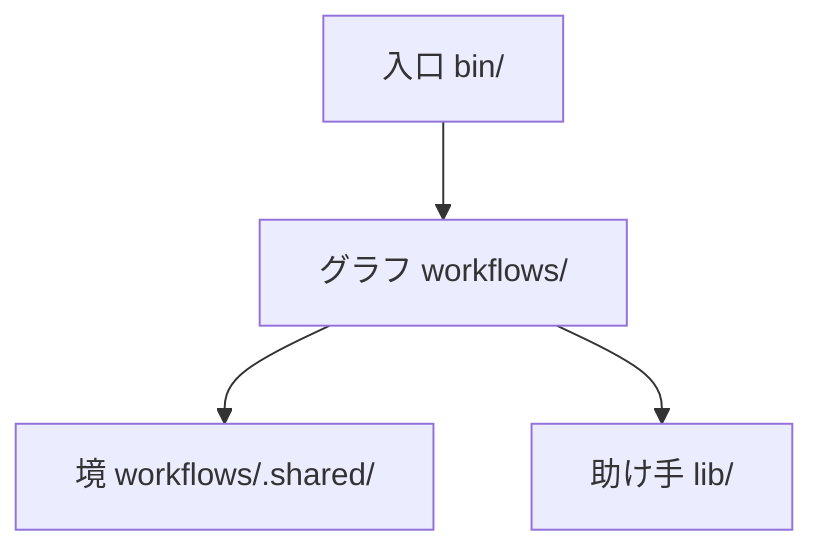

# works-factory

works-factory は、どのリポジトリにも使える修正の工場。直してほしい事（修正依頼か GitHub の issue）を渡すと、確かめ済みの変更と報告を返す。工場は、まず何が問題かを判定し、直し方を計画し、その計画を別の目に審査させる。直す前には、落ちるテストで欠陥を示す（赤の証明）。前から落ちていたテストと今回の欠陥を分ける。互いに触らない直しは別々の作業ツリーで並べて進める。対象のプロジェクト自身の確かめ（テストや CI）を走らせる。最後に、直しの経緯を知らない別の審査役が、目的だけから白紙で作った設計と突き合わせて判定する。人に聞くのは、決めた承認ノードの所だけ。

GitHub の About: A dev factory on Archon that turns a fix request into a verified change for any repository: plans are reviewed before code is written, red tests are proven before fixes, every agent claim is checked against quoted evidence, and independent reviewers judge blind. Japanese only for now.

今は日本語だけ。

## 約束すること

- 事実は機械が確かめる。テストが落ちたか・通ったか、何件か、どのファイルが変わったかは、AI の申告でなく機械が見る（テストの結末の JUnit XML・git の差分など）。
- 判断には引用の証拠を要る。AI が「この理由で落ちた」「ここが原因」と言う時は、根拠の文を引かせ、その引用が実物に在るかを機械が照らす。判断の正しさは別の目が見る。
- 持ち主の決めは言葉のまま記録し、工場に戻す。人が承認ノードで答えた事・方針として決めた事は `docs/owner-decisions.md` に言葉のまま残り、次の判断と次の run の材料になる。同じ事を二度聞かない。
- 承認ノードを通らなかった物は取り込まない。人が最後の承認ノードで見た差分は封じられ（hash）、取り込む時に照らす。違えば止まる。

## 流れ

1. 判定: 依頼の前提を実測し、目的を 1 文に固め、同じ種類の問題を世の中がどう解いているか（定石）を当たり、根本の欠陥を単位に切る。
2. 計画: 単位ごとに直し方・触ってよい範囲・受け入れのテストを決める。
3. 事前審査: 書く前に計画を叩く。別の役が目的の文だけから独立に設計し、計画と比べる。
4. 修正: TDD（先に落ちるテストを書き、直して通す）。互いに触らない単位の組を、別の作業ツリーで並べて直す（Archon の `fan_out:`）。
5. 試験の関門: 対象のプロジェクトの確かめを走らせ、赤の原因（今回入れた・元から・環境）を分け、緑を作業ツリーの指紋つきで認証する。
6. 独立の目: 4 つの観点（最小か・独立設計と合うか・全体の整合・見えていない範囲）を、経緯を知らない別の会話の審査役が判定する。
7. 報告: 結末・単位ごとの記録・人への問い・次に回す事。

承認ノードは、始める時・直す前（聞く必要がある時）・最後の 3 か所が基本。無人で回す方針も選べる。

## 使い方

入口は殻 1 本 `bin/works-factory` で、人は Archon の命令をそのまま打つ（`bin/works-factory <Archon の CLI の引数>`。旗は命令の後ろに置く）。殻は認証と置き場の隔離を整え、ASF の止め（`factory/pack.json`）の版の Archon の源を取り、そこから `bun` で起こす。グラフは Archon の家に置かない。メイングラフ `works-factory-line`（`workflows/line/`）が 8 つのサブグラフ（`workflows/<名>/`）を順に include する（作りの順は `docs/design.md`）。

1. 入れる: Python 3.12 以上と git の在る機械で、このリポジトリを clone して `bun` を入れ、借りるプラグイン（`bin/_lib/borrow/borrow.json` の物）を Claude Code に入れる。足りなければ、殻が入れる命令を 1 行ずつ出して止まる。
2. 始める: `bin/works-factory workflow run works-factory-line --cwd <対象> --input request=<依頼>`。
3. 答える: `bin/works-factory workflow respond <run> approve|stop [一言] --cwd <対象>`。家（Archon の DB）は対象ごとなので、対象の外から打つ時は `--cwd` が要る。`WORKS_FACTORY_HOME` で始めた run は、答える時も同じ値を付ける（承認ノードの文の答えの行がその形で出る）。
4. 見る: `bin/works-factory workflow status --cwd <対象>`・`workflow get <run> --cwd <対象>`。
5. 当てる: `bin/apply <run> --cwd <対象>`（中身は `bin/_lib/apply.py`）。封じた hash を照らしてから対象へ当てる。
6. CI の赤を次の依頼へ運ぶ: run の外の CI が赤と言った試験の id（1 行に 1 つ。`-` なら標準入力）を、前の run の報告が書いた次の依頼の下書きの `prior_failures` に足す: `python3 -I lib/carry.py carry-ci --request <next-request.json> --failed <試験の id のファイル> --out <next-request.json>`（同じ行は 2 度足さず、依頼の形が違えば何も書かずに終了の値 2）。

- 止める: 承認ノードで `workflow respond <run> stop <一言>` と打つと、メイングラフが後ろを飛ばして報告を出す（`workflow reject <run>` も同じ）。承認ノードの間で走っている run は `workflow cancel <run>` で止まるが、報告は出ない。
- 自分のグラフ（`workflows/`）を Archon に渡すのは `workflow run` の時だけ。`trigger`・`chat` には渡らない。
- run は始めに `workflows/` だけを写し取るので、走っている間にこのリポジトリの `lib/` を変えると、その run に効く。
- 選べる道は環境変数で渡す（どれも無ければ Claude Code と gh のログインのまま動く）: `WORKS_FACTORY_HOME`（家の置き場。絶対パス。家・対象・Archon の源の取り置き（`XDG_CACHE_HOME`）が実パスで `/tmp/claude-*` の下なら、役の sandbox が書ける置き場なので拒む）・`WORKS_FACTORY_KEYCHAIN_ITEM`（Claude のアカウントを keychain の項目の名で選ぶ）・`WORKS_FACTORY_NO_AUTH=1`（認証の要らない道）・`CLAUDE_BIN_PATH`（隔離した設定にプラグインを入れる本物の claude の絶対パス。無ければ `PATH` の絶対の置き場から探す）・`WORKS_FACTORY_COLDWRITE_MARKETPLACE`・`WORKS_FACTORY_COLDWRITE_MARKETPLACE_REPO`（coldwrite を借りる時）。

Claude Code からは `/works`（raiki61/claude-plugins の works プラグイン）で同じ事ができるようになる。

## 作り

- 入口 `bin/`: 人が打つ口。止めた版の Archon の源を取り寄せ、そこから Archon を起こす。
- グラフ `workflows/`: この工場のエッセンス。どの確かめと役が在り、各々が何をし、どの順でつながり、どこで人に聞くかを、Archon の書き方で書く。メイングラフ（サブグラフを並べた 1 本の流れ）と、判定・計画・事前審査・修正・試験の関門・独立の目・報告・取り込みのサブグラフ。各サブグラフは YAML・役の指示書・ノードの script を持ち、サブグラフの間で渡す物の型は Archon の `output_format` で表す。YAML は手で書き、変換せずに Archon に渡す。
- 境 `workflows/.shared/`: Archon との出入りの口と、Archon に無い物を補う小さな部品だけ（`docs/polyfills.md` に全部載る）。
- 助け手 `lib/`: script ノードが呼ぶ Python のモジュール（引用の照らし・TDD の赤の判定・元から赤の見分け・範囲の照らしなど）。Archon を知らない。

グラフを回すのは止めた Archon（ASF と同じ開発中の源。`docs/design.md` の「語」）。ASF のグラフはその源の `.archon/workflows/sdlc/` に在り、グラフの名で選び分けて見比べられる。別の実行の道具へ移る時は、グラフをその道具の書き方で `docs/design.md` から書き直す。役の指示書と `lib/` はそのまま持っていける。

AI 向けの決まりは各階層の `AGENTS.md`（根の物から辿る）、設計は `docs/design.md`。

## リポジトリの中の見方

根には、この工場の物と、ASF の取り付け命令が置いた物が並ぶ。名前で見分けられる。

- この工場の物: `bin/`・`workflows/`・`lib/`・`tests/`・`docs/`・`pack.json`・`MISSION.md`・`AGENTS.md`（各階層）・`engineering.md`（ASF の役が読む入口。`AGENTS.md` を指すだけ）・`README.md`・`.github/`。グラフの名は `works-factory-` で始まる。
- ASF の物: 名前が `factory`・`FACTORY`・`harness`・`.factory` で始まる物（`factory/`・`FACTORY.md`・`FACTORY_RULES.md`・`harness/`・`.factory/`）。ASF がこのリポジトリを作る時に使う。ASF の命令がこの場所と名前を決め打ちで読むので、動かさず名前も変えない。中身も手を加えず、ASF が書けと言うファイル（`harness/END-TO-END.md` など）だけを書く。
- Archon に読ませるグラフ: この工場の物はこのリポジトリの `workflows/`、ASF の物は Archon の源の `.archon/workflows/sdlc/`（名前は `archon-` で始まる）。どちらも Archon の家には置かず、`--workflow-source` で読ませる。
- 置き場の木の全部と、名前の決まりは根の `AGENTS.md` の「リポジトリの形」と E18。

## 関係

- Archon: AI の処理をグラフにして YAML で書き、機械が順に回す道具。作者は coleam00（[coleam00/Archon](https://github.com/coleam00/Archon)）。works-factory はその上で動く。
- ASF（AI software factory）: Archon の作者が作った、作業の受け付けから merge までのグラフの束。作りの型（出力の形・緑の認証・取り込みの計画の封印・守りのパスなど）を読んで学んだ。学んだ型と違いは `docs/asf-notes.md`。この工場の層（`bin/`・`workflows/`・`lib/`）には ASF のコードを写さない。ASF の取り付け命令が置いた物は、ASF がこのリポジトリを作るために置いたまま使う（上の「リポジトリの中の見方」）。
- 今の works（raiki61/claude-plugins の `works/`）: この工場の前の形。graphloops プラグインのレビューと修正のループ（review-graph）から育った。works-factory は今の works の能力を 1 つも落とさずに作り直した物で、同じ能力に届いたら置き換える。置き換えた後、claude-plugins には `/works` の薄い入口だけが残る。

## 文書

- `MISSION.md`: 目的と範囲の外
- `AGENTS.md`（各階層）: AI 向けの作りの決まり（コードを書く前と審査の前に読む）。`engineering.md` は ASF の役のためにそこを指すだけ
- `docs/design.md`: 層・メイングラフ・サブグラフ・能力の棚卸し・作りの順
- `docs/owner-decisions.md`: 持ち主の決め（言葉のまま）
- `docs/polyfills.md`: Archon に無い物を補う部品の名簿
- `docs/asf-notes.md`: ASF から学んだ型
- `docs/plans/`: 実装の計画

## 今の状態

作っている途中。入口の殻 `bin/works-factory`・メイングラフ `workflows/line/`・8 つのサブグラフ・`lib/`・層の試験が在り、メイングラフは本物のサブグラフと組んだ筋書き（Archon の `workflow test`。役は起こさない）で確かめている。小さな対象のリポジトリに 1 つの依頼を本物の役で通す段 1 の歩く骨組みはまだ。土台は ASF に作らせている。修正の工場として今使えるのは、今の works（raiki61/claude-plugins の works プラグイン）。作りの順と進みは `docs/design.md` の「作りの順」。
