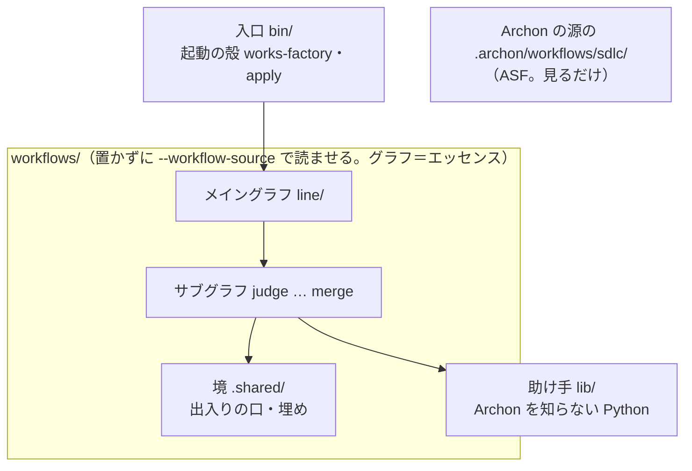
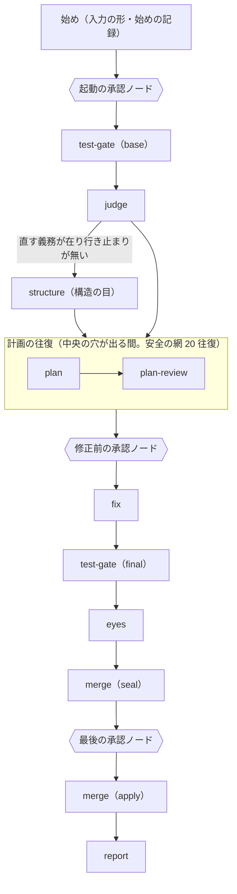

<!-- coldwrite:skip 設計の正本。語は冒頭の「語」のセクションで定義 -->
# works-factory の設計

状態: 2026-10-11 の初版。持ち主の決め（`docs/owner-decisions.md` の 2026-10-11 の行）から起こした。コードはまだ無い。

## 語

- Archon: AI のグラフを YAML で書き、機械が順に回す道具。土台は止めた Archon（下）。
- ASF（AI software factory）: Archon の作者が作った、作業の受け付けから merge までのグラフの束（`coleam00/Archon` の枝 `factory/sdlc-on-dev` の `.archon/workflows/sdlc/`）。見る版は止めた Archon と同じ。
- 止めた Archon: ASF の取り付け命令が置いた `factory/pack.json` の `repository` を、`integration_revision_required` の commit（今は `a972888a`。2026-10-18 に `64ec0c2e` から上げた。その前は同じ日に `355f1867` から、2026-10-16 に `d97d00ef` から）で取った Archon の源。ASF と同じ開発中の源で、Archon の本体と ASF のグラフの両方をここから取り、`bun` で起こす（持ち主の決め `archon-same-as-asf`。読み方は「pack.json」のセクション）。
- 今の works: raiki61/claude-plugins の `works/`。工場 darkfactory を持つ。棚卸しは origin/main の 2026-10-11 の姿（commit `ab9b9f17` まで）。
- review-graph: graphloops プラグインのレビューと修正のループ（`works/.shared/core/graphloops/graphs/review-loop.json`）。今の works の元。
- 語をそろえた訳: 持ち主の言葉「言葉は統一しようか。そろそろ。ノード、エッジとかグラフ図の考え方で統一して」（2026-10-12）。持ち主の決め `graph-words`（`docs/owner-decisions.md`）。
- メイングラフ: サブグラフを順に並べた 1 本のグラフ（`workflows/line/`）。
- 親のグラフ・子の run: `workflow:` のノードでほかのグラフを自分の run として起こすグラフと、起こされた run。周の鎖（`workflows/chain/`）はメイングラフの run を子の run として周ごとに起こす親のグラフ。
- サブグラフ: メイングラフに `include:` で取り込む部品（フォルダは `workflows/<名>/`）。ほかのサブグラフを知らない。
- ノード: Archon の YAML の 1 つの node。
- AI ノード: AI の役を起こすノード。役の名（判定役・修正役・裁定役など）はそのまま使う。
- script ノード: `script:` で Python などのコードを走らせるノード。
- エッジ: ノードの間の依り（`depends_on`）。
- 承認ノード: 止まって人に答えを聞くノード（Archon の待ちのノード `wait:` の `attention` を `form: select` で書いた物）。
- 出力ノード: サブグラフの出力を返すノード（`returns:` が名指す物）。出力はノードやサブグラフが返す値。
- ループ: 同じノードの並びを条件まで繰り返す物（Archon の `loop:`・`loop_group`）。
- 共有ボード: 今の works で `盤面` と呼んでいた、run の状態を持つ作業場。
- セクション: 文書や役の指示書の一区切り（見出しの下）。
- 記録された方針: 人か対象の持ち主が「決めた」と記録に残した決まり。出どころは方針の文書の写し・依頼の answers・承認ノードの人の答え・決定記録の突合が挙げた決着済みの論点の 4 つだけで、役を縛るのはこの一覧の行だけ。無人の run が承認ノードで採った推しの一言と、判定が保留にした問いに採った推し（目の prep が問いの台帳の `taken_pushes` から読む）は人の決めではないが、この run が従うと採った条件として、人の答えと分けた行（名指し `無人の run が採った推し <id>`）で一覧に並ぶ（R4 が推しの条件とのぶつかりを名指せる。R2 の独立設計には渡さない）。一覧は `lib/policy.py` の `recorded` が組み、判定役・修正案の役・事前審査の役・R3・R4 に同じセクションで貼る。判定役と修正案の役は承認ノードの人の答えを入力に持たないので、その行は「この役には渡っていない」と載る。R4 の方針とのぶつかりは、一覧の行を名指さない行を受け付け（`eyes` のループ `r4-loop`）が拒んで出し直させ、3 回とも通らなければ名指さない行も最後の承認ノードで人に聞く（issue #455）。
- 対象の文: 記録された方針の一覧に当たらない、対象のリポジトリのコードのコメント・docstring・テストの説明文。コードの今の姿の説明で持ち主の決めではなく、綺麗な形と食い違うなら直しの一部として書き換える。
- 単位: 判定役が切った 1 つの欠陥。直す・拒む・諦めるの数え方の単位。
- 組: 判定の単位か計画の項目を共にする単位と、範囲が交わる項目の単位どうしのまとまり。組は分けない。組ごとに別の作業ツリーで並べて直す。
- エッセンス: 持ち主のグラフ（`workflows/`）。どの確かめと役が在り、各々が何をし、どの順でどうつながり、どこで人に聞くか。Archon の書き方（メイングラフとサブグラフの YAML・役の指示書 `commands/`・ノードの script `scripts/`）で書く。持ち主の言葉「で、私がエッセンスって呼んでるのはグラフの内容やグラフ全体の形かな。」（2026-10-11）
- lib: Archon を知らない Python の助け手（`lib/`）。script ノードが呼ぶ（引用の照らし・TDD の赤の判定・元から赤の見分け・範囲の照らしなど）。エッセンスそのものではない。
- 境: Archon との出入りの口と、Archon に無い物を補う埋め（`workflows/.shared/`）。
- 埋め（polyfill）: Archon に無い物を外から補う部品。名簿は `docs/polyfills.md`。
- ポインタ: Archon の `{type: archon_artifact, run_id, path}`。run の置き場の中のファイルを指す。
- 型つきの成果物: ノードの `output_type` で型の名を付けた出力。受け手は `$TYPED_ARTIFACTS_FILE` の一覧から型で引く。

## 目的

持ち主の自分版の工場を持つ。今の works の能力を 1 つも落とさず、作りは Archon と ASF に寄せて簡単にする。

- 持ち主の言葉（2026-10-11）: 「作りをASF参考にArchonに寄せたほうがいいのでは。確かめの中身とかはようはその上に載るエッセンスってことでしょ」
- 簡単にする訳: 「じゃないと後続がこうやって変換すればいいやって思っちゃうかもしれないでしょ」。だから YAML は変換しない（`workflows/AGENTS.md` の E1）。
- 今の works を直して寄せるのでなく、横に新しく作る（「横に自分のグラフつくりはじめるかんじでいいのではって思ってた」）。
- 最新の ASF を横に並べて見られる形にする（「その最新のソフト自動出荷工場を横目に見れる形じゃないとダメなのではという気がしてる」）。

## 4 つの層

| 層 | 置き場 | 持つ物 | 知ってよい物 |
| --- | --- | --- | --- |
| 入口 | `bin/` | 起動の殻（認証と隔離を整えて Archon を起こす。人は Archon の命令をそのまま打つ）・Archon の源の取り寄せと起こし方・`apply`・埋めの一部 | `pack.json`・`factory/pack.json`・Archon の CLI |
| グラフ（エッセンス） | `workflows/` | メイングラフとサブグラフの YAML・役の指示書・ノードの script・サブグラフの間で渡す物の型（`output_format`） | 境の口・lib |
| 境 | `workflows/.shared/` | Archon の入出力の口 1 つ・埋め | Archon の変数と型 |
| 助け手 | `lib/` | Archon を知らない Python のモジュール | Python のパッケージ（標準と外の物） |

- 言語は Python 3.12 以上（`lib/`・境・サブグラフの script・`bin/`・試験）。訳: 今の works の確かめが Python で書かれていて、移すだけで済む。下限は持ち主の決め `py-floor`。外のパッケージは使ってよい（持ち主の決め `outside-packages-ok`）。自前で書く前に既製の物を当たり、版を止める。Archon は `script:` のノードを `runtime: uv` で Python として走らせる（`guides/script-nodes.md`「`runtime` | `'bun'` \| `'uv'`」）。ASF は TypeScript だが、コードを写さないので言語を揃える訳が無い。
- 層を足す時は `AGENTS.md` の E10。
- 別の実行の道具へ移る時（Archon の競合に移る危うさへの備え）: グラフをその道具の書き方で `docs/design.md` から書き直す。役の指示書（指示書の中の Archon の変数だけ書き換える）と `lib/` はそのまま持っていける。サブグラフの間の入出力は、その時に `output_format` から取り出す（持ち主の決め `io-in-output-format`）。

## Archon・ASF・今の works との関係

- Archon: 土台。中は直さない。足りない所は埋め（`docs/polyfills.md`）。開発元には連絡しない。
- ASF: 横に並べて見るだけ。ASF のグラフは `bin/` が取った Archon の源の `.archon/workflows/sdlc/` に在り、グラフの名（`archon-*` と `works-factory-*`）で選び分ける。ASF のグラフを回す時は `--workflow-source` に源を渡す（ASF の `factory/consumer.py` と同じ）。採った型は `docs/asf-notes.md`。
- 今の works: 能力の正本。置き換えるまでは今の works が本番。能力を 1 つずつサブグラフと `lib/` へ移し、「能力の棚卸し」の表で追う。置き換えた後、claude-plugins の `works/` は `/works` の薄いスキルだけを残し、`bin/` を呼ぶ。

## pack.json

版の止めの正本。ただし Archon の版は書かない。

- Archon の版: ASF の取り付け命令が置いた `factory/pack.json` の `repository`・`integration_revision_required`（40 字の hash）・`source_directory`（源の中の ASF のグラフのフォルダ）が正本。`bin/_lib/pack.py` の `load` がこれを読み、`archon.repo`・`archon.commit`・`asf.folder` として渡す。ASF の取り付け命令が `factory/pack.json` の版を進めれば、自分のグラフを回す Archon も同じ版になる（持ち主の決め `archon-same-as-asf`）。Archon の本体と ASF のグラフの両方をこの源から取る。ただし ASF の consumer（`factory/consumer.py`）が走らせて照らすのはこの値ではなく、`factory init --revision` が `.factory/consumer.json`（git に入れない）に書いた `revision` で、2 つを照らし合わせる物は無い。2026-10-11 にはどちらも `d97d00ef`。
- `asf`: `committed_here: false` は、ASF のグラフをこのリポジトリに入れないこと（字は写さず型だけ採る。`AGENTS.md` の E8）。
- `ours`: 自分のグラフのフォルダ・Archon に読ませる pack の名（`works-factory`）・名の頭（`works-factory-`）・メイングラフの名。

`bin/`（`bin/_lib/place.py`）は run の時に次を行う。Archon の家（`$ARCHON_HOME/workflows` など）には何も置かない。

1. Archon の源をその commit で 1 度だけ `<キャッシュ>/archon/<commit>/` に取り、`bun install --frozen-lockfile` で依存を入れる。bun が無ければ取る前に止まる。取り置いた源は使う前に照らす（HEAD がその commit・`git status` が空・`node_modules` が在る。ASF の `factory/consumer.py` の `verify_source` と同じ）。合わなければ消して取り直す案内で止まる。
2. Archon は `bun <源>/packages/cli/src/cli.ts` で起こす（ASF の `factory/consumer.py` の `cli()` と同じ形）。
3. 自分のグラフは `archon workflow run --cwd <対象> --workflow-source <置き場>` で起こす。Archon は `--workflow-source` の `<置き場>/.archon/workflows/` を読むので、その中の `.archon/workflows/<pack>/`（`pack` は `pack.json` の `ours.pack`。`works-factory`）がリポジトリの `workflows/` を指す小さな置き場をキャッシュ（`${XDG_CACHE_HOME:-$HOME/.cache}/works-factory`。`place.cache_dir`）に作る（埋めの P3）。pack の形にするのは、止めた Archon が名前で指す script を pack の形のグラフの時だけグラフのフォルダの `scripts/` から探し、pack の部品を `<pack>/.shared/` から読むため（`guides/script-nodes.md` の「Named Script Resolution」・`script-discovery.ts` 151-222 行）。前の形の置き場（`.archon/workflows` が直に `workflows/` を指す symlink）が在れば、消して回し直す案内で止まる。Archon は run の始めにその中身を run の物として写し取り、その run は写しだけを走らせる（Archon の `packages/workflows/src/workflow-source.ts`）。

## メイングラフ

### 順と承認ノード

0. test_cmd の形の確かめ（メイングラフのノード `testcmd`）: 入力 `test_cmd` が run の作業ツリーの直しでなく対象の手元を試す形（`lib/testcmd_check.py`）なら、ノード `testcmd-stop` が Archon の `cancel:` で、止める形の行と理由を cancel の理由にして AI を起こす前に run を止める。対象の手元は、run の作業ツリーと同じ git の作業ツリーのうち run の作業ツリーの外の全部（元の clone も、`git worktree add` で作った作業ツリーも）。許し `WORKS_FACTORY_ALLOW_TESTCMD=1` が在れば止めない。確かめそのものが落ちた時も同じに止める。git が無視する物を相対で指す形は止めず、注意の行を出す（最初の語なら `lib/tree_run.prove_launchable` が試験を起こす前にも止める）。止めなかった時の注意の行（許しの行と注意の形の行）は出力の `reason` に入り、報告の集め `collect` が受けて報告の冒頭に載せる（下の report の出力の `notices`）。始め（1）はこのノードが止めなかった時だけ走る。
1. 始め（メイングラフのノード）: 入口の入力を 1 つの形にそろえ、始めの記録を書く。差分も依頼の行も無ければ AI を起こす前に止める。固定材料（入力 `fix_fixture`。前の run が修正の前に写した置き場のフォルダ）を名指した run は、写しを今の run の置き場に取り込み（`lib/fixture.py` の `adopt`。写しのファイルの中の置き場と作業ツリーのパス・run の id・HEAD を今の値に置き換え、対象に無い commit は同じ木で作り直す）、始めの記録は写しの物を今の run の id・入力・版の控え・機能の切り替えにして固定材料の印 `fixture` を足して書き、`from_fixture: true` と運ぶ値のポインタ `fixture` を返す。直す前のテスト（3）・judge（4）・計画の往復（5）・修正前の承認ノード（6）は飛び、起動の承認ノード（2）を通ると修正（7）から始まる。拒む物（AI の前。何も取り込まない）: 無いフォルダ・`spec=on` との組み・控えの無い・形の版（`fixture.FORMAT`）が違う・写しのファイルが控えと違う・今の木（`HEAD^{tree}`）が写した時と違う・依頼の文が違う・入力の欄が違う（`fixture.CURRENT` の欄を除く）。周の鎖との組みは鎖の `chain-start` が拒む。今の works の `entry._start_from_fixture`・`fixture.adopt`・`dev/use.sh` の `WORKS_USE_FIX_FIXTURE`。
2. 起動の承認ノード（人）: 何を始めるかを見せて止まる。
3. test-gate（base）: テストの走らせ方を見つけ、直す前の結末（元から赤のテスト）を控える。
4. judge: run の頭の深さ・前提・目的・定石・素材・判定。`--spec` の時は中に仕様の承認ノード（人）を持つ。run の頭の深さは、入口の直後の役（`head-depth`）が依頼の行ごとに残っている未知の種類（無し・原因・形・範囲）を依頼の字とリポジトリの行の引用で返し、受け付けが引用の実在を照らして、一番重い種類の段（`lib/headdepth.py` の `UNKNOWNS`・`tier_of`）を控えに書く（照らしが通らなければ標準。下の「深さの段の表」）。役は同じ返答で、材料に貼られたノード群（`lib/launchgroups.py` の `GROUPS`）のうち既定の模型か effort を替えるべき群だけを訳つきで選ぶ（`groups`）。受け付けは段の照らしが通った後に `launchgroups.choices` で照らし、表に無い群・許さない語・同じ群の 2 行目の行だけを既定に戻して訳を残し、向き（上げ・下げ・同じ・混ざる）と一緒に控えの `groups` に書く。Archon a972888a に run の中で後のノードの模型を付け替える口が無いので、この選びは上げる向きも下げる向きも記録だけで、今の run にも子の run にも周の鎖の次の周にも効かない（持ち主の決め `head-choice-record-only`。`docs/polyfills.md` の候補）。報告の `## 模型` のセクションは、記録だけであることと、走りの模型を替えるのは起動の時の `--model @wf-<群>=<模型>`（effort も替えるなら `<模型>` の代わりに effort を持つ別名）であることを 1 行で言う（`lib/headdepth.py` の `RUN_SWITCH`）。段の判定には混ざらず、照らしが外れても段は落とさない。
4'. structure（構造の目）: 計画の 1 回目の周が修正案の役を起こす run（judge が直す単位を出し、直す義務の単位が在り、行き止まりの単位が無く、始めの記録・判定・定石の行が読める）で 1 回だけ走る。決めはメイングラフのノード `owed` が、計画の周を開く口と同じ物（`lib/planfile.py` の `held_why` と読めない入力の訳）で引き、出力 `{owed, why, stop_reason}` の `owed` を `structure` の `when` が読む（例外の時は止めの理由 `works:line-script` で計画の往復へ進めない）。役を起こさない run は測らず目も起こさない（今の works の `line_edge.structure_edge(plan_go=False)`）。単位が名指すファイルを機械で実測し（段 A）、構造の目（道具なしの別の会話）が直しが構造を汚すかを単位ごとに判定して、構造の目の控えを返す。単位が変わるのは再審の後だけで、その後に計画は走らないので測り直さない。計画の往復（5）・案の直し・事前審査は同じ控えを入力 `structure` で受ける（今の works では別のサブグラフ `blk-structure`）。構造が飛ばされうるので、計画の往復へは返しのノード `structure-in`（埋め P2）が控えのポインタか null を渡す。
5. 計画の往復: plan → plan-review を、事前審査が中央の穴（下の「事前審査の止め時」）を挙げる間くり返す。計画の壁打ち（plan と plan-review の往復）は run の頭の深さのどの段でも省かない。run の頭の深さ（judge の `depth`）はメイングラフの `plan-review-run` が平の入力 `head_depth` で受け、事前審査の木にするかを決める時だけ読む（段の足しと、軽量の段が名指しの無い木を off に読むことは「深さの段の表」。名指しが勝つ）。同じ中央の穴で 2 度続けて止められたら止める。2 往復目から開いた block に中央の穴が無くなれば、端の穴を修正の段へ申し送って修正へ進む（止め時の正本は `lib/converge.py` の `decide`）。安全の網 20 往復に届けば、工場の不具合として止めて修正前の承認ノードへ回す。直す物が無い周（judge が ready: false で止めの語も無い）は計画の往復・修正前の承認ノード・fix を飛ばし、plan-review を形 design（入力 `mode: design`。修正案は null）で 1 度include して（`design-only`）最後の R2 が要る独立設計だけを作る。メイングラフのノード `fixed` が直す物の無い形（`no_fix`・`go`・差分も申し出も無い・設計は `design-only` の物）で受けて、最後のテスト（8）と独立の目（9）で周を締め、差分が無いので封じも当てもしない（`merge-seal`・`merge-apply` の `when` が `no_fix` を読む。最後の承認ノードは封じのノードが飛んでも開く: `ask-final` は `depends_on: [eyes, merge-seal]`・`none_failed_min_one_success`）。結末は残りが無ければ `no_fix_needed`（R2 が直す物が在ると言えば残りに数える）。今の works の `line_edge.plan_edge`（1107-1119 行）。計画の往復が直す義務 0 件で修正案を作らなかった周（開いた単位が全部人の答え待ちの問いの出どころ。`plan-out` の `nothing_owed`）も、修正前の承認ノードと fix を飛ばしたまま同じ尾（`design-only` → `fixed` の `no_fix` → 最後のテスト・独立の目）を通る（今の works の `line_edge.plan_edge` 1109-1114 行の空の修正。#291）。judge は単位を出したので、この周の結末は `no_fix_needed` でなく残りの決め（`round_limit`）で、独立の目が通さなかった札は残りに載る。飛びうるノードを後ろのノードが結ぶ所は `{from, if_skipped}`（Archon は飛んだノードの出力を直に結んだノードを落とす: `output-ref.ts` 272・344 行）
6. 修正前の承認ノード（人）: 事前審査の 4 つの軸（自明・世界の解・汚くない・やりすぎでない）で人に聞く物がある時だけ開く。承認ノードの項目は事前審査の出力 `questions` の行（種類と文。揃わない軸の訳は行の尾に 1 度）で、メイングラフは軸の行を項目の無い時だけ足し、事前審査が設計だけの行・止まりの行（止まった理由つき）を返していれば足し直さない（1 件 1 行）。無人の run では、事前審査の項目のうち台帳の問い（種類 `fork`・`escalate`）だけは承認ノードに載せずに報告へ回し（問いの出どころは直す義務から外れたまま修正へ進む。ただし判定の役が選択肢を名指す推し（推しの頭と選択肢の短い方が切れ目まで揃う）を書き、出どころが今の周の単位に在り、出どころ・depends が開いた単位の fork・held の問いは、問いの台帳の読み（`lib/gatemarks.py` の `answered`・`run_push`）が推しを答えとして採り、出どころ・depends を直す義務に戻す。計画・修正・報告が同じ口で数え、報告は冒頭 1 行目と「人が決めること」に採った推しを並べ、修正役への行は承認ノードの推しと同じく `answer.said` の形（直前の行に `answer.PUSHED_NOTE`）で人の答えと読み分け、R4 の「記録された方針」にも推しの行が並ぶ。issue #593。採れる推しの無い問いと escalate は今どおり外し、報告の冒頭 2 行目の「保留にしたままの問い」に数える）、ほかの種類（狭め・事前審査の穴・方針の文書の変化・事前審査の諦め・設計の問い・世界の解の外れ・設計だけの行）が在れば、承認ノードに載るはずの項目の全部が通す推しを持てばその推しで進み（答えの欄 `pushed`。決めは `lib/gatepolicy.py` の `passage`。持ち主の決め `unattended`）、そうでなければ開かずに止める（`works:needs-human`）。事前審査の壁打ちが止まった行（`STUCK_ITEM`）も、事前審査の役が返答の一番上に書いた止まった時の推し（`stuck_recommend`。`lib/converge.py` の `STUCK_PUSH`。往復の行の `push`）の尾を持ちうる（付く条件は `lib/gatepolicy.py` の `stuck_pushable`。尾を組むのは `lib/gatemarks.py` の `stuck_push`）。尾の無い行は今どおり止まる。保留の項目の前の往復の block は、推しが付く止まりでは機械が印 `held` つきで `review.json` の faces に足し、修正役が事前審査の穴に key ごとに答える義務に乗る（`block_faces` は審査が挙げた block に数えない）。持ち主の決め `unattended`・issue #552。推しで通った周は報告の冒頭と run の記録だけが読み口で、鎖の次の周へ渡す要約には載らない。
7. fix: 修正の段へ運ぶ値（直す前のテストの控え・判定・計画の往復・修正前の承認ノードの答えと載せなかった問い）は中継のノード `fix-in` が 1 か所に集め、fix から後ろのノードはそこからだけ読む（`$fix-in.output.<欄>`）。`fix-in` はどの run でも走る（`answer-start` に結ぶ）ので、固定材料の run で飛んだノードを後ろが直に結んで落ちることが無い。通常の run は受け皿（`test-gate-base-out`・`judge-out`・`structure-out`・`plan-rounds-out`・`plan-rounds-review-out`）の `got` から組み、修正に入る時（修正前の承認を通った時）に 1 度だけ run の置き場を固定材料 `<run の置き場>/fix-fixture/` に写す（`lib/fixture.py` の `noted_capture`。写せなくても止めない。写したフォルダか写せなかった訳は始めの記録の `fixture_captured` に置き、報告の入口のセクションが読む。今の works の `line_edge._capture_fixture`）。固定材料の run は取り込んだ写しの値を運び、`collect` は飛んだ段の欄をその値で埋める。組ごとの並べ（`fan_out:`）・TDD のループ・修正役・裁定・差分の審査と手直し。修正のサブグラフのノードが 1 つでも落ちれば（組の子の run が使用枠の切れなどで落ちて組のノードが落ちた時も、裁定や審査のループなど組でないノードが落ちた時も。諦めた子は結果を書いて済む）run は failed で終わり、fix の中では柵のノード `nodes-ok`（サブグラフの sink で、`fix` と落ちても止めない段のほかの全部のノードに結ぶ）と、落ちたノードより後ろの作業のノード（`clean` から `delta-loop` まで。組のノードが落ちた時は `join` も）が飛び、返すノード `fix`（`all_done`）は `done: false` で済む。1 回目の修正（`fix`）では、sink が飛んだので `depends_on: [fix]` のメイングラフのノード（`after-fix`・`fix-out`）が飛び、その後ろ（`fixed` から先）も飛ぶ。2 度目の修正（`refix-run`）では、`fixed` も飛ぶ（`none_failed_min_one_success` は、前が落ちたので飛んだ依存を落ちと数える）ので、試験の関門（final）と `rejudge-run` から先は走らない。run を resume すれば、落ちたノードとその後ろの飛んだノードを同じ run・同じ作業ツリーで続きから回す（続きはノード単位で、落ちたループ（`loop_group`）は 1 周目からやり直す。止めた Archon の `dag-executor.ts` の `executeLoopGroupBody` の `startIteration`。組の子なら落ちた子を続きから回し、順の組の後ろの子は、前の子が使える結果を残すまで頭で止まる。issue #576・#594）。落ちても止めない段はレンズ（`lens` とその出力の中継 `lens-reply`）だけで、レンズが落ちても集め役 `lens-collect` がレンズの行を理由つきの failed で残して差分の審査へ進む（run は落ちたノードを持つので failed で終わり、報告は受け止めた落ちに載せる。宣言は `fix` 自身の出力ノードの `with:` の `optional`（出力の欄 `optional` で受け皿が `collect` へ運び、`collect` が include の id の頭を付けて合わせる）。Archon は落ちたノードの出力を `if_skipped` の結びでも読ませないので、集め役は飛んだ中継を `if_skipped: null` で受ける）。レンズの支度 `lens-prep` と集め役が落ちれば run を止める。裁定が計画の項目の誤りとした時は、1 run に 1 度だけ plan と plan-review をもう一度 include し、案の直しの承認ノード（人）を通る（文は聞く項目ごとに約束の欄の変化・その項目を誤りとした申し出の文と裁定の文〔`ask-replan` の入力 `conflicts` ← `$fix.output.conflicts`〕・前と後の項目の JSON。今の works の `replan._gate_section`）。無人の run で案の直しの承認ノードを開くはずの時は、6 と同じく聞く項目の全部が通す推しを持てばその推しで進み（答えの欄 `pushed`）、そうでなければ開かずに止める（約束の欄が変わった項目の行は推しを持たないので止まる）。2 度目の修正が走らなかった時（承認ノードの stop・無人の止め・直した案ができなかった）は、1 回目の修正の差分も試験の関門から先へ進めない。差分の審査が 2 往復で通らなかった run は、今の works の最後のテスト（`p4.ci` は手直しの段が済むのを待つだけで、審査の通りを待たない）と同じく試験の関門・独立の目・最後の承認ノードへ進め、通らなかった審査は報告の残りに載る（メイングラフのノード `fixed` の `go`）。修正役の異議（1 回目と 2 度目の修正の両方。メイングラフのノード `fixed` の `objection` がつなぐ）は、2 度目の修正の後に judge を再審の入力でもう一度 include する（1 度。`fixed` の `rejudge`。今の works の `h-rejudge` が refit の後に走った形。`works/darkfactory/darkfactory.yaml:827`）。再審が採らなかった異議は再審されずに残った異議として最後の承認ノードを開け（11）、報告と次の依頼に載る。再審の止め（`judged` の `stop_reason`）は試験の関門（final）の `when` が読み、後ろへ進めない。2 度目の修正は 1 回目の申し出と裁定（`prior_conflicts`）・案の直しの事前審査の出力（`plan_review`）・機械の申し送り（`notes`。`answer-replan` の `fix_notes`）を受ける（fix の出力のノード）。`fixed` の後のメイングラフのノード `spec-check`（`workflows/line/scripts/spec_check.py`）は、仕様の段（`--spec`）が承認の時に `J/spec.json` へ固めた受け入れ条件のテストの sha256 を今の作業ツリーと照らし（ポインタは `$fix-in.output.spec`。固定材料の run は `spec=on` と組めず、仕様の段の run の写しは入力の欄 `spec` が違うので取り込まないため、ポインタは null で問いも止めも無い）（`lib/judge_accept.py` の `spec_questions`。テストの凍結 `lib/tddloop.py` の `frozen_problems` と別に置く: 基準が人の承認の時で、許しを持たない）、変わっていればファイルごとに承認し直すかの問いを返し、止めの語 `works:spec-changed`（人待ち）を返す。在るが測れないファイル（読めない・通常のファイルでない・上限超え）は「消えた」と言わずにその訳を問いに載せ、`J/spec.json` が無い・読めない・形が違う時も黙らずに「読めない」の問いを 1 行返して人待ちにする。照らし自体が落ちた時は「照らしが落ちた」の問いを 1 行と止めの語 `works:line-script` を返す（0 件は最後の承認ノードが「変わっていない」と読み、問わずに通るので）。今の works はここで差分の審査・最後のテスト・独立の目を回さずに終えたが、それは元の engine が問いで共有ボードを止めた制約なので、ここでは回したまま最後の承認ノード（11）で問いを見せる（#510）。仕様の段を挟んだ run（`start` の出力 `spec` を `spec_on` で受ける）なのに判定が `J/spec.json` の指しを返さなかった時も、黙って通さずに問いを 1 行と `works:spec-changed` を返す。照らせなかった時（読めない・指しが無い・落ちた）は出力の `unchecked` が真で、最後の承認ノードの 1 行目と見出し・報告の人が決めることの見出し・次の依頼の下書きの source は「変わった」でなく「照らせなかった」と言う（止めの語と結末は同じ）。最後の承認ノードはこの問いの並びに「承認すると差分は承認し直しを待たずに当たる」の 1 行を足し、`bin/apply` はこの問いを残した run（メイングラフと周の鎖の出力の `spec_questions`。止めの語は別の待ちが先に立つことが在るので読まない）を断らずに当て、当てた後に標準エラーへ 1 行で知らせる（`bin/_lib/apply.py` の `respec_note`。今の works の `apply_checked` も断らなかった）（#550）。
8. test-gate（final）: テスト一式と CI。緑を作業ツリーの指紋つきで認証する。
9. eyes: 独立の目 R1〜R4 と、直した後の構造の実測、守りのパスの当たり。R1〜R4 を回すかは run の頭の深さと単位の深さに従う（頭の深さが軽量で、全部の単位が軽量なら省く）。固定材料の run は判定も計画の往復も回さないので、写した run の判定・計画の値（頭の深さと単位の深さを含む）を `fix-in` が写しのまま運ぶ（標準に倒さない）。
10. merge（seal）: 人に見せる差分を封じる（hash）。
11. 最後の承認ノード（人）: 開ける理由は 1 つの列（`ask-final` の `needs`。今の works の `line_edge._final_needs`）で、開くかと冒頭の 1 行目をこの列だけから作る。列の行のうち、守りのパスの当たり（確かめられなかった時も）・書き換えを許したテストに触った（許したテストの変更。今の works は裁定の許しを 2 つ目の一覧として守りのパスに通した）・人に回した食い違いの申し出・申し出の控えを読めない・修正の段の隣の控えを読めない（人に回した物と数え直しの食い違いを数えられない）・承認の後に受け入れ条件のテストが変わった（`spec-check` の `questions`。この承認ノードの答えは問いに答えず、承認し直すのは次の run の仕様の段）、は開き方に依らず開き、無人の run なら開かずに止めて差分を当てない（承認ノードが飛ばされた run も `merge-apply` に届かない。筋書き `eyes-failed-protected`）。申し出は `fixed` の `conflicts`（fix と refix-run の `conflicts.json` のポインタ）の先を `lib/conflict.py` の `human_lines` で読み、人に回した行（`ask_human` と案の直しを諦めた `fix_plan_item`）だけを数えて行のまま並べる（直す裁定だけなら開けない）。読めない控えは 0 にせず訳を並べて開く。判定の役が保留にしたままの問い（今の works の `gatemarks.held_lines` と同じく、人に聞く状態の問いのうち、依頼の answers も修正前の承認ノードで通した答えも当たらない物。承認ノードに載せなかった問いと、一言の「保留: <key>」で名指した問いは答えていない）は見せるが開ける理由に数えない。依頼の answers の当ては判定の結び（1 回目の判定の出力の欄 `answer_ties`。メイングラフは `ask-final` に `answer_ties: $judged.output.answer_ties` を渡す〔固定材料の run は写した判定の欄〕。再審の判定も 1 回目の物を指す）と測れていない素材の名（今の判定の出力の欄 `materials`。`$judged.output.materials`）も読む `lib/gatemarks.py` の `binds` の 1 つの式で、結びの宛て先の key が今の問いに無ければ字の一致に落とし、そのことを 1 行並べる。文のセクションは今の works の `final_edge`・`_final_text` の並び: 冒頭 3 行（持ち越した単位の 1 文 `split_line` を 1 行目に）→ 守りのパス（差分の見方 `git -C <作業ツリー> diff <起点> -- <パス>` と一覧の置き場）・許したテストの変更（修正の段ごとの欄 `allowed_tests` の先の行を許しの id と出どころつきで）→ 食い違いの申し出と修正の段の隣の控えを読めない訳 → 修正役が人に回した物（`fixed` の `handoffs`）→ 減っていない単位（`querytest.STUCK_HEAD`）→ 例で証明できない判定の問い → 閉鎖の数え直し（欄 `closure` の先。`querytest.CLOSURE_HEAD`）→ 同じ run の中で直した修正案の項目（項目ごとに 1 行。人が承認した・聞かずに通した〔手段の欄だけ〕・無人の run で範囲を広げた・直さずに諦めた: 訳・未完了。`lib/replan.amend_lines` を報告も読む）→ 最後のテストの一式と修正前のテスト（test-gate の出力の `by`・`suites_line`・`baseline_line`・`log`・`reason` から。任せ先の自己申告の緑には宣言 `.review-checks.json` に書く次の手）・受け付けが手元で回さなかった試験と最後のテストの段に任せた試験・赤緑を確かめずに受けた回とはみ出しの決着（欄 `accept_trace` の先）・ログ・作業ツリー → 差分の審査と穴の枝の名札と手直しの結果（欄 `delta_holes` の先）→ 止めずに残った異議と決着した再審の結果（`runreport.rejudge_lines`）→ 構造の目が落ちた周（計画の `structure` の先の `structure-state.json`。`structmark.note`）→ 直した後の実測（`structmark.after_lines`。実測が null なら、実測が無い 1 行）→ 修正前の承認ノードで通した行（`review` の隣の `gate-passes.json`）と人が通したので R4 で聞き直さなかった行（eyes の `notes` の隣の `r4-gate-passes.json`）と事前審査の往復（`review` の隣の `gate.json` の `converge`）→ 取り込むと消えるファイル（封じた差分の `deleted file mode`）→ 独立の目（平易な名。R2 の行の下に R2 の 2 つの役に渡した前提と「渡されていない」と書いた文とそのうち渡していた物、前提の検算の行の下に偽と分かった仮定の問いと次の run の制約に足す実測。eyes の `notes`）と clean が消したファイル・レンズ・仕組みの異常（取れない。U6）（`lib/fixbeside.py` の `always_rows`）と残りの数え → 承認し直すかの問い（`spec-check` の `questions`。この承認ノードの答えは答えないと添える）・人に聞いている問い（記録のまま引き、この承認ノードの答えは答えないと添える）・保留の問いと答え方・答えた問い・当たらなかった依頼の答え・読めなかった保留 → 読めなかった控えの訳 → 封じた差分の hash と、この文の控え（run の置き場の `gates/final-gate.md`）。修正役が人に回した物（返答の `breaks.accepted`）と直したという申告と機械の数え直しが合わない単位は、開ける理由の列の行（開き方に依らず開く物ではない。今の works の `_final_needs` と同じ）で、fix の出力の欄 `handoffs`・`mismatched` を `fixed` が 1 回目と 2 度目の修正の分を合わせて渡す。減っていない単位・閉鎖の数え直し・回さなかった試験・確かめずに受けた回・穴の名札と手直し・レンズは修正の段ごとの出力の控えの欄（`fixed` の `records`）を `lib/fixbeside.py` の `read` で読む（部分 D2。S03・S28・S29）。開くかは無人の方針（`final_gate`: always・when_needed・protected_only と `unattended`）で決まる。
12. merge（apply）: 封じた hash を照らしてから、外へ 1 度だけ書く（既定は差分を run の置き場に置き、人が `bin/apply` で当てる。今の works と同じ）。入力 `deliver` に出口の語 `pr` を選んだ run だけ、照らした差分を run の枝に修正案の項目（1 つの論理の変更）ごとの commit で依存の順に積み（修正の段の記録 `$fixed.output.item_claims` で差分のパスを項目に決める。決められなければ 1 つの commit に倒し、訳を報告の人が決めることのセクションに出す。`lib/itemcommits.py`）、Archon に同梱の `archon-pr` の子の run がその枝への push と PR の作成をする（E17。merge の出力の `deliver`）。報告の冒頭 2 行目は PR を作った在りかか、作らずに止めた訳か、作ったと確かめられなかった訳（PR の子の run が落ちたか読み戻しが合わない。push や PR の作成は済んでいるかもしれない）を言う（`lib/runreport.py` の `apply_said`）。
13. report: いつも走る（前の段が落ちても。サブグラフの出力ノードそのものが落ちた時も、受け皿 `<include の id>-out` が飛ばされ、collect はその出力を null で受ける）。結末の語・報告・次の run への持ち越し。
14. 後始末（メイングラフのノード `sweep-children`。報告の後、出力ノード `result` の前）: fix の並べ（`groups-par`）の子の run が残した作業ツリーと枝を、止めた Archon の `complete --force` で消す（`workflows/.shared/childsweep.py`。issue #113）。消すのはこの run の子で status が `completed` の物だけ（`failed` などの子は run の再開が作業ツリーを使い回すので残す）。その子を起こした fan_out のノードと同じ include の `join` がこの run で両方 `completed` になっていなければ、その子も残す（どちらかが落ちた run は再開でき、再開した `join` が子の作業ツリーから書き込みの記録を写す。ノードの状態は `workflow get --json --verbose`）。落ちない（訳は出力の `error`）。出力 `{cleaned, left, error}` は `result` の欄 `children` に載る。今の works は並べの終わりごとに自分で worktree を消した（`unittrees.sweep`）が、新しい形はメイングラフの終わりに 1 度だけ消す。承認ノードで止まったまま・取り消された run はここに届かず片付かない。

- 報告つきの止めは承認ノードの `stop`・`reject` だけ（後ろを `when:` で飛ばして report へ進む。結末は `stopped_by_human`）。承認ノードの間で走っている run は報告の無い Archon の `workflow cancel` で止め、これを狭めとして認めた（持ち主の決め `stop-at-gates`。Archon に報告つきで止める口が無い。「能力の棚卸し」の「止め札」の行）。
- run の頭の深さ（judge の `depth`。`fix-in` の `head_depth` が fix・`redepth`・eyes へ運ぶ）が軽量で、単位がどれも軽量なら（深さの決め）、差分の審査と R1〜R4 を省く（単位の深さの省き。段の省く物 `depth.TIERS` の `omits`）。標準・重厚の頭の run は単位の深さに依らず全部を通る。直した後に標準へ上げ直す決めもメイングラフが持つ。上げ直し（メイングラフのノード `redepth`。元 `depth.raise_`）は、案の直しの後の深さを単位ごとに合わせ（1 回目の単位の行を残す）、信号（修正の段が止めた単位・申し出・答えていない問い〔問いの台帳の問いごと。`gatemarks.pending`〕・案の直し・再審・run 全体の広さ〔計画の `allowed_paths` と修正の差分のファイルの和とテストの本数。`depth.run_wide`〕・修正の差分が頭の深さの役の引用した `where` のファイルの外に出た〔テストのファイルは除く。`depth.outside_cited`。引用は判定の出力の欄 `depth_record` の先の `depth-head.json`〕・TDD のループで修正役が拒まれた〔最後の修正の段の欄 `tdd_refused`。fix の出力ノードが `lib/fixbeside.py` の `tdd_refused` で TDD のループの状態から読む〕・修正役が範囲の相談をした〔最後の修正の段の欄 `accept_trace` の先の `conflict.ASKED_OP` の行。`consult.consulted_units`〕・修正役が直さずに残すと答えた事前審査の block が在る〔入力 `plan_declared` ← `$fixed.output.plan_declared`。その block を読むのは差分の審査と R4 だけなので、軽量で両方を省くと誰にも届かない。fix は `fixboard.declared_lines` で読み、差分の審査を省かない〕。4 つの理由の文は `depth.late_signals`）で標準へ上げ（上げるだけで下げない）、数えた数と起点を `counted` に返す。run 全体の広さから修正の後の 4 つの事実までの数えと控えの扱いは `lib/latedepth.py` の `signals` の 1 か所で、fix の中の上げ直し（`fixboard.redepth`。差分の審査を省くかを決める）と `redepth` の両方が呼ぶ（`redepth` が fix の上げた控えを読むだけにしないのは、案の直し・再審・修正の段が止めた単位など `redepth` だけが知る信号が在るから）。範囲の相談の行を運ぶ控え（`redepth` では欄 `accept_trace` の先、fix の中では戻せた組の子の結果 `result.json`）が無い時は上げずに `counted` に「修正の後の信号の控えが無い」の訳を添え（範囲の相談を数えていない）、TDD のループの状態が無い時はループが走っていないので拒否を数えず、どちらも在るのに読めない時だけ上げる側へ倒す（信号の元は `lib/fixbeside.py` の、`redepth` が `fixed` の `records` の最後の段を読む `late_records` と、fix の中で置き場を読む `late_place`。同じ形を返す）。出力 `{depth, skip_optional, raised, counted, stop_reason}` は目（`depth`）と報告（入力 `redepth`）が読む。
- 周の鎖（頼まれたら run を何周もつなぐ）は、メイングラフを子の run として並べる親のグラフ `works-factory-chain`（`workflows/chain/`）。置き先を決めた訳は「能力の棚卸し」の「メイングラフと入口」の「周の鎖」の行。

### メイングラフが運ぶ物

型の正本は、出すサブグラフの出力ノードの `output_format` とメイングラフの `with:` だけ（持ち主の決め `io-in-output-format`）。下の表は何が渡るかの目録で、型の写しではない。

- 始めの記録（入口の入力の形を含む）: メイングラフの始めのノードが出す → 全部（script が `INPUTS_<名>` を字のまま読む）
- 直す前の結末: test-gate（base）→ fix・test-gate（final）
- 判定（単位の目録・判定のポインタ・定石の行のポインタ）: judge → structure・plan・plan-review・fix・eyes
- 構造の目の控えのポインタ: structure → plan・plan-review・メイングラフ（`fix-in` が運び、案の直しと最後の承認ノードが読む）・report
- 計画（修正案のポインタ・波及のポインタ・単位ごとの深さ）: plan → plan-review・fix・eyes
- 事前審査（止めか通しか・4 つの軸・人への問い）: plan-review → メイングラフ（承認ノードと往復）・plan
- 修正（単位ごとの結末・申し出・諦めた単位・差分のポインタ。組ごとの結果は `fan_out:` が入力の順に集めた `$<id>.output`）と型つきの成果物 `tdd-unit`: fix → test-gate・eyes・report
- 緑の認証（緑・赤の原因・作業ツリーの指紋。eyes にはテストごとの base と最後の結末も）: test-gate（final）→ eyes・merge
- 独立の目と型つきの成果物 `eye-verdict`: eyes → merge・report
- 封じた差分（hash・守りのパスの当たり）: merge（seal）→ 最後の承認ノード・merge（apply）
- 報告（結末の語・報告のポインタ・持ち越しのポインタ）: report → メイングラフの出力（人は `bin/works-factory workflow get <run>` で見る）
- 修正の段へ運ぶ値（直す前の結末・判定・構造の目・計画・事前審査・修正前の承認ノードの答え・載せなかった問い）: メイングラフの `fix-in` → fix から後ろの全部。固定材料はこの値（`received`。欄の名は `collect` の欄と同じ）と run の置き場の写しを持つ

受け渡しの決まりは `workflows/AGENTS.md` の E4・E5。

### 繰り返し

- 判定の受け付けが拒めば、判定役に 3 回まで出し直させる（judge の中の `loop:`）。
- 計画の往復はメイングラフの `loop_group` の `plan-rounds`（plan と plan-review の 2 つの include（id は `plan`・`plan-review-run`。ループの中の id は include されても頭が付かず、plan-review のサブグラフのループの中のノード `plan-review` とぶつかるので、メイングラフの側を替える）と、終わりの返しのノード `plan-out`）で、安全の上限 20 回（`max_iterations`）。止め時は回数でなく事前審査の壁打ちの `converge.decide`（同じ中央の block が続けば止め、2 往復目から開いた block に中央の穴が無ければ通す。下の「事前審査の止め時」）で、`plan-out` の `stalled` が真になって抜ける。`plan-out` は計画ができなかった周が直す義務 0 件の周か（plan の出力の欄 `nothing_owed`）を `nothing_owed` で返し、`design-only` の `when` が読む。`loop_group` の中のノードは外から見えないので、外のノードは `plan-out` が返し直した `$plan-rounds.output.<欄>` を読む（U4）。ただし `collect` は往復の後ろの受け皿 `plan-rounds-out`（plan の欄）と `plan-rounds-review-out`（plan-review の欄）から読む（往復の中のノードが落ちると `$plan-rounds.output` は読めず、`collect` も落ちるため）。往復の上限は `plan-out` と事前審査（`plan-review-run`）に `with:` の `round_limit` で渡す（試験が `max_iterations` と同じ値を縛る。正本はメイングラフで、lib に数を写さない）。上限の周の往復は事前審査が `at_cap` で止め（承認ノードの理由は「仕組みの異常として止めた」）、`plan-out` の `done` も上限の周の終わりで必ず真になるので、往復は上限に当たって落ちずに修正前の承認ノードへ回る。
- 並べ: 単位を組にし（組は分けない）、fix は組ごとに `fan_out:` で並べる。幅は計画の組の数から run の時に決まり、並べの数の上限だけを持つ。固定の枝の数・待ちの列・錠は持たない（持ち主の決め `no-queue`。今の works の固定の 3 本と待ちの列（commit `ab9b9f17`）は持ち込まない）。結果は `fan_out:` が入力の順に集める。組の差分は決めた順に親の木へ戻し、戻せなかった組は理由つきで報告と次の run に回す。組ごとの作業ツリーの持ち方は未決 U8。
- 修正役が 3 回拒まれた単位は、その単位を始めた時の版に戻し、理由を残して裁定に回し、ほかの単位は先へ進む。
- 差分の審査 → 手直しは 2 往復まで。

### 事前審査の止め時

計画の往復（plan → plan-review の壁打ち）の止め時は、往復の数でも block の数の減り方でもなく、事前審査が挙げる穴の中身で決める（issue #662。正本は `lib/converge.py` の `decide`）。

- 札: 事前審査は穴（face）ごとに `reach` を返す。中央（`converge.CENTRAL`）は、直さずに修正へ進むと当たる害の定義の名 4 つ: `breaks_fix`（直しが壊れる）・`loses_behavior`（今ある振る舞いを失う）・`against_policy`（記録された方針に背く）・`forces_redesign`（やり直しを迫る設計の選び。柵が一類の入口を丸ごと見逃す物を含む）。端（`peripheral`）はどれにも当たらない穴（古い説明文の取り残し・書き換えの一覧の漏れ・試験の材料）で、修正の段で修正役が key ごとに答え、直さずに残すと答えた（`declared`）block は直しの後の目の R4 の材料に載る（下の「止め時」）。札の値が定義の名そのものなので、訳の欠けは型の enum が拒む。札の無い face と控えの古い行は中央と読む。
- 止め時: block が無ければ通す（`clean`）。中央の block が前のどれかの往復の block と重なれば止める（`persisted`）。2 往復目から、開いた block に中央が無ければ通す（`settled`。端の block は `review.json` の faces に載ったまま修正役が key ごとに答える道に乗り、取り込んだ（`absorbed`）物は差分の審査が検算し、直さずに残すと答えた（`declared`）物は fix の出力 `plan_declared` から `fixed` を通って eyes の入力 `plan_declared` に渡り、R4 の頭に key・訳・修正役の答えのセクションで貼られる。`plan_declared` が空でない run は上げ直し（fix の差分の審査の前と、メイングラフのノード `redepth`）が深さを標準へ上げるので、頭も単位も軽量の run でも差分の審査と R4 を省かない（`depth.late_signals` の `declared`））。1 往復目は端の block だけでも一度は修正案の役に返す。ほかは往復の数と block の数に依らず続ける。
- 網: 往復のループ（`plan-rounds` の 20）と、計画と事前審査の受け付けの出し直しのループ（`rolekit.NET_AFTER` の 20）は、Archon が `loop_group` に求める `max_iterations` を満たすための届かない大きさの網で、止め時には使わない。届いた時は工場の不具合として止め、承認ノードと報告に名指す（`converge.CAP_WHY`・`rolekit.NET_WHY`）。受け付けの出し直しを 3 回で諦める決まりは計画と事前審査の受け付けには無い（ほかの役は `GIVE_UP_AFTER` の 3 回のまま）。
- 後の回の材料: 2 往復目からの事前審査には、開いた項目の案の文の差分（`converge.sentence_diff`。場所つきの足した文と消した文）と波及の一覧と前の往復の穴だけを渡し、変わっていない文は載せない（持ち主の決め `reuse-results`「後の回は直しが持ち込んだ物だけを見る」）。項目どうしの関わりを見る相乗りの審査だけは全部の項目の行を持つ。木にしない往復（審査役が 1 人）は相乗りの審査を持たないので、項目が 2 つ以上なら、機械が作れる項目どうしのセクションを 1 つ足す: 波及の一覧の重なりのうち開いた項目に当たる行と、ほかの項目（閉じた項目も含む）の `unit_keys`・`allowed_paths`・`files` の path（`planblk._cross_part`。ほかの項目の案の文は貼らない）。前の往復で中央だった block を端に付け替える時は `why` を書き直させ、前の往復と同じ字なら受け付けが拒む（`converge.relabel_gaps`）。新しい block の出自の札も、変わった項目の中では審査の引用が当たる文（変わっていない文か足した文か）で決める（`converge._origins`）。
- 訳: issue #662 のコメント 3 の数え（12 本の run・block 142 件。この札の分け方で人が読んだ物）では、往復ごとの新しい中央の穴は 33 → 12 → 7 → 4 と減り、端の穴は残り続けた。新しい中央の穴が 0 件の往復で抜けると、12 本のうち 10 本が止まり、往復は 42 回のうち 8 回減る（取り逃す中央の穴は 3 本で 4 件。修正の段と直しの後の目への申し送りで拾う前提で、本物の run で後に拾えたかを測る）。これは仮説で、札は審査役が付ける。今ある `kind` の札（regression・entrance など）では代わりにならない（中央の 30 件が contract_drift に古い docstring の穴と混ざる）。2 往復目の中央の穴の多くは 1 往復目の後の書き直しが入れた文に在ったので、書き直しの直後の往復は止めずに審査する（1 往復目は端だけでも返す訳）。
- 持ち主の決め `stop-by-rate`（止め時は見つかる数の減り方から決める・未収束のまま報告で締める）の読み: 「見つかる数の減り方」は、往復ごとの中央の新しい穴が出なくなる移りと読む（block の総数の比べではない）。「未収束のまま報告で締める」は、同じ中央の穴が続いた止まり（`persisted`）が持つ。網に届いた止まり（`unsettled`）は工場の不具合である。この読みは #662 の実装の読みで、持ち主の確かめ待ち。持ち主の決め `slim`（根拠の無い上限を置かない）と issue #662 の「上限はいらない」に沿い、数の比べの止め（前の往復より block が減らなければ止める）は置かない。

### 深さの段の表

run の頭の深さ（judge の `depth`）の 3 段の定義の、ただ 1 つの表（issue #441・#561。持ち主の決め `depth-by-reason`・`three-tiers`）。表は `lib/depth.py` の `TIERS` の写しで、深さの語（`HEADS`）・重厚が足す機能（`depth.tier_adds`）・報告の深さの行（`headdepth.report_line`）はどれも `TIERS` から引き、表との一致は `workflows/AGENTS.md` の E20 の試験が縛る。省く物は段の頭の run で、直した後も単位がどれも軽量の時だけ省く確かめ（`depth.OMITS` の名。同じ段の頭の run では、軽量の単位ごとに緑の後と親に当てた後の `test_cmd` の走らせ直しも省く。`depth.UNIT_OMIT`）、足す物は段が足す機能（`lib/entry.py` の `FEATURE_DEFAULTS` の名）。ノードを深さの `when` で飛ばす道は作らない（どのノードの `when` も、出力の深さの欄を読む句を持てない）。

| 段 | 省く物 | 足す物 | 理由 |
| --- | --- | --- | --- |
| 軽量 | `p3.delta_review`・`r1.comment_candidates`・`r1.minimality`・`r2.compare`・`r3.coherence`・`r4.hidden_scope` | 無し | 依頼の全部の行が未知の種類『無し』（原因と直す所を依頼の字とリポジトリの行の引用で示せた）run。省く物は単位の深さの省き（差分の審査と R1〜R4）で、直した後も単位がどれも軽量の時だけ省く（記録された方針 `dynamic-depth`）。足す物が無いので、名指しの無い事前審査の木も開いた項目の数に依らず off に読む（`TIERS` の `auto`。issue #687）。計画の壁打ち（plan と plan-review の往復）はどの段でも省かない |
| 標準 | 無し | 無し | 今までどおりの全部の確かめ。未知の種類『原因』（症状だけで原因がコードに見えない）か『形』（設計の選び）の行が在る run。引用が通らない・機械の止め（仕様の段・設計だけ・依頼の行が無い・機械の確かめが無い）の run はここ |
| 重厚 | 無し | `judge_verify`・`review_tree` | 未知の種類『範囲』（公開の約束の変更・複数のサブグラフにまたがる）の行が在る run に、触る所が広い時の取りこぼしを拾うため、判定の裏取りと事前審査の項目ごとの木を足す（issue #648、持ち主の決め `depth-by-reason`）。単位の深さは標準 |

注:

- gate の機械の止めの run は役を起こさず標準になり、自動では重厚を選ばない。重厚が要るなら入力 `thickness=重厚` で名指す（名指しは役を起こさずに固定し、単位の深さは標準に固定する）。
- 名指した重厚（`thickness=重厚`）が足す機能を `features_off` で切る組は、入口（`workflows/line/scripts/start.py` の `words`）がぶつかった機能を名指して止める。自動で選んだ重厚は入口の後に決まるので止められず、名指しで切った機能は入れずに、報告の深さの行が「名指しで切った」と言う。
- 重厚の足しは、判定の裏取りの支度（judge の `verify-prep` が始めの記録と頭の深さの控えから決める）と、事前審査の木（`plan-review` の入力 `head_depth`）が読む。裏取りは開いた単位が 2 つ未満なら重厚でも回さない（報告の裏取りの行が訳を出す）。
- まとめる目（`TIERS` の `merges`。軽量だけ `r3.coherence`・`r4.hidden_scope`）: 軽量の頭の run で、上げ直しなどで目を省かずに回す時は、この目を 1 つの役 `eyes-one` が 1 つの会話で見る（eyes の `prep` が `depth.merges` を読む）。別の会話にする訳がある目だけを分ける持ち主の決め（`eyes-by-reason`）で、決めは軽量の run の組み方なので、「その目だけが拾う穴」は軽量の run に近い小さい差分（差分 400 行未満の 14 本の run）で数えた。そこでほかの目が挙げない要修正は R1 13 件・R2 5 件・R4 7 件・R3 0 件（43 本全体では R1 74 件・R2 18 件・R3 3 件・R4 14 件。数えの控えは issue #687 のコメント）。R2 は修正を見ない独立設計と突き合わせ、ほかの観点の結論を見ると偏るので分けたまま。R1 は小さい差分でも単独の穴を一番多く拾い、問いの台帳を受け取るのも R1 だけなので、標準の run と同じ前段つきの役のまま。R4 も小さい差分で単独の穴を拾うので分けたまま。R3 は小さい差分で単独の穴が 0 件で、道具（Read・Grep・Glob）と模型の群も R4 と同じなので、R4 の受け付けのループの中の 1 つの役が R4 と一緒に見る。まとめても R3 の観点は審査の指示に残り、同じ会話の中で見続ける。4 つの観点（最小性・設計の比較・整合・見えていない範囲）はどれも審査の指示に残る。標準と重厚の目は目ごとの役のまま。

載せなかった候補（代わりが無い）:

- judge の P1 の素材（`local-review`・`consistency-bypass`・`hygiene`・`external-standards`・`provenance`・`procedure-trace`・`gate-efficacy`・`test-double-fidelity`・`main-path-observation`）: 差分の無い依頼の run では今すでに起きない（`lib/judge_accept.py` の `due_view` が入口の印を立てる）。差分の在る run では、ReviewBench で所見を出したのは judge（15 件・最後の差分に 4）と eyes だけで、judge の所見はこの素材から来る。安全面・黙った失敗・ゲートの変異の検算などは eyes が見ない。
- `judge__prior-decisions-loop`（過去の決定記録の探し）: eyes の R4 が照らすのは記録された方針の文書だけで、git の履歴や issue の決定を探す役はほかに無い。
- `judge__purpose-review-loop`（書き手が要約した目的の監査）: eyes の R2 の独立設計も同じ目的の文から作るので、要約が狭めていたら R2 も同じく狭まる。
- 計画の事前審査のループ（`plan-review-run__review-loop`）: 軽量の頭の run で飛ばす道があったが、計画の壁打ちはどの段でも省かないと決めて外した。ReviewBench の測り（2026-10-14）は事前審査が高い（3 課題の和で 3772 秒・33.14 USD・所見 0）ことを示したが、事前審査は省かない。
- fix・test-gate・eyes・report: issue #441 が飛ばさないと決めている。

## サブグラフの出力の約束

9 つのサブグラフを並べて移すための、メイングラフとの約束。サブグラフごとに、出力ノード（`returns:`）・`outcome_field`・出力の欄・受ける入力（`with:`）を先に決める。欄の名は今の works（`blk-*/schemas/`・review-graph のノードの schema・`report.py`）から採り、E5・E17 と持ち主の決めが求める所だけ変えた。

- 正本: YAML が書けたら、型の正本は出力ノードの `output_format` とメイングラフの `with:`（持ち主の決め `io-in-output-format`）。このセクションは並べて書く間に名・型・読み手を揃えるための約束。YAML と食い違ったら、どちらが正しいかを決めて両方を合わせる。
- 機械: メイングラフの `with:` が読む `$<include の id>.output.<欄>` が、そのサブグラフの出力ノードの `output_format` に在るかは Archon の `validate`（`tests/layers/test_archon_validate.py`）が見る。まるごとの参照 `$<include の id>.output` を受ける script が読む欄の名（`boundary.picked` の名の並び）は validate が見られないので、`output_format` に在るかも E5 の機械が見る。`outcome_field` が `required` に在るかと、読み手の無い欄が無いかも E5 の機械（`tests/layers/test_block_returns.py`）が見る。下の「→」の読み手は、その試験を赤にしないための目録。
- 書き方の決め:
  - 欄は全部 `required` に入れる。値が無い時は欄を落とさず `null`・`[]`・`""` で表す。null を取るのは「null 可」と書いた欄だけ。
  - ポインタは `{type: "archon_artifact", run_id, path}`（E5）。下では型を「ポインタ」と書く。
  - 2 つの形を持つサブグラフ（test-gate・merge）は、出力ノードを 1 つのまま `mode` の欄で形を返す。形に当たらない欄は null。
  - 「→ メイングラフ N」は「メイングラフ」の「順と承認ノード」の N 番の段（承認ノードの文か `when:`）が読む。「→ サブグラフ名」はそのサブグラフが `with:` で受ける。「→ メイングラフの出力」はメイングラフの出力ノード `result`（メイングラフの `returns: result`。report の出力を受けて返し直す）を通して、人（`bin/works-factory workflow get`）と、周の鎖 `works-factory-chain` の決めのノード（`outcome`・`next_request`）が読む。
  - ポインタの先のファイルの中身は、欄が名指す今の works の同じ名のファイルの形のまま（新しい入れ物の形を作らない）。今の works が別のファイルに持っていた物は、同じフォルダの隣のファイルに置く。隣のファイルを名で開くのは、それを作ったサブグラフの中だけ。ほかのサブグラフとメイングラフが読む物は、作ったサブグラフが出力の型（`output_format`）の欄（中身か、ポインタ）として返し、メイングラフが `with:` で配線し、読む側はその形を入力（ポート）で受ける。読む側の入力の説明は形だけを書き、作り手を名指さない（E4）。読む側が自分の置き場へ写す時は自分の名で写す。judge・structure・plan・plan-review・fix・eyes の隣のファイルはそれぞれの「出力」の欄で返す。サブグラフの隣のファイルの名の字は、そのサブグラフの名の住処（`docs/layers.json` の `homes` にサブグラフごとに 1 つ宣言した `lib/` のファイル。judge は `lib/judgebeside.py`、structure は `lib/structbeside.py`、plan は `lib/planfile.py`、plan-review は `lib/planreviewbeside.py`、fix は `lib/fixnames.py`、eyes は `lib/eyesbeside.py`）だけが持ち、そのサブグラフの書き手と受け付けは住処の定数を引く。メイングラフの run の共有の置き場（試験の結果の控えと、利用者の HOME・XDG に戻して起こした印）は、メイングラフの始めのノード `start` が作って出力の欄で返し、メイングラフが入力でサブグラフへ渡す（サブグラフは自分の置き場の形から辿らない）。機械: `tests/layers/test_block_paths.py`（E4。`tests/layers/scan.py` の表 `NAME_HOMES` のサブグラフの置き場のファイルとメイングラフの共有の置き場を、持ち主の外が名指さない）。
  - 直す前の結末のファイル（test-gate の `baseline` の先）は必須の欄 `{suite, test_cmd, rev, exit, cases}`。`suite` は始めの記録の `tdd_suite` の実行ファイル（無ければ `""`）、`cases` は JUnit の 1 件ごとの結末の並び。読み書きは `lib/baseline_red.py` の口だけ。test-gate は自分の欄（`junit_steps` ほか）を足してよい。base は走らせた形の行 `how`（根・宣言の準備と段・test_cmd の命令と頭の語の解けた先。`declared_checks.run_how`）も足し、fix が置き場に写して修正役と TDD の役の指示書に貼る（`fixboard.tests_how_text`。issue #687）。
  - 同じメイングラフの run の中の試験の結果の控えは、メイングラフの始めのノード `start` が run の成果物の置き場の直下に決めた置き場（`lib/tree_run.py` の `reuse_dir`。名は `REUSE_SUB`）に置く。置き場は `start` の出力 `reuse_dir` で、メイングラフが test-gate（base）と fix へ入力 `reuse_dir` で渡し、fix は組の子の run へ同じ値を渡す。鍵の run は始めの記録の `run_id`。test-gate の base が置いて引き、fix の組の子の run の TDD のループの頭が引いて置く。入力が空なら使い回さない（自分の置き場へ黙って倒さない）。最後のテスト（test-gate の final）は引かない。別のメイングラフの run の控えは引かない（持ち主の決め `reuse-results`）。
  - fix の `conflicts` の先は `conflicts.json` = `{"items": [...]}`（今の works の `conflict.py` の形。行の欄 `unit_key`・`kind`・`between`・`ruling`（`decision`・`text`・`limits`）・`replan`）。
  - 型つきの成果物: `green-cert` は test-gate の出力ノードの出力そのもの。`tdd-unit` は fix の 1 回の include に 1 つで、中身は組ごとの段の物 `[{group_id, ran, reason, suite, reused, units}]`（今の works の blk-fix の `tdd` の出口。走らなかった組も `ran: false` で載る）。`eye-verdict` は `{eye, status, reason}`（`eye` は `r1`・`r2`・`r3`・`r4`・`premise-check`）。
  - 承認ノード（`wait:` の `attention`）の `options` は答えの語を全部持つ（Archon は `options` に無い答えを拒む）。通す語は `approve`・`continue`、止める語は `stop`・`reject`（今の works のメイングラフの承認ノードの語）。止め札は止める語で、文が `request:` で始まる物。サブグラフの `stop_reason` は人の止めを `human:<所>`、止め札を `request:<所>` の形で返す。
  - メイングラフが include に渡す値（`with:`）は、飛ばされうるノードの出力を直に書かない。include の `with:` には `{from, if_skipped}` の束ねが書けない（埋め P2）ので、メイングラフの返しのノード（`answer-*`・`structure-in`・`collect`）が `{from, if_skipped: null}` で受けて返し直した欄を渡す。返しのノードの `output_format` は受けた欄の名だけを書き、型は受けた元（サブグラフの出力ノードの `output_format`）を正本とする（返しのノードの `from` が読む欄は Archon の `validate` が照らす）。
  - サブグラフが約束に無い入力を要る時は、YAML の `inputs:` に既定値（`""`・`"null"`・`"[]"`）つきで宣言し、メイングラフが渡す前も動く形にする。出力の欄は足さない。足す入力はこのノードに書いてからメイングラフが渡す。
  - 出力ノードは落ちない。lib と境の口の import は出力ノードの `main` の中で読み、読めない時も標準ライブラリだけで偽の結末とポインタの先のファイルを書いて返す（merge・test-gate・eyes・plan・plan-review・report・judge・fix の出力ノードと同じ形）。中の誤りを全部捕まえ、そのサブグラフの偽の結末（`ok: false`・`ready: false`・`done: false`・`pass: false`）と訳を `output_format` に合う形で返す（メイングラフは落ちた出力ノードの先へ進めない。報告は受け皿を通して出るが、そのサブグラフの出力は null になる）。
  - メイングラフはサブグラフごとに受け皿のノード `<include の id>-out`（`workflows/line/scripts/returned.py`）をサブグラフの後ろに既定の `trigger_rule` で置き、`collect` はサブグラフの出力を受け皿の出力 `{got, stop_reason}` からだけ読む。落ちたノードの出力は `{from, if_skipped}` でも読めず（止めた Archon の `packages/workflows/src/dag-executor.ts` の `resolveBindingDirective`）、直に読むと `collect` も落ちて報告が出ない。受け皿は受けるノードが落ちても飛ばされても飛ばされ、`collect` の `if_skipped: null` に落ちる。受け皿は受けるノードの出力をまるごとの参照 `got: "$<受けるノード>.output"` で受け、`with:` の `names:` に宣言した欄だけを口 `boundary.picked` で `got` にする（欄ごとの参照を書き写さない）。直す物が無い周の独立設計は `design-only-out` で受ける。
- メイングラフの中の id（`$<id>.output` の `<id>`。メイングラフを書く人とサブグラフを書く人がこの名で合わせる）:
  - メイングラフのノード: `start`（始めのノード）・`answer-start`・`answer-before-fix`・`answer-replan`・`answer-final`（承認ノードの答えの返しのノード。`{go, answer, stop_reason}`。`answer` はどの承認ノードも同じ形 `{decision, text, asked}`（承認ノードが開かず、推しでも進まなかったら null）で、`asked` は承認ノードが人に見せた項目の行（項目を持たない承認ノードは `[]`。読み手は `asked` の無い答えを別に読まない）。無人の run が承認ノードを開かずに推しで進んだ答えは、同じ形に欄 `pushed`（採った推しの並び `{item, answer, note, why}`。`lib/answer.py` の `PUSHED`）を足して持ち、`asked` は承認ノードに載るはずだった項目の行になる。欄 `pushed` の在る答えは人の答えでない（答えを別の形に写す読み手は `answer.origin` で欄を写し、人の答えと名乗る読み手は `answer.by_push` で分ける）。`answer-before-fix`（script `before_fix_answer`）の `asked` は `ask-before-fix` の出力 `asked`（承認ノードに載せた項目の文）で、承認ノードを通した答えなら始めの記録の欄 `policy` を事前審査が固め直した版（人が方針の文書の変化を通した時だけ変わる）で書き直し、`answer-replan`（script `replan_answer`）の `asked` は `ask-replan` の出力 `asked`（案の直しの承認ノードに見せた「項目 <id>: …」と事前審査の問いの行。報告と最後の承認ノードが項目ごとに人が承認したかを読む `lib/replan.amend_lines`）で、2 度目の修正に渡す `fix_answers` も返す）・`ask-before-fix`・`ask-replan`・`ask-final`（承認ノードを開くかと文を決める）・`plan-rounds`（計画の往復の `loop_group`）・`plan-out`（往復の終わりの返しのノード）・`<include の id>-out` と `plan-rounds-out`・`plan-rounds-review-out`（受け皿。サブグラフと往復の出力を `{got, stop_reason}` に受け直す。`collect` だけが読む。2 度目の修正 `refix-run` は受け皿を持たず、`collect` は `fixed` を通して読む）・`fix-in`（修正の段へ運ぶ値の中継。順の 7）・`after-fix`（案の直しと再審をinclude するか）・`judged`（judge か rejudge-run の単位と判定）・`fixed`（fix と refix-run の出力を合わせた物。`go` は試験の関門（final）へ進めるか）・`spec-check`（承認済みの受け入れ条件のテストが変わったかの照らし）・`redepth`（直した後の深さの上げ直し）・`collect`（報告へ渡す物を集める返しのノード）・`sweep-children`（後始末）・`result`（メイングラフの出力ノード）
  - 承認ノード: `gate-start`・`gate-before-fix`・`gate-replan`・`gate-final`（仕様の承認ノードは judge の中）。`decisions` は `approve`・`continue`・`stop`・`reject`（`reject` は `stop` と同じ。`decisions` に無いと、Archon は `reject` の答えを run の取り消しとして扱い、報告が出ない。止めた Archon の `packages/core/src/operations/workflow-operations.ts` 1633-1641 行）
  - include: `test-gate-base`・`judge`・`structure`（構造の目。judge の後に 1 度。ノード `owed` が真の run だけ）・`plan`・`plan-review-run`・`design-only`（直す物が無い周の独立設計。plan-review を形 design で include する）・`fix`・`rejudge-run`（judge の再審）・`replan`・`replan-review`（案の直し）・`refix-run`（案の直しの後の 2 回目の修正。fix のサブグラフを 1 度だけ include する）・`test-gate-final`・`eyes`・`merge-seal`・`merge-apply`・`report`。include の名は、include する全サブグラフのループの中のノードの名と重ねない（Archon はループの中のノードの id に頭を付けず、メイングラフのinclude の名をループの中の `$<名>.output` までサブグラフの出力ノードへ書き換える。`include-expander.ts` の `renameIncludeRef`）。plan-review・fix・judge のループの中に `plan-review`・`refix`・`rejudge` のノードが在るので、メイングラフの側に `-run` を付ける。機械: `tests/workflows/test_line.py` の `test_include_ids_are_not_loop_body_ids`
  - 同じサブグラフを 2 度 include する所の出力は include の id ごとに分かれる（U2）。`rejudge-run`・`replan`・`replan-review`・`refix-run`・`design-only` の出力は include したサブグラフと同じ形。後の段が fix の出力を読む所は `$fixed.output.<欄>`、judge の単位と判定を読む所は `$judged.output.<欄>`、plan と plan-review の出力を往復の外から読む所は `$plan-rounds.output.<欄>` を読む。ただし fix から後ろのノードは、直す前のテスト・1 回目の判定・計画の往復・修正前の承認ノードの答えを中継のノード `fix-in` の `$fix-in.output.<欄>` から読む（順と承認ノードの 7）。
- メイングラフの始めのノード `start` の出力のうち、サブグラフが読むのは 4 つ:
  - `prior_failures`（ポインタ・null 可）: 前の run の持ち越しの前の失敗の行（始めのノードが依頼から `lib/carry` で置く、今の works の `prior-failures-in.json`）。無ければ null → judge・plan
  - `record`（ポインタ）: 始めの記録。run の置き場の根を共有ボードの根とした `lib/startrec.py` の置き場 `r1/start.json`（lib の読み手が `startrec.read` で読む所と同じ 1 つ。サブグラフはポインタの先を自分の置き場の同じ所へ `startrec.adopt` で字のまま写し、欄を既定で埋めない）。今の works の `start.json` の欄（`input`（入口の入力の形 `{base: {rev, from, name, label}, head_rev, diff, requests, request_file, pr: {number, title, body} | null, spec}`。どの入口でも鍵が同じ。入口の種類（`base.from`）で分かれるのは入口の変換 `lib/entryshape.py` とメイングラフの `start` だけ）・`inputs`（入口の入力の写し。拒んだ run にも在る）・`versions`（版の控え `lib/versions.py`。分からない値は null で `unknown` に訳。拒んだ run にも在る）・`answers`（依頼の answers）・`run_id`・`base_rev`（修正の前の HEAD。差分の根 `input.base.rev` とは別）・`review_rev`（計画と事前審査の材料の読む版。今は `base_rev` と同じ HEAD。材料の BASE は `input.base.rev`）・`test_cmd`・`tdd_suite`（TDD のループと 1 件ごとの結末に使う実行ファイルのパス。入口の入力から。無ければ `""` で、test-gate の base が用意した実行器が照らしを通った時だけその絶対パスを結ぶ）・`suite_written`（tdd_suite を省いた run だけ。用意した実行器の `{from, path, ok, why, dropped, stored}`。`from` は取り置き `keep` か書き手の役 `ai`、`ok` は null が照らす前・true が通った・false が作れなかった。`lib/suitewrite.py`）・`final_gate`・`unattended`・`policy`（人の方針の文書を run の始めに 1 度だけ固めた版 `{named, path, sha256, copy}`。`named` は入口の名指し `policy_md`、`path` は名指しの文書か、対象のリポジトリの git の共通の置き場の `graphloops/policy.md`。文書が無ければ `path` は `""`、`sha256` と `copy` は null。役に貼る本文は `copy` から読み、`policy_md` を生で読まない。修正前の承認ノードで人が方針の文書の変化を通したら、メイングラフのノード `answer-before-fix` がこの欄を通した版に書き直す。だから fix・eyes・judge の再審は人が通した版を読む）・`spec` ほか）→ 全サブグラフ
  - `reuse_dir`（string）: 同じ run の中の試験の結果の控えの置き場の絶対パス（`lib/tree_run.py` の `reuse_dir`）。拒んだ run と落ちた出力は `""` → test-gate（base）・fix
  - `user_env_dir`（string）: 対象のコマンドを利用者の HOME・XDG に戻して起こした印（`lib/userenv.py` の `RAN_FILE`）を置く置き場の絶対パス（run の置き場）。サブグラフは `workflows/.shared/boundary.py` の `drop_runner_env`・`aim_user_env` に渡して印の変数を立て、空なら変数を外す（起動の殻を通った run では `lib/userenv.restore` が戻さずに止まる）→ test-gate・fix・judge・report（report へは `collect` を通す）

### judge の出力

- 出力ノード `verdict`・`outcome_field: ready`（ASF の `W/triage/archon-triage.yaml` の形）
- 入力（`with:`）:
  - `start` ← `$start.output.record`
  - `baseline` ← `$test-gate-base.output.baseline`（`rejudge-run` は `$fix-in.output.baseline`）
  - `objection` ← `$fix.output.objection`（`rejudge-run` の時だけ。`judge` では `""`）
  - `prior_failures` ← `$start.output.prior_failures`（前の run の持ち越しの前の失敗の行のポインタ。始めのノードが依頼から `lib/carry` で置く今の works の `prior-failures-in.json`。無ければ null）
  - `user_env_dir` ← `$start.output.user_env_dir`（`judge`・`rejudge-run` の両方。仕様の受け入れ条件のコマンドを利用者の環境で起こした印の置き場。既定 `""`）
- 出力:
  - `ready`（boolean）: 判定を受け付け、直す単位が 1 つ以上在る。false も正しい終わり → メイングラフ 5・report
  - `stop_reason`（string）: ready が false の訳（止めの理由の語 `lib/stop_reasons`）。ready なら `""` → report
  - `units`（array）: 単位の目録。項目は `{id, paths, summary}`（今の works の `structure-units`）→ structure・plan・plan-review・fix・eyes
  - `judgment`（ポインタ）: 受け付けた判定の全体（今の works の `judgment.json`。review-graph の `p2.diagnose` の `units`・`questions`・`framing`・`one_shot`・`precedents` ほか）→ plan・plan-review・fix・eyes・メイングラフ 7（再審の前後の単位の比べ）・メイングラフ 11（保留にしたままの問い）
  - `purpose`（ポインタ）: 目的の固定（今の works の `purpose.json` と `purpose-means.json`）→ plan-review（R2 は目的の文だけから設計する）・eyes
  - `world`（ポインタ・null 可）: 定石の行（今の works の `world-row` の行の並び）。取れなかった時は null → plan・plan-review・eyes
  - `spec`（ポインタ・null 可）: 仕様（要件と受け入れテスト。review-graph の `spec.write`）。`--spec` でない時は null → plan
  - `out_of_purpose`（ポインタ・null 可）: 目的の外の所見 → report（次の run への持ち越し）
  - `rejudge_verdict`（string・null 可）: 再審の答え `採る`・`退ける`・`一部採る`（review-graph の `p2.rejudge`）。再審でない時は null → メイングラフ 7・report
  - `depth`（string）: run の頭の深さ `軽量`・`標準`・`重厚`（judge の `head-depth-*` が決めた控え `judge/depth-head.json`。控えが無い・再審は `標準`。段の定義は「深さの段の表」）→ メイングラフ 5（`plan-review-run` の入力 `head_depth`）・`fix-in` の `head_depth`（fix・`refix-run`・`redepth`・eyes の入力 `head_depth`。段の省く物を効かせる）・report。判定の中の裏取りの支度も控えを読む
  - `depth_why`（string）: `depth` の根拠（役の訳か、機械の止めの訳か、照らしが通らなかった訳）→ report
  - 判定の置き場のファイルのうち、ほかのサブグラフとメイングラフが読む物の欄（どれもポインタ・null 可。欄と置き場のファイルの表は `lib/judge_accept.py` の `PORTS`（ファイルの名は判定の名の住処 `lib/judgebeside.py` の定数。`judgment` のポインタの隣。再審は再審の置き場）と `FIRST_PORTS`（1 回目の判定でしか書かない物。再審の時も 1 回目の判定の置き場を指す）。判定は止めた時も `premises`・`verify`・`pr_excluded`・`materials`・`purpose_review`・`depth_record` の先を空の形で必ず書き（`PUBLIC_FILES`。再審は 1 回目の物を写す）、ほかの欄は先が無い run では null。読み手は null を「行が無い」と読む:
    - `premises`: 実測した制約（`premises.json`。`{constraints}`）→ plan-review（独立設計に貼る）・eyes・report
    - `verify`: 判定の単位の裏取りの申し送り（`judge-verify.json`）→ plan・report
    - `pr_excluded`: 並行 PR と重なるので外した範囲（`pr-excluded.json`）→ plan・plan-review・report
    - `materials`: 素材の状態（`materials.json`。`{<素材の名>: {status, …}}`）→ plan・plan-review・fix・eyes・メイングラフ（`redepth`・`ask-final`）・report
    - `purpose_review`: 目的の監査の役の受けた返答（`purpose-review.json`。`{verdict, reason, findings}`。監査が走らなかった時は `{}`。今の works の `record.process.purpose_review`。名は `lib/judgebeside.py` の `PURPOSE_REVIEW_FILE`）→ plan-review（裏取りを通った「狭めている」で独立設計を回さない）
    - `depth_record`: run の頭の深さの控え（`depth-head.json`。`{depth, why, items: [{item, unknown, cause_quote, where?, code_quote?}], facts, groups: [{group, model, effort, why, default: {model, effort}, direction, fallback}]}`。`groups` は役の群の選びを `launchgroups.choices` で照らした行で、拒んだ時と支度の控えは空。名は `lib/judgebeside.py` の `DEPTH_FILE`）→ plan（修正案の材料）・fix（`prep` が自分の置き場へ写し、`fixboard.redepth` が読む。組の子は読まない）・メイングラフ（`redepth`。引用した where のファイルは `lib/headdepth.py` の `cited_files`）・report（`lib/runreport.py` の `_model_lines` が `headdepth.groups_lines` で読み、## 模型 のセクションに群ごとの選びの行を並べる。模型の選びと結末の固定のデータは新しい入れ物を作らず、既にある 3 つの JSON を run の id（`WORKFLOW_ID`）を鍵に引く。在り処は `lib/runreport.py` の `DATA_PLACES`）
    - `decisions`: 決定記録の突合の返答（`material-prior-decisions.json`。`reply.settled` が決着済みの論点。名は `lib/judgebeside.py` の `PRIOR_DECISIONS_FILE`）。突合が走らなかった run は null。再審の後も 1 回目の物を指す → plan・plan-review・eyes（`$judged.output.decisions`。記録された方針の行）
    - `answer_ties`: 依頼の答えと作り直しの行を今の判定の問い・単位に結んだ行（`answer-ties.json`。`{"rounds": {"1": [<行>, …]}}`、`lib/gatemarks.py` の `save_answer_ties` の形）。中身が無い run は null。再審の後も 1 回目の物を指す → plan・fix・eyes・メイングラフ（`redepth`・`ask-final`。修正の後ろは `$judged.output.answer_ties`）・report
    - `review_lenses`: 局所レビューで確かめられなかったレンズの控え（`local-review-lenses.json`。`lib/judgebeside.py` の `REVIEW_LENSES_FILE`）。中身が無い run は null。再審の後も 1 回目の物を指す → report（「未確認のレンズ」のノードが `diverted.report_lines` で読む）
    - `pr_drafts`: 並行 PR の担当への申し送りの下書き（`pr-downgrades.json`。`[{pr, files, note}]`。投稿しない。名は `lib/judgebeside.py` の `PR_DRAFTS_FILE`）。中身が無い run は null。再審の後も 1 回目の物を指す → report（人が決めることのノードが人に渡す）
    - `world_state`: 世界の解の段の控え（`world-state.json`。`{status, reason, world_file, classes, dropped}`。段が落ちた訳と落とした抜き書きの数。`lib/judgebeside.py` の `WORLD_STATE_FILE`）。段が走らなかった run は null → report（世界の解のノードが段の落ちた訳と類・落とした抜き書きの数を読む）
    - `purpose_means`: 目的の役が目的の文から分けた依頼の解き方の控え（`purpose-means.json`。`{means}`。名は `lib/judgebeside.py` の `MEANS_FILE`）→ plan-review（修正前の承認ノードの項目が世界の解の外れの出どころを照らす）
    - `rejudge_exit`: 再審の出口（`rejudge-exit.json`。`{ok, reason, passes, verdicts, unsettled, objection, new_open_units, lowered, unnamed_changed, diff_file, reads_file}`。`lib/judge_accept.py` の `rejudge_collect` が再審のループを抜ける時に書き、名は `lib/judgebeside.py` の `REJUDGE_EXIT_FILE`）。再審でない時は null → メイングラフ（`judged` が比べを返し、欄 `rejudge_exit` で `ask-final` へ渡す）・report。どちらも読むだけで、再審の前後を自分で数えない
    - `rejudge_diff`: 往復ごとの単位の前後の差（`rejudge-diff.json`。`[{round, pass, verdict, changed, unnamed_changed, lowered}]`。`REJUDGE_DIFF_FILE`）。再審でない時は null → report（再審で変わった単位の行）
  - `optional`（array・required に入れない）: このサブグラフが落ちてもメイングラフが先へ進めてよいノード（世界の解の段・run の頭の深さの段）の宣言。項目は `{node, bare}`（`node` は judge の中のノードの id か、区切り `-` で終わる頭。`bare` はループの中のノードで、run の記録の step に include の前付けの無い素の id で載るか）。値は出力ノード `verdict` の `with:` の `optional`（JSON の字）を境の口 `boundary.items` で読んだ並びで、どの出力（約束の形のものも）にも載る。受け皿 `judge-out`・`rejudge-run-out` が運び、`collect` が include の id の頭を付けて report の入力 `optional` に合わせる（再審 `rejudge-run` も同じサブグラフなので同じ宣言）→ メイングラフの `collect`

### structure の出力

- 出力ノード `structure`・`outcome_field: ok`（今の works の `blk-structure` の出口 `collect`）。欄と置き場のファイルの表は `lib/structfile.py` の `PORTS`（ファイルの名は構造の名の住処 `lib/structbeside.py` の定数）
- 入力（`with:`）:
  - `start` ← `$start.output.record`（固めた方針の文書の写しを読む）
  - `units` ← `$judge.output.units`（paths が空の単位は測らない）
- 出力:
  - `ok`（boolean）: 構造の目の控えの `status` が `ok`。false も正しい終わりで、計画は構造の目の行なしで進む（実測が落ちた・目が 3 回拒まれた・目の会話が落ちた。訳は控えの `reason`）→ report
  - `structure`（ポインタ）: 構造の目の控え（`structure-state.json`。`{status, reason, design_file, wall_s, skipped}`。欄 `design_file` が構造の目の行 `design.jsonl`〔今の works の `design-row` の形〕を指し、`skipped` は paths が空で測らなかった単位の id。読み手は `design_file` と `skipped` から読み〔`lib/structmark.py` の口〕、隣を名で開かない）→ plan（`plan`・`replan`。`plan` へはメイングラフの `structure-in` が運び、構造が飛ばされた run は null）・plan-review（構造の目が「人に上げる」とした行が修正前の承認ノードの問いになる。今の works と同じ）・メイングラフ 11・report
  - `optional`（array・required に入れない）: このサブグラフの中のノード（構造の実測と構造の目）が落ちてもメイングラフが先へ進めてよい宣言。項目は `{node, bare}`（`node` は structure の中のノードの id か、区切り `-` で終わる頭。`bare` はループの中のノードで、run の記録の step に include の前付けの無い素の id で載るか）。値は出力ノード `structure` の `with:` の `optional`（JSON の字）を境の口 `boundary.items` で読んだ並びで、どの出力にも載る。受け皿 `structure-out` が運び、`collect` が include の id の頭を付けて report の入力 `optional` に合わせる → メイングラフの `collect`

### plan の出力

- 出力ノード `plan`・`outcome_field: ready`（ASF の `W/plan/archon-plan.yaml`。ready が false も正しい終わり）
- 入力（`with:`）:
  - `start` ← `$start.output.record`
  - `units`・`judgment`・`world`・`spec` ← `$judge.output.<同じ名>`（`replan` は `$fix-in.output.<同じ名>`）
  - `verify`・`pr_excluded`・`depth_record`・`answer_ties`・`materials`・`decisions` ← `$judge.output.<同じ名>`（`replan` は `$fix-in.output.<同じ名>`。既定 `"null"`）: 修正案の材料（裏取りの申し送り・並行 PR の外した範囲・頭の深さの控え・記録された方針の決着済みの論点）と、直す義務の数えが読む問いの台帳の結びと素材の状態
  - `structure` ← `$structure-in.output.structure`（`replan` は `$fix-in.output.structure`。既定 `"null"`。構造が飛ばされた run は null）: 構造の目の控え。修正案の材料に構造の目の行と測らなかった単位を貼り、受け付けが汚れると見た行への答えを照らす。案の直しも同じ控えを受ける（構造は run に 1 回だけ測る）
  - `review` ← `$LOOP_PREV.plan-out.output.review`（往復の 2 回目から、前の周の plan-review の指摘。1 回目は空の字 `''`。Archon の `$LOOP_PREV` は 1 回目に空の字を渡す。`replan` では `''`）
  - `ruling` ← `$fix.output.replan_items`（`replan` の時だけ。`plan` では `[]`。形は `replan_items` の項目の番号の字）
  - `conflicts` ← `$fix.output.conflicts`（`replan` の時だけ。`plan` では null。裁定の文を案の直しの役に渡す）
  - `prior_failures` ← `$start.output.prior_failures`（judge と同じ前の失敗の行のポインタ。`plan`・`replan` の両方）
- 出力:
  - `ready`（boolean）: 修正案ができた（受け付けを通った）。false は 3 つ: 受け付けが網の回（`rolekit.NET_AFTER` の 20 回）まで拒み続けた時・直す義務の単位が無い時・行き止まりの単位が在る時。構造の目が「人に上げる」とした行は false にせず、structure の出力の `structure` で plan-review に渡り修正前の承認ノードの問いになる（今の works と同じ）。出力に false の訳を分ける語は持たない（欄を足さない）: 網の回の拒否と行き止まりは report がどちらも `stopped_by_line` にする。義務の単位が無い時は、メイングラフの `plan-out` と report がどちらも欄 `nothing_owed` を読み、直す物が無い周の尾（最後のテストと独立の目）へ進め、諦めに数えない（judge が単位を出したので結末は `round_limit`） → メイングラフ 5・report
  - `plan`（ポインタ）: 修正案。項目ごとの書いてよい範囲・受け入れテスト・定石と構造の行ごとの従うか外れの訳（今の works の `plan-fields.json`）→ plan-review・fix・eyes
  - `ripple`（ポインタ）: 波及の一覧（今の works の `ripple.json`）→ plan-review・fix・eyes
  - `depth`（array）: 単位ごとの深さ。項目は `{unit_id, depth, why}`、depth は `軽量`・`標準`（今の works の `lib/depth`）→ メイングラフ（深さの決め）・fix
  - `round`（integer）: 何回目の案か（往復と案の直しを通して数える）→ report
  - `fix_plan`（ポインタ・null 可）: 修正案の役の返答（`p2.fix_plan.json`。項目の並び `plan` と承認ノードの決め手の欄・2 往復目からは `block_answers`。`lib/planfile.py` の `PORTS`）。受け付けを通った返答が無い周は null → plan-review（`fix_plan`）・fix（`fix_plan`。自分の名で写す）・メイングラフの `answer-replan`・report（修正案の狭める行の答えの下書き）
  - `rejects`（array）: この周の受け付けが拒んだ行 `{at, reason, kind?}`（`rejects-plan.json` の行。`rolekit.reject_rows`）→ plan-review（`plan_rejects`。往復の行の rejects に写す。P120）・report（止めた段の最後の拒否）
  - `nothing_owed`（boolean）: 直す義務の単位が 0 件で役を起こさなかった周か（`round.json` の `why` が `planfile.NOTHING_OWED`）→ メイングラフの `plan-out`（`design-only` の `when`）・report
  - `gave_up`（array・null 可）: 案の直しの周で役が受け付けの網の回（`rolekit.NET_AFTER`）まで拒まれ続けた時の、渡した項目ごとの諦めの行 `{item, why, ruling}`（`replan-gave-up.json` と同じ中身。`planfile.note_gave_up`）。諦めていなければ null → report（P142）

### plan-review の出力

- 出力ノード `review`・`outcome_field: pass`
- 入力（`with:`）:
  - `units`・`judgment`・`purpose`・`world` ← `$judge.output.<同じ名>`（`replan-review` は `$fix-in.output.<同じ名>`）
  - `premises`・`materials`・`pr_excluded`・`purpose_review`・`decisions`・`purpose_means` ← `$judge.output.<同じ名>`（`replan-review` は `$fix-in.output.<同じ名>`。`design-only` は `premises`・`purpose_review`・`decisions` だけ。既定 `"null"`）
  - `plan`・`ripple` ← `$plan.output.<同じ名>`
  - `structure` ← `$structure-in.output.structure`（`replan-review` は `$fix-in.output.structure`。構造が飛ばされた run は null）: 構造の目の控え
  - `fix_plan` ← `$plan.output.fix_plan`・`plan_rejects` ← `$plan.output.rejects`（`replan-review` は `$replan.output.<同じ欄>`。`design-only` は渡さない。既定 `"null"`・`"[]"`）: 修正案の役の返答（形 review・replan では要り、null なら入力の名を挙げて落ちる）と、この周の受け付けの拒否の行（往復の行に残す）
  - `start` ← `$start.output.record`（無人の印・設計だけ・依頼のファイル・方針の文書・事前審査の木の既定・固めた版。承認ノードの材料と R2 の名指しのセクションが読む）
  - `answers` ← `$answer-start.output.answer`（R2 に貼る承認ノードの答え `{decision, text, asked}`。起動の承認ノードが開かなかった run は null）
  - `ruling` ← `$fix.output.replan_items`（`replan-review` の時だけ。`plan-review` では `[]`。裁かれた項目（`replan_items` と同じ番号の字）だけを審査する。番号でない行と案の外の番号は拒む）
  - `conflicts` ← `$fix.output.conflicts`（`replan-review` の時だけ。`plan-review` では渡さない（既定 null）。裁かれた項目ごとに申し出と裁定の文を事前審査に貼る）
  - `mode`（既定 `""`。部分 D2・L-W07）: `design` は直す物が無い周のinclude（メイングラフの `design-only`）。修正案（`plan`・`structure`・`ripple` は `"null"`）を読まずに独立設計のループだけを回し、事前審査のループを飛ばし、出力ノードは通った形（`pass: true`・承認ノードの項目と問い無し・4 つの軸は ok）と `design` のポインタと、faces の無い `review`（置き場の `design-form/review.json`。隣に空の `gate-passes.json` と `gate.json`）を返す（`lib/boardview.py` の `open_design`・`DESIGN_FORM`）
  - `gate_answers` ← `$fix-in.output.answer`（修正前の承認ノードの答え。`replan-review` の時だけ。`plan-review` では渡さない（既定 null。往復は修正前の承認ノードの前）。修正前の承認ノードの答え `{decision, text, asked}`（推しで進んだ答えは欄 `pushed` も持ち、`gate-answers.json` の行にも写す）、`asked` は承認ノードに載せた項目の行（`questions` の `text` と承認ノードの軸・止まりの行）。承認ノードが開かず、推しでも進まなかった run は null）。通した行を次の include で聞き直さず、方針の文書の変化を通したらその版を固め直す
  - `head_depth`（`plan-review` の時だけ。`$judge.output.depth`。既定 `""`）: run の頭の深さの段の語。事前審査の木を決める時に、始めの記録に `review_tree` の名指しが無ければ段の足し（`depth.tier_adds`）を引く。形 review の時だけ効く。`replan-review` と `design-only` では渡さない（木を決めない）
  - `round_limit`（`plan-review` の時だけ。メイングラフの往復のループの安全の上限 20 で、`max_iterations` と同じ数。`replan-review` と `design-only` では渡さない（既定 null。ループの外））。計画の周 `round` がこの数の往復は、中央の新しい block が出ていても止める（`at_cap`。届かない大きさの網で、届けば工場の不具合）
- 出力:
  - `pass`（boolean）: 止める指摘が無い（通し。block が無いか、2 往復目から開いた block が端だけ。端の block は `review` の faces に載ったまま修正の段へ申し送る）→ メイングラフ 5（往復を抜ける）
  - `stalled`（boolean）: 壁打ちを止めた（同じ中央の block が続いた・往復の安全の網の周に届いた。`lib/converge`）、または受け付けが諦めた → メイングラフ 5（往復を止める）・report
  - `review`（ポインタ）: 項目ごとの指摘（review-graph の `p2.plan_review` の `faces`・`shrink`・`reason`）→ plan（次の周）・report
  - `gate_passes`（ポインタ）: 修正前の承認ノードが聞かずに通した行（`review` の隣の `gate-passes.json`。`gatemarks.passes` の行の並び。名は事前審査の名の住処 `lib/planreviewbeside.py` の `GATE_PASSES_FILE`）→ メイングラフ 11（`ask-final` が `gatemarks.passes_of` で読む）・report
  - `gate`（ポインタ）: 承認ノードの項目 `{kind, text}` の `items` と事前審査の壁打ちの往復の行 `converge`（`review` の隣の `gate.json`。`GATE_FILE`）→ メイングラフ 11（`ask-final` が `gatemarks.converge_of` で読む）・report
  - `design`（ポインタ）: 独立設計 R2（review-graph の `r2.design` の `question_stands`・`design`。今の works の `design.json`）→ eyes（R2 の比較）
  - `design_premises`（ポインタ・null 可）: 独立設計の役に貼った物の控え `{node, given, withheld, seen, claims?}`（`design` の隣の `design-premises.json`。`DESIGN_PREMISES_FILE`）。設計が無い訳の控えの隣には無いので null → eyes（入力 `design_premises`。R2 の頭に独立設計の後に来た答えを分けて貼る）
  - `gate_axes`（object）: 4 つの軸。鍵は `obvious`（自明）・`world`（世界の解）・`clean`（汚くない）・`not_overkill`（やりすぎでない）、各 `{ok: boolean, note: string}` → メイングラフ 6
  - `ask_human`（boolean）: 修正前の承認ノードを開くか → メイングラフ 6
  - `gave_up`（array・null 可）: 案の直しの事前審査で受け付けが諦めた時の、裁かれた項目ごとの諦めの行 `{item, why, ruling}`（`replan-gave-up.json` と同じ中身）。ほかは null → report（P142）
  - `questions`（array of `{kind, text}`）: 修正前の承認ノードの項目。`kind` は項目の種類（`lib/gatemarks.py` の `KIND_WORDS` の鍵: `regression`・`policy`・`policy_changed`・`fork`・`escalate`・`world`・`design`・`design_only`・`replan`・`given_up`）、`text` は承認ノードに載せる文。置き場の `pass-<k>/gate.json` の項目と同じ → メイングラフ 6（承認ノードの文の冒頭の種類と台帳の問いへの答え方。無人の run は `fork`・`escalate` だけを報告へ回し（推しつきの fork・held は台帳の読みが答えに採るので来ない）、ほかの種類は、承認ノードに載る項目の全部が通す推しを持てばその推しで進み（`lib/gatepolicy.py` の `passage`）、そうでなければ止まる）・eyes・report
  - `review` の先の `review.json` は受け付けた返答（壁打ちの欄 `resolved` も持つ。plan の往復の控え `lib/planfile.py` の `converge_record` が読む。推しが付く止まり〔`gatemarks.stuck_push` が空でない〕では、機械が足した保留の項目の前の往復の block も印 `held` つきで faces に持ち、修正役の答える義務に乗る。返答の一番上の `stuck_recommend` は外して往復の行の `push` に置くので、ここには無い）

### fix の出力

- 出力ノード `fix`・`outcome_field: done`
- 組ごとの並べ（`fan_out:`）は fix の中に置く。組は `lib/groups` が単位と計画から作り、出力は組を集めた後の 1 つ。
- 入力（`with:`）:
  - `start` ← `$start.output.record`
  - `baseline`・`units`・`judgment`・`plan`・`ripple`・`depth` ← `$fix-in.output.<同じ名>`（直す前のテストの控え・1 回目の判定・計画の往復の出力。メイングラフの中継のノード `fix-in` が運ぶ）
  - `fix_plan` ← `$fix-in.output.fix_plan`（計画の出力の欄 `fix_plan`。`refix-run` は `$replan.output.fix_plan`。既定 `"null"`）: 修正案の役の返答のポインタ。fix の prep が置き場へ自分の名（`lib/fixboard.py` の `PLAN_REPLY_FILE`）で写し、承認済みの項目の unit_keys の出どころにする
  - `reuse_dir`・`user_env_dir` ← `$start.output.<同じ名>`（`refix-run` も同じ。既定 `""`）: 同じ run の中の試験の結果の控えの置き場と、利用者の HOME・XDG に戻して起こした印の置き場。組の子の run へも同じ値を渡す
  - `answer_ties`・`materials`・`depth_record` ← `$fix-in.output.<同じ名>`（`refix-run` も同じ。既定 `"null"`）: fix の prep が置き場へ自分の名（`lib/fixboard.py` の `JUDGE_COPIES`）で写し、直す義務の数えと修正の後の深さの信号が読む。組の子は親の置き場の写しを引き継ぐ
  - `head_depth` ← `$fix-in.output.head_depth`（run の頭の深さの段の語。`refix-run` も同じ。fix の prep が置き場の `head-depth.json` に写し、差分の審査を省くかを `depth.skip_reason` が段の省く物と単位の深さから決める）
  - `answers` ← `$fix-in.output.answer`（修正前の承認ノードの答え `{decision, text, asked}`。`asked` は承認ノードに載せた項目の行（`$ask-before-fix.output.asked`）で、fix はこの行が頭で始まる問いを人か推しが答えたと読み、問いの単位を直す義務に戻す（`lib/gatemarks.py` の `gate_items`。推しで進んだ答えの欄 `pushed` は行に写す）。承認ノードが開かず、推しでも進まなかった run は null）
  - 直す義務は `lib/gatemarks.py` の `duty`（開いた単位 − 答えの無い承認ノードの問いの出どころ・depends ＋ 承認ノードか依頼の answers が答えた問いの出どころ・depends。plan の 1 回目の周の必ず入れる単位と同じ口）から、直す裁定でない裁定の単位を除いた物。依頼の answers の当ては判定の結びと素材の状態を読むので、fix の prep は入力 `answer_ties`・`materials` の先を在れば置き場に写す
- `refix-run` の時: `only_items` ← `$fix.output.replan_items`（直す計画の項目の番号。`replan_items` と同じ形。fix はその項目に載る単位だけを直す）、`plan`・`depth` ← `$replan.output.<同じ名>`、`ripple` ← `$answer-replan.output.fix_ripple`（案の直しが作り直した波及の一覧。作り直せなかった〔読めない・作れなかった訳 `error` を持つ〕時だけ 1 回目の案の一覧。今の works の `line_edge.refit_ripple_file`。`lib/replan.py` の `remade_ripple`）、`answers` ← `$answer-replan.output.fix_answers`（修正前の承認ノードの答えの条件と案の直しの承認ノードの一言を見出しの下に並べた `{decision, text, asked}`。`asked` は修正前の承認ノードの答えの物。今の works の `replan._notes` と同じく、修正前の承認ノードで通した範囲と条件と問いの答え（人の答えか、無人の run が採った推し）を 2 度目の修正も守る。どちらの承認ノードも開かなかった run は null）、`prior_conflicts` ← `$fix.output.conflicts`（1 回目の申し出と裁定のポインタ。fix の prep はその先のフォルダの `conflicts.json` の行を印 `prior_pass` つきで写し、直す項目の案の直しを待つ行を案を直した行にし〔`lib/conflict.py` の `adopt_prior`〕、隣の TDD のループの状態 `tdd-<k>/state.json` も 1 回目のループとして写す〔`lib/fixboard.py` の `adopt_prior_pass`〕。今の works は 1 つの共有ボードで `conflict.second_pass` が 1 回目の行を見た: 1 回目の裁定 `fix_test_scope` の範囲の直しを事後の関門と凍結が許し、ループをまたぐ凍結が効き、直した項目の単位がまた TDD の確認の上限まで落ちたら `ask_human`（by `tdd-repeat`）で人に上げ、この段で新しく `fix_plan_item` と裁いた行は出力ノードが段を抜ける時に諦めた行にする〔`lib/replan.py` の `close`・`CLOSE_WHY`〕。1 回目の置き場のファイルをパスで組んで開かない）、`plan_review` ← `$replan-review.output.review`、`notes` ← `$answer-replan.output.fix_notes`（採った項目の事前審査の穴のうち人に聞く種類でない物を見出し「## 直した項目 {item}（単位 {units}）の事前審査の穴」の下に並べた文。今の works の `replan._notes` の 3 つ目。修正役と TDD の役の notes_file に足す。承認ノードの答え `answers` には混ぜない）、ほかは `fix` と同じ。fix は include の名ごとに run の置き場の下の別のフォルダを使うので、`refix-run` は `fix` の控えを上書きしない。出力は fix と同じ形で、メイングラフのノード `fixed` が `fix` と `refix-run` の出力をまとめて後の段に渡す。
- `plan_review` ← `$fix-in.output.review`（計画の往復の事前審査の出力のポインタ。既定 `"null"`。fix の prep が置き場の `p2.plan_review.json`〔修正案の役の返答の写し `fix-plan-reply.json`（`lib/fixboard.py` の `PLAN_REPLY_FILE`）と同じフォルダ。修正役の指示書 `direct.md` が名指す〕に写す。修正役は `plan_faces` で穴 `faces` と別案 `shrink` に key ごとに 1 度だけ答え、受け付けは答えの無い key・事前審査に無い key・重複を拒む〔`lib/fixboard.py` の `plan_face_errors`。組の子は自分の単位の穴と単位の無い行に答える〕。差分の審査役の材料 `out.p2.plan_review` にもなる。推しが付く止まりでは、機械が足した保留の項目の block〔印 `held`〕も faces に在り、修正役が key ごとに答える）。`prior_conflicts`（既定 `"null"`）・`notes`（既定 `""`）は `refix-run` にだけ渡す
- 約束に無い入力（既定 `""`）: `only_items`（メイングラフは `refix-run` にだけ渡す。`fix` では渡さず空）・ほかはメイングラフは渡さない: `mode`（`""` はサブグラフ、`group` は組ごとの子の run）・`group`（組 1 つの JSON）・`from_tree`（親の作業ツリーの姿の木の sha）・`out_dir`（子が結果を書く、親の run の置き場の中の絶対パス）。fix は組ごとの並べのために自分（pack `works-factory` の `works-factory-fix`）を `workflow:` と `fan_out:` で子の run として起こす（未決 U8）。
- 出力:
  - `done`（boolean）: 直しを作業ツリーに入れ終え、差分の審査を通した。諦めた単位が在っても true → メイングラフのノード `fixed`（メイングラフ 8 へ進むかの `go`）・report
  - `units`（array）: 単位ごとの結末。項目は `{unit_id, group_id, status, reason}`、status は `fixed`・`given_up`・`not_done` → eyes・report
  - `groups`（array）: 組ごとの結果。項目は `{group_id, unit_ids, returned, reason, backed_out?, unrestored?}`（returned は親の木へ戻せたか。backed_out は当ててから確かめ直しが赤か落ちて戻した組だけが持つ、戻したパスの並び。unrestored は戻そうとして戻せなかった組だけが持つ、親の作業ツリーに当たったままのパスの並びで、その後の組は当てない。clash は合わせのループに入った組（確かめ直しの赤で戻した組と、字で当たらず食い違いの印つきで当て直した組。後者は backed_out を持たない）だけが持つ合わせのループの結末 `{outcome, requests, patch}` で、outcome は合わせ役が直して当てた `repaired` か組どうしの合わせの申し出にした `parked`、requests はその申し出の id、patch は置き場からの控えの差分のパス。持ち主の決め `clash-goes-to-ruling`）→ report
  - `conflicts`（ポインタ・null 可）: 申し出と裁定（`lib/conflict` の形）。無ければ null → メイングラフ 11・plan（replan）・report
  - `replan_items`（array of string）: 裁定が誤りとした計画の項目の番号（承認済みの修正案の `plan[]` の 1 から数えた位置を 10 進の字にした物。例 `["2"]`。重ねない・現れた順）。空でなければメイングラフが案の直しを 1 度include する → メイングラフ 7・plan
  - `objection`（string）: 修正役の異議と、組どうしの合わせの申し出への裁定 `rejudge`（判定の単位の切り方の誤り）の文。空でなければメイングラフが再審を 1 度include する → メイングラフ 7・judge
  - `diff`（ポインタ）: 累積差分（run の始めの版から）→ メイングラフの `redepth`。同じフォルダ（修正の段の置き場。差分が空の時と出力を組めない時の訳のファイルも同じ所）に約束の控えを置き、ほかのサブグラフとメイングラフが読む物は下の欄で返す（組の子の分は子の結果 `result.json` の欄で親へ運び（修正役の返答を受け付けた組の分だけ。join の和と同じ決まり）、裁定の後の修正の段の分と合わせる）。読み手（メイングラフ 11 の `ask-final`・`redepth`・eyes・report）は `fixed` の段ごとの並び `records` を `lib/fixbeside.py` の読み手の口（`read`・`tdd`・`late_records`）に渡し、欄のポインタを置き場の中のパスに戻すのはその口の中だけ。欄が null・読めない控えは訳にし（最後の承認ノードを開ける理由。閉鎖の表を読めなければ残りに数える）、0 件に見せない
  - `allowed_test_changes`（array of string）: 許したテストの変更のパス → report（メイングラフ 11 は欄 `allowed_tests` の先を読む）
  - `allowed_tests`（ポインタ・null 可）: 許したテストの変更の訳（`allowed-tests.json`。`[{path, permit, source}]`。`source` は `plan`・`consult`・`ruling`。行が無ければ `[]`。出力を組めない時も `[]`）→ メイングラフ 11（許しの id と出どころつきで並べる）
  - `accept_trace`（ポインタ・null 可）: 受け付けの行の並び（`accept-trace.json`。回ごとの選んだ試験の行 `{op: "fix_tests_selected", node, pass, attempt, note, ci_left, final_left, final_far}`〔読み手は組と段ごとの最後の回を読む〕・赤緑を確かめずに受けた訳〔`fixgates.SKIPPED_OP`〕・はみ出しの決着〔`impact.ACCEPT_OVERFLOW_OP`〕・範囲の相談の 1 問 1 答〔`conflict.ASKED_OP`〕。組の子の行は `group_id` も持つ。`lib/fixboard.py` の `accept_trace_rows`。出力を組めない時は無ければ `[]`）→ メイングラフ 11・`redepth`（範囲の相談の行。`late_records`）・report
  - `lenses`（ポインタ・null 可）: レンズの集め役の事実と数え（`lenses.json`。`{collector: {ok, reason}, summary, lines}`。`collector` は落ちた・ok でない・何も書かずに落ちた時は `ok: false` と理由、`summary`・`lines` は出力ノードが置き場のレンズの控えから数えた `lens.summary`・`lens.report_lines`）→ メイングラフ 11・report
  - `closure`（ポインタ・null 可）: 修正の後に判定の問いで数え直した閉鎖の表（`closure.json`。`{rows, claimed}`。今の works の `querytest.closure_lines`・`report._closed_units`。組めない時は `{"error": 訳}`、出力を組めない時は置かず null）→ メイングラフ 11・report
  - `delta_holes`（ポインタ・null 可）: 差分の審査の穴の枝の名札と手直しの結果（`delta-holes.json`。`{ties: {"1", "2"}, handled: {"1", "2"}}`。今の works の `report.branch_rows`・`next_request` の手直しの行。組めない時と出力を組めない時は `closure` と同じ）→ メイングラフ 11・report
  - `tdd_unit`（ポインタ・null 可）: 組ごとの TDD の記録（`tdd-unit.json`。型つきの成果物 `tdd-unit` と同じ中身。名は修正の名の住処 `lib/fixnames.py` の `TDD_UNIT_FILE`。`tdd-unit` の前に止まった run と組の子の run は null）→ eyes（比較役に段ごとの TDD の記録を貼る）
  - `removed`（array of ポインタ・null 可）: ノード `clean` が消したパスの控え（`fix-removed.json`。`lib/fixnames.py` の `REMOVED_FILE`。置き場の根と scope の根の分）のポインタの並び。`clean` の前に止まった run は `[]`、探せなければ null。消したパスの全件はファイルにだけ在る（欄・ノードの出口・環境変数に載せない）→ メイングラフ 11・report
  - `tdd_refused`（object）: TDD のループの状態（`tdd-<k>/state.json` の `calls`）から読んだ、修正役が拒まれた単位 `{refused: [単位の名], unread: [在るのに読めない状態の訳]}`（`lib/fixbeside.py` の `tdd_refused`）→ `redepth`（`late_records`。`unread` は上げる側へ倒す）
  - `item_claims`（object・null 可）: 出口の語 `pr` が差分を修正案の項目ごとの commit に分ける記録 `{items: [{item, unit_keys, approach, after}] か null, claims: [{unit_key, files}], unread: [訳]}`（`lib/itemcommits.py` の `record`。承認済みの項目と依存の前の項目の番号、戻せた組の子と裁定の後の修正役の返答の `changes[].files` と子の TDD のループの単位の `test_files`。読めない控えは `unread`。組の子の形と出力を組めない時は null）→ `fixed`（1 回目と 2 度目の段を `merged` で合わせる）→ merge-apply の入力 `items`
  - `changed`（object）: review-graph の `p3.fix` の印。`mechanism_changed`・`premise_drift`・`gates_changed`・`seams_changed`・`security_surface_changed`・`path_changed`（どれも boolean）と、前提のずれの申告の文 `premise_drift_note`（string。組の順に改行でつなぐ。無ければ `""`。今の works の `loop.drift_notes`）→ eyes（R4・前提の検算・比較役の頭）
  - `x_scalars`（object）: 修正役が足した規模の数値（`x_` で始まる名 → 数。組ごとの値は名ごとに足す。無ければ `{}`。今の works の `p3.fix` の `x_scalars`）→ eyes（規模の数値。形の外の欄は eyes が名指して落とす）
  - `delta_review`（object）: 差分の審査 `{rounds: integer, pass: boolean}`。軽量で省いた時と、差分が空で塞いだと言われた穴も無い時は `{rounds: 0, pass: true}`（訳は diff の隣の `delta/skipped.json`） → report
  - `handoffs`（array of string）: 修正役が人に回した物（受け付けた返答の `changes[].breaks.accepted`。1 件 1 行。`lib/fixboard.py` の `handoff_lines`）→ メイングラフのノード `fixed` → メイングラフ 11（開ける理由）・report（人が決めること）
  - `mismatched`（array of string）: 直したという申告と機械の数え直しが合わない単位（1 件 1 行。`fixboard.mismatched_lines`）→ メイングラフのノード `fixed` → メイングラフ 11（開ける理由）
  - `plan_declared`（array of string）: 修正役が直さずに残すと答えた（`plan_faces` の `declared`）事前審査の block（1 件 1 行「key: 訳（直す側の答え: …）」。裁定の後の答えが組の答えに勝つ。`fixboard.declared_lines`。組の子は `[]`）→ メイングラフのノード `fixed`（1 回目と 2 度目の修正の分を合わせる）→ eyes の入力 `plan_declared`（R4 の頭に貼る）
  - `stop_reason`（string）: 止めの語。戻せず当たったままの組が在れば `stopby.UNRESTORED`（人待ちの語。作業ツリーが信用できないので、fix の中の裁定・後始末・差分の審査も木を動かさない）、ほかは `""` → メイングラフのノード `fixed`（held にして最後のテストへ進めず、`stop_reason` で報告の結末 `needs_human` に届ける）
  - `optional`（array・required に入れない）: このサブグラフが落ちてもメイングラフが先へ進めてよいノード（レンズ `lens` とその中継 `lens-reply`。柵 `nodes-ok` に結ばないノードと同じ集まり）の宣言。項目は `{node, bare}`（`node` は fix の中のノードの id か頭、`bare` はループの中のノードで、run の記録の step に include の前付けの無い素の id で載るか。fix のレンズはループの外なので偽）。値は出力ノード `fix` の `with:` の `optional`（JSON の字）を境の口 `boundary.items` で読んだ並びで、どの出力（約束の形のものも）にも載る。受け皿 `fix-out` が運び、`collect` が include の id の頭（`fix` と、受け皿を持たない `refix-run`〔`fix` と同じサブグラフで、`fix` の後にしか走らない〕）を付けて report の入力 `optional` に合わせる → メイングラフの `collect`
- 型つきの成果物: 単位ごとに `output_type: tdd-unit`（出力ではない。report だけが一覧から読む。E5）

### test-gate の出力

- 出力ノード `result`・`outcome_field: ok`（ASF の `W/validate/archon-validate.yaml` の `result` の形）
- 入力（`with:`）:
  - `mode`: `base`（`test-gate-base`）・`final`（`test-gate-final`）
  - `start` ← `$start.output.record`
  - `baseline` ← `$fix-in.output.baseline`（final だけ。base は null）
  - `reuse_dir` ← `$start.output.reuse_dir`（base だけ。final は引かないので渡さない。既定 `""`）・`user_env_dir` ← `$start.output.user_env_dir`（両方。既定 `""`）
- 出力:
  - `mode`（string）: `base`・`final` → report
  - `ok`（boolean）: base は直す前の結末を控えられた。起こした段が 1 つも走らなかった base の 2 つの形は素材が `not_run` で、`ok` は偽になって止まる（`lib/declared_checks.py` の `checks_reply`）: 宣言の段（`.review-checks.json`）が全部起こせないか、JUnit を宣言した段が全部試験を走らせなかった base（対象の準備 `setup` が落ちた base もここ。報告の試験が全部 error の段は、報告に試験が並んだ（実行器が試験を集めた）ので走った段に数え、`awaiting_human` で判定へ進む）と、`test_cmd` を起こせなかった by role の base。理由に道具の誤りの文・準備の誤りの文・準備の案内（`declared.SETUP_HINT`）が載り、report の「直す前のテスト:」の行にも出る。書式の誤り・任せ先の CI の役が回せなかった系統・一部だけ走った base は今どおり素材が `awaiting_human` で、止めない（`reason` が系統か起こせなかった訳を名指しし、judge の台帳の awaiting の問いと report の人が確かめる物に載る。任せ先の役は base で走らせられなければ `awaiting_human` で書き、`not_run` は受け付けが拒む）。素材が無い・`not_run`・`carried_over` は偽）。final は緑を認証した（`green` で、指紋が今の作業ツリーと合う）→ メイングラフ 4（base）・メイングラフ 9（final）・merge
  - `green`（boolean）: テスト一式（final は CI も）が緑。base で赤でも `ok` は true になりうる → report
  - `red_cause`（string）: 赤の原因 `introduced`・`inherited`・`environment`・`interaction`・`incomplete`・`""`（ASF の enum。緑なら `""`）→ report
  - `ran_steps`（object）: `{ran, unran}`。起こした段の名と、起こせない・JUnit の報告を宣言して試験を走らせなかった段の名（`green_cert.ran_steps`）。任せ先の CI の役の run は、役が素材の `systems` に書いた系統の名（final の `not_run` で要る。同じ名を ran と unran の両方に書いた物はどの形でも拒む。受け付けが拒む）。誤りは両方空。冒頭の句が「走っていない」の時、両方在れば 2 つを名指した「試験の段の一部しか走らせられていない」にし（#514）、起こした段だけ在る時と、任せ先の CI の役の run で unran が無い時は「走ったと確かめられていない」にする（`green_cert._not_ran`。走っていないと言うのは、起こせなかった証拠が在る時だけ。#538）→ report・メイングラフ 11
  - `baseline`（ポインタ・null 可）: 直す前の結末（テストの走らせ方と元から赤のテスト）。base だけ → judge・fix・test-gate（final）
  - `fingerprint`（object・null 可）: 作業ツリーの指紋 `{head, diff_hash}`。final だけ → merge（seal が照らす）
  - `test_outcomes`（object・null 可）: テストごとの base と最後の結末 `{rows: [{key, base, final, fail_message}], unmeasured}`（赤→緑・緑→緑・緑→赤・赤→赤を全部。`base`・`final` は片側に居なければ `""`、`fail_message` は最後が赤なら最後の、でなければ base の物）。赤の原因の照らし（`green_cert.classify`）と同じ決めで base と最後の 1 件ごとの結末を比べ、比べない時は `rows` が空で `unmeasured` に訳。final だけ → eyes
  - `evidence`（ポインタ）: 走らせた記録（人が読む `evidence.md`。下の 5 つの欄と同じ値の行を含む）→ report・eyes（R1 が走らせ方とログの置き場を読み、差分が足して使われない物を名指す材料にする）
  - `by`（string）: 走らせ方の語 `engine`・`role`・`role_needed`（出力ノードの中の誤りなら `""`）→ report・メイングラフ 11
  - `suites_line`（string）: 走らせた一式・走らせなかった物の 1 行（誤りなら `""`）→ report・メイングラフ 11
  - `log`（string）: ログの置き場（無ければ `""`）→ report・メイングラフ 11
  - `baseline_line`（string）: 頭「修正前のテスト: 」つきの修正前のテストの 1 行。final だけ（base と誤りは `""`）→ report・メイングラフ 11
  - `reason`（string）: 認証しなかった訳の 1 行（ok が真なら `""`）→ メイングラフ 11
  - `optional`（array・required に入れない）: このサブグラフが落ちてもメイングラフが先へ進めてよいノード（TDD の実行器のループ `suite-loop` と書き手 `suite-write`。落ちれば実行器の無い run の道を通る）の宣言。項目は `{node, bare}`（`bare` はループの中のノードで、run の記録の step に include の前付けの無い素の id で載るか）。値は出力ノード `result` の `with:` の `optional`（JSON の字）を境の口 `boundary.items` で読んだ並び。受け皿 `test-gate-base-out` が運び、`collect` が include の id の頭 `test-gate-base` を付けて report の入力 `optional` に合わせる → メイングラフの `collect`
- 型つきの成果物: 出力ノードに `output_type: green-cert`（report が全部の周の認証を一覧から拾う。E5）

### eyes の出力

- 出力ノード `verdict`・`outcome_field: ok`（今の works の `eyes-exit.ok`）
- 入力（`with:`）:
  - `units`・`judgment`・`purpose`・`world` ← `$judged.output.<同じ名>`（再審が走ればその出力）
  - `materials`・`premises`・`decisions`・`answer_ties` ← `$judged.output.<同じ名>`（再審が走ればその出力）。既定 `"null"`
  - `plan`・`ripple` ← `$fixed.output.<同じ名>`（計画の往復の物。案の直しの後に 2 度目の修正が走った run は案の直しの物に差し替えた承認済みの物。元 `works/darkfactory/lib/line_edge.py` 1058-1064 行）
  - `depth` ← `$redepth.output.depth`（plan の深さを直した後に上げ直した物）
  - `head_depth` ← `$fix-in.output.head_depth`（run の頭の深さの段の語。R1〜R4 を省くかを `depth.skip_reason` が段の省く物と単位の深さから決める）
  - `design` ← `$fixed.output.design`（計画の往復の設計。直す物が無い周は `design-only` の設計）
  - `design_premises` ← `$fixed.output.design_premises`（`design` と同じ源の、独立設計の役に貼った物の控え。既定 `"null"`）
  - `diff`・`changed`・`x_scalars` ← `$fixed.output.<同じ名>`（`changed` の `premise_drift_note` を比較役の頭に貼り、`x_scalars` を規模の数値に足す）、`fix_units` ← `$fixed.output.units`
  - `green_ok` ← `$test-gate-final.output.ok`
  - `test_outcomes` ← `$test-gate-final.output.test_outcomes`（試験の関門が比べたテストごとの base と最後の結末）、`records` ← `$fixed.output.records`（修正の段ごとの出力の控えの欄。欄 `tdd_unit` の先を `lib/fixbeside.py` の `tdd` で読む）。R2 の比較役に、テストごとの base と最後の結末（移り方ごとに全部。赤の無い run でも緑→緑のテストの名が載る）と段ごとの TDD のループの記録（報告と同じ行）を機械の実測として貼る。累積差分の起点の訳（起点が PR の根か修正前の HEAD か・PR の差分と直しの差分の分かれ・空の時に打ち消し合ったか何も変えていないか）も貼る。比較役の道具は Read と累積差分のファイルのまま（issue #384）
  - `checks` ← `$test-gate-final.output.evidence`（最後の試験の関門の証拠の文 `evidence.md` のポインタ。既定 `"null"`。R1 が読む。prep の `checks_file` が置き場のパスを R1 の指示書に渡し、渡っていない時と先が読めない時は、そう書いた括弧の訳の文にする（黙った空にしない）。`by`・`suites_line`・`log` は eyes に渡さず、走らせ方とログの置き場は証拠の文の行を R1 が読む）
  - `start` ← `$start.output.record`（直した後の実測の数える版・守りのパスの当たり・方針の文書の置き場）
  - `plan_questions` ← `$fixed.output.plan_questions`（修正前の承認ノードの項目 `{kind, text}`。fixed が計画の往復の `questions` をそのまま渡す。直す物が無い周は `[]`）、`answers` ← `$fixed.output.answer`（fixed が修正前の承認ノードの答えをそのまま渡す。直す物が無い周は null。修正前の承認ノードで人が通した行を R4 に渡し、同じ行を聞き直さない。持ち主の決め `decision-records`）
  - `plan_declared` ← `$fixed.output.plan_declared`（修正役が直さずに残すと答えた事前審査の block の行。直す物が無い周は `[]`。prep が R4 の頭にセクション `eyeverdict.DECLARED_HEAD` で貼り、R4 が累積差分の後も残るかを読んで redesign-needed か surfaced で扱う）
  - `start_answers` ← `$answer-start.output.answer`（始めの承認ノードの答え `{decision, text, asked}`。開かなかった run は null。前提の検算に貼る人の答えの頭。plan-review の `answers` と同じ源）
- 出力:
  - `ok`（boolean）: R1〜R4 が全部 pass。深さで省いた目は数えない → メイングラフ 10・merge
  - `r1`・`r2`・`r3`・`r4`（object・null 可）: 目ごとの `{status, reason}`。status は `pass`・`fix-needed`・`redesign-needed`・`unverifiable`（review-graph の `r1.minimality` ほか。`fix-needed` は R1 だけ（`seal.eye_statuses`）で、言い方は `seal.STATUS_WORDS` の「直しが要る」。`pass` でないので `ok` は偽で、最後の承認ノードが開く。R1 の作り直しは出力の `redesign_points` の名指しから導き（名指しが在れば `redesign-needed`）、名指しの無い作り直しは `fix-needed` に倒す。倒した訳は理由の頭に付く。`redesign_points` の欄が在るのに配列でない・読める項が無い時は、名指しが無いのと区別して `unverifiable` にし、訳が理由の頭に付く。成果物 `eye-verdict` は目の書いた札のまま残す。R2 の `unverifiable` は、比べのノードが落ちた・独立設計が無い時と、独立設計と比べなかった時（目的の文が空・独立設計の返答に問いが立つかの欄 `question_stands` が無い。訳の頭は `独立設計と比べなかった: `）。前提が崩れた時は `premise_check` にも載る）。省いた目は null → report
  - `questions`（array of string）: R4 の人への問い → メイングラフ 11
  - `premise_check`（object・null 可）: 前提の検算 `{verdict, reason}`、verdict は `resolved`・`escalate`（review-graph の `stop.premise_check`）。走らなければ null → メイングラフ 11・report
  - `structure_after`（ポインタ・null 可）: 直した後の構造の実測（今の works の `structure-after.json`）→ メイングラフ 11（考えの住処の柵の数が増えた）・report
  - `protected_hits`（array of string）: 差分が当たった守りのパス。先頭 `listcut.SHOWN` 行と、超える時は残りの 1 行（`protect.shown`。全件は置き場の `eyes/protected-all.json`）→ report
  - `notes`（ポインタ・null 可。部分 D2。S12・S14）: 最後の承認ノードに出す R2 の前提の材料 `premise-inputs.json`（`{design, compare, claims}`。R2 の 2 つの役に渡した前提の控えと、比較役が「渡されていない」と書いた文と、そのうち渡していた物 `compare.claims_given`。今の works の `eyes-exit.json` の `premise_inputs`。`lib/eyeverdict.py` の `write_notes`）。出力ノードが材料を書けなかった道（支度が落ちた・lib が読めない）は null で、`r4_passes`・`premise_reply` も null → メイングラフ 11（`ask-final` の `eyes` の `notes`。R2 の行の下に `eyeverdict.r2_input_lines` で並べる）・report（同じ口）
  - `r4_passes`（ポインタ・null 可）: 人が通したので R4 の問いから外した行（`r4-gate-passes.json`。名は目の名の住処 `lib/eyesbeside.py` の `R4_PASSES_FILE`。plan-review の `gate_passes`〔修正前の承認ノードが聞かずに通した行〕とは別物）。`notes` と同じ道で null → メイングラフ 11（人が通した行。`eyeverdict.gate_pass_rows`）・report
  - `premise_reply`（ポインタ・null 可）: 前提の検算の役の出力 `{key, verdict, reason, resolution?, facts_to_add?}`（`premise-check.json`。`PREMISE_FILE`）。検算が走らなかった run は null → メイングラフ 11（前提の検算の行の下。`eyeverdict.premise_fact_lines`）・report（同じ口。前提の検算が仮定を偽〔resolved〕と示した時の `facts_to_add` は、次の依頼 `next-request.json` の `constraints` に運ぶ）
- 前の run の前提の検算が運んだ実測（入力 `premises` の先の制約のうち `measured_how` が `lib/carry.py` の `CARRIED_HOW_HEAD` で始まる行）が在る run は、支度が深さで目を省かない（`run_eyes` を真に。今の works の `r2_refire_forced`）
- 型つきの成果物: 目ごとに `output_type: eye-verdict`

### merge の出力

- 出力ノード `merge`・`outcome_field: ok`（ASF の `d97d00ef` の `W/merge-queue/archon-merge-queue.yaml` の封印と読み戻し）
- 既定は E17: apply は封じた差分を run の置き場に置くだけ。対象のリポジトリへ当てるのは人（`bin/apply`）。出口の語 `pr` の時だけ、照らしのノード `place` の後に commit のノード `pr-commit`（照らした差分を run の枝に修正案の項目ごとの commit で積む。項目の commit の題と本文は項目の番号と approach と依存から作り、最後の commit の本文に照らしの要約と項目と commit の対を載せる。各 commit の時点で試験が通るかは確かめない。本体の作業ツリー・切り離された HEAD・対象の既定の枝〔origin の HEAD〕と同じ名の枝・今の差分の hash が封じた hash と違う時は積まずに止める。積んだ後も差分の根から積んだ最後の commit までの hash を照らす。`lib/runbranch.py`）と、Archon に同梱の `archon-pr` を起こす `workflow:` のノード `pr-open`（入力 `branch` に積んだ枝を渡し、publish はその枝へ push する。題と本文は AI のノード prepare が決め、push と PR の作成と読み戻しは script のノード publish がする）と、PR の記録の repo・head の repo・head の枝・base の枝・head の版を積んだ物と照らす読み戻しのノード `pr-read` が走る。commit のフックは飛ばさず、落ちれば積まずに止める。出力ノード `merge` は落ちない（PR の子の run が落ちると `pr-read` が飛ばされ、読み戻しが合わない時と同じく `deliver.act` を `unconfirmed`〔作ったと確かめられなかった〕にする）。人が答える前に出口が見えるように、始めの承認ノードの文は出口の語を 1 行で出し、最後の承認ノードの文は `pr` の run で push 先の run の枝と向け先の既定の枝（`pr-commit` と同じ `lib/runbranch.py` の `pr_branches` で文を組む時だけ読む。積む前に止まる見込みならその訳。封じた差分が無い run では積まず PR も作らないこと）を 1 行で出す
- 入力（`with:`）:
  - `mode`: `seal`（`merge-seal`）・`apply`（`merge-apply`）・`check`（周の鎖の `hand`。封じた hash を今の差分と照らすだけで置く。承認ノードの答え・緑・目は周ごとの run で済んだ物）
  - `start` ← `$start.output.record`（seal・apply）
  - `base_rev`: 差分の根の版（check だけ。周の鎖は `$chain-start.output.origin`）
  - `deliver`: 出口の語（`lib/entry.py` の `DELIVERS`。空は置くだけ・`pr` は PR まで。apply・check だけ。メイングラフは `$INPUTS.deliver`）
  - `request`: 依頼のファイルのパス（pr の時に、依頼が名指した issue を PR の文へ渡す。apply・check だけ）
  - `fingerprint` ← `$test-gate-final.output.fingerprint`、`green_ok` ← `$test-gate-final.output.ok`
  - `eyes_ok` ← `$eyes.output.ok`
  - `sealed_hash` ← `$merge-seal.output.hash`（apply・check。seal は null）
  - `answer` ← `$answer-final.output.answer`（apply だけ。最後の承認ノードが開かなかった run は null）
  - `r2` ← `$eyes.output.r2`（apply だけ。seal は渡さない）。R2 が `redesign-needed` なら人の答えに関わらず置かない（持ち主の決め `small-core`）。`unverifiable` とほかの目が通さなかった札（`fix-needed` を含む）は人の通す語で置く
- 出力:
  - `mode`（string）: `seal`・`apply` → report
  - `ok`（boolean）: seal は差分を封じた。apply は封じた hash と今の差分が合い、置いて読み戻せた → メイングラフ 11（seal）・report
  - `hash`（string）: seal は封じた差分の sha256。apply は読み戻した差分の sha256 → メイングラフ 11・merge（apply が照らす）
  - `diff`（ポインタ・null 可）: seal は封じた差分。apply は置いた先（人が `bin/apply` で当てる物）。差分が空か組めない時は null（`ok` は false、`reason` に訳）→ report
  - `protected_hits`（array of string・null 可）: 守りのパスの当たり。seal だけ。先頭 `listcut.SHOWN` 行と、超える時は残りの 1 行（`protect.shown`。全件は置き場の `merge/protected-all.json`）→ メイングラフ 11
  - `protected_count`（integer・null 可）: 守りのパスの当たりの全件の数（確かめられなかった時は 0）。seal だけ → メイングラフ 11
  - `reason`（string）: ok が false の訳（hash の食い違いなど）。ok なら `""` → report
  - `deliver`（object・null 可）: 対象へどう渡したか `{act, pr, reason}`。seal は null。`act` は `placed`（出口の語が空で置いた）・`none`（空の語で置かなかった）・`pr`（PR を作って読み戻した。`pr` が `{number, url, is_draft}`）・`stopped`（出口の語 `pr` で作らずに止めた。`reason` が訳）→ report（冒頭 2 行目）・周の鎖の `result`
  - `optional`（array）: 落ちても先へ進めてよいノードの宣言（PR を作る子の run のノード `pr-open`）→ メイングラフの `collect`

### report の出力

- 出力ノード `report`・`outcome_field: ok`（Archon の `outcome_field` は `required` の boolean だけを受けるので、結末の語 `outcome` とは別の欄にする。メイングラフは自分の出力ノード `result` で report の出力を受けて返す）
- 入力（`with:`）: report の YAML の `inputs:` の 30 個（#682 で名を付け直した 8 つ〔直す前のテスト・最後のテスト・封じた差分・置いた差分と、承認の答え 4 つ〕は値の形の名で、メイングラフのノードの id ではない。どれも既定値 `""` と値の形の説明を持つ）。値はメイングラフの report の `with:` が `$collect.output.<collect の欄>` と結ぶ（メイングラフの返しのノード `collect` が、飛ばされうる全部の出力を `{from, if_skipped: null}` で受けて組み直した物。飛ばされた段は null。欄の名は collect の側の名で、ポートの名と同じ字とは限らない）:
  - `start`（始めの記録のポインタ）
  - サブグラフの出力（出力の欄の object か null）: `before-tests`（直す前のテスト）・`judge`・`rejudge`・`structure`・`plan`・`plan-review`・`replan`・`replan-review-result`（案の直しの事前審査）・`fix`・`final-tests`（最後のテスト）・`eyes`・`sealed-diff`（差分を封じた出力）・`applied-diff`（差分を置いた出力）。`plan`・`plan-review` は計画の往復の受け皿 `plan-rounds-out`・`plan-rounds-review-out` の物（plan-review の欄が全部 null なら null。直す物が無い周は `plan-review` に `design-only` の受け皿 `design-only-out` の出力）。`fix` は 1 回目と 2 度目の修正を合わせたメイングラフのノード `fixed` の出力（段ごとの出力の控えの欄の並び `records`〔fix の出力の `diff` と控えの欄〕を報告は両方読む。`records` の無い出力〔`fixed` が飛ばされた時の 1 回目の出力〕は、その欄を 1 段として読む。申し出 `conflicts` はポインタの配列で、2 度目の修正が走れば 1 回目の行を写して持つ 2 度目の控え 1 つ。`objection` は 1 回目と 2 度目の修正役の異議をつないだ文で、再審は両方を受ける。再審が無いか答えの無い run の異議を report は再審されずに残った異議として読む）で、`fixed` が飛ばされた時は 1 回目の出力
  - 承認ノードの答え `{decision, text, asked}`（無人の run が推しで進んだ答えは欄 `pushed` も持つ）か null: `start-answer`・`before-fix-answer`・`replan-answer`・`final-answer`（`before-fix-answer` の `asked` で、報告は承認ノードが聞いた台帳の問いを答えたと読む）
  - メイングラフの値（部分 C。メイングラフの `collect` がメイングラフのノードの出力を `{from, if_skipped: null}` で受けて渡す）: `stops`（メイングラフの script のノードの止めの語 `{節: 語}`。入口の拒み `works:start-refused`・無人の run の `works:needs-human`・承認の後に受け入れ条件のテストが変わった `works:spec-changed`・メイングラフの script の例外 `works:line-script`・人の止め `human:<関所>`。語の住処は `lib/stopby.py` の表。`lib/outcome` が結末に入れる: `works:start-refused`・`works:line-script` は `stopped_by_line`、`works:needs-human`・`works:spec-changed` は `needs_human`、`human:` は `stopped_by_human`）・`prior-failures`（依頼の前の失敗のポインタ `$start.output.prior_failures`。報告の入口のノードに行を出す）・`deferred`（`ask-before-fix` の無人の run で承認ノードに載せなかった問い）・`widened`（`ask-replan` の聞かずに通した範囲を広げるだけの直し。字は `lib/replan.widen_text`）・`final-reasons`（`ask-final` の `reasons`）・`spec-changed`（`spec-check` の `questions`。報告の人が決めることの頭と次の依頼の下書きの行）・`spec-unchecked`（`spec-check` の `unchecked`。真なら頭と下書きの source が「照らせなかった」と言う）・`redepth`（`redepth` の出力。報告の入口のノードの深さの行 `lib/depth.lines`）・`optional`（受け止める段の宣言。include 丸ごと受け止める段はメイングラフの YAML の `collect` の `with:` の `optional` に、サブグラフの中のノード（judge・plan・fix の中の、世界の解・構造の実測・レンズ・頭の深さ）は各サブグラフの出力ノードの `with:` の `optional`（`[{node, bare}]` の JSON の字。`bare` はループの中のノードで、記録の step に include の前付けの無い素の id で載るか）に書き、出力の欄 `optional` で受け皿（`judge-out`・`rejudge-run-out`・`plan-rounds-out`・`replan-out`・`fix-out`）が `collect` へ運び、`collect` が include の id の頭（`judge`・`rejudge-run`・`plan`・`replan`・`fix`・`refix-run`。継ぎの字は `childsweep.INCLUDE_SEP`）を付けてメイングラフの宣言と重ねずに合わせる。report の入力には、区切り（`__`・`-`）で終わるノードの id の頭か、ノードの id そのもの（そのループの中のノードも含む）の並びで届き（区切りの無い頭は、名の頭が同じ止める段まで受け止めてしまう。`lib/runreport.py` の `_declared`）、宣言の外で落ちたノードは後にメイングラフが進んでも途中で終わった落ち `interrupted` に数える。サブグラフの宣言が届かない run〔受け皿が null・境の口を読めずに約束の形だけを返した出力・差し替えの出力に `optional` が無い〕では、そのサブグラフの中の受け止める段の落ちも宣言の外として途中で終わった落ち `failed` に数え、報告は落ちたノードそのものを名指す。受け止めの狭めは人が受け入れた（#682。結末の語は変わらず、stop_reason の先頭のノードの名と、報告の落ちたノードの並びは変わりうる。落ちたノードは報告に名指されるので黙って落ちない）。元 `report.split_fallen`）・`notices`（run を止めずに進めた起こす前の注意の行の並び。どのノードの出力かはメイングラフの YAML の `collect` の `with:` だけが書き（今は頭のノード `testcmd` の `reason`）、`collect` が行に割る。報告の冒頭の 3 行と人が決める物の下に 1 行ずつ載る）。2 度目の修正の段の行は `fix`（メイングラフのノード `fixed` の出力）が運ぶ
  - `stages`（段の表。メイングラフの `collect` が script `collect.py` の `STAGES` を値で渡す。`{nodes: {役の名: ノードの名}, links: [{before, flag, after, text, held?, needs?}]}`。`nodes` はノードの名が役の名と違う役だけを写し〔`final-tests` → `test-gate-final` など〕、報告の文と止めの語の「<段のノードの名>:<語>」はこの表で描く。`links` は出力の続きで、`before` の出力の欄 `flag`（null は出力が在るだけ）が真なのに `after` の出力が無い run を途中で終わった `interrupted` と読む。`held` は `before` の出力のその欄が偽なら数えず〔メイングラフが意図して後の段を飛ばした周〕、`needs` はその役の出力が無い周は数えない。lib は段の順もノードの名も持たない。届かない・表の形でなければ、facts は結果を名乗らせない〔`record_invalid`〕）
  - `user-env-dir`（字）: 利用者の HOME・XDG に戻して起こした印の置き場（`$start.output.user_env_dir` を `collect` が運ぶ。飛ばされた・空なら印を読まない）
  - 型つきの成果物の一覧（`tdd-unit`・`green-cert`・`eye-verdict`）は `with:` でなく report の中で `$TYPED_ARTIFACTS_FILE` から読む（E5）
- 出力:
  - `ok`（boolean）: `outcome` が `fixed`・`fixed_needs_check`・`no_fix_needed` の時 true → メイングラフの出力
  - `outcome`（string）: 結末の語。enum は今の works の `report.py` の `OUTCOMES` の 10 語 `fixed`・`fixed_needs_check`・`no_fix_needed`・`round_limit`・`stopped_by_request`・`stopped_by_human`・`stopped_by_line`・`needs_human`・`record_invalid`・`interrupted` → メイングラフの出力（周の鎖 `works-factory-chain` の決めのノードが `lib/report.py` の `OUTCOME_KINDS` で種を引く）
  - `stop_reason`（string）: 止めた段と理由の語（`lib/stop_reasons`）。止まらなければ `""` → メイングラフの出力
  - `report`（ポインタ）: 機械の報告（今の works の `report.md`）→ メイングラフの出力
  - `report_ai`（ポインタ・null 可）: 人に向けた報告（今の works の `report-ai.md`。下の「報告の形」）→ メイングラフの出力
  - `next_request`（ポインタ・null 可）: 次の依頼（`lib/carry`。今の works の `next-request.json`）→ メイングラフの出力。欄 `constraints`（部分 D2。E37・S14）は前提の検算が仮定を偽と示した時の実測 `[{text, measured_how, kind: "実測"}]`（今の works が共有ボードの制約に足した行の形 `review-loop.py:253-257`。書き手は report〔`carry.carried_constraints`〕、読み手は次の run の `start`〔`carry.parts` の鍵。`findings`・`answers`・`prior_failures` と同じ 1 つの口〕と judge〔入口が置き場の `carried-constraints.json` に置き、前提の実測の受け付けが `premises.json` の `constraints` に足す。`judge_accept.with_carried`〕と eyes〔R2 を省かない〕。直す穴 `findings` にも前の失敗 `prior_failures` にも混ぜない。約束は `lib/next-request.schema.json`）
  - `prior_failures`（ポインタ・null 可）: 前の失敗の行（`lib/carry`。今の works の `prior-failures.json`）→ メイングラフの出力

### メイングラフの出力

- 出力ノード `result`（`workflows/line/scripts/result.py`）・`outcome_field: fixed`。`collect` と `report` と後始末 `sweep-children` の後に `trigger_rule: all_done` で走り、resume でも回し直す（`always_run`）。読み手は人（`bin/works-factory workflow get`）・差分を当てる殻 `bin/apply`・段 1 の通しの試験
- 欄:
  - report の出力の 7 つ（`ok`・`outcome`・`stop_reason`・`report`・`report_ai`・`next_request`・`prior_failures`。report が届かなければ null と `""`）と、結末が `fixed`・`fixed_needs_check` の時に真の `fixed`
  - `apply`（object・null 可）: merge-apply の出力の `{ok, hash, diff, reason}`。merge-apply が飛ばされたら null → `bin/apply`
  - `sealed`（object・null 可）: merge-seal の出力の `{ok, hash, diff}`。merge-seal が飛ばされたら null → `bin/apply`（`apply.hash` と照らす）
  - `r2_status`（string・null 可）: 独立の目の R2 の `status`。省いた・飛ばされたら null → `bin/apply`（`redesign-needed` の run は当てない）
  - `final_answer`（object・null 可）: 最後の承認ノードの答え `{decision, text, asked}`（`answer-final` の `answer`）。承認ノードが開かなかったら null → `bin/apply`（止まった run を拒む 1 行に人の一言を載せる。M43）
  - `spec_questions`（integer）: 仕様の照らし `spec-check` が残した承認し直すかの問いの数（照らせなかった時の問いも数える。`spec-check` が飛ばされたら 0）→ `bin/apply`（当てた後に 1 行で知らせる。断った時は断りの 1 行だけ。止めの語は別の待ちが先に立つと `spec-changed` にならないので読まない。周の鎖の出力 `result` も同じ形で持ち、`bin/apply` は同じ口で読む）
  - `children`（object・null 可）: 後始末 `sweep-children` の出力 `{cleaned, left, error}`（消した子・名と理由つきで残した子・何も消せなかった訳）。ノードが飛ばされたら null → 人
- `apply`・`sealed`・`r2_status`・`final_answer`・`spec_questions` は `$collect.output.<欄>`（`merge_apply`・`merge_seal`・`eyes`・`gate_final`・`spec_changed`）だけから組む。merge・eyes の出力を直に読むと、その出力ノードが落ちた時にメイングラフの出力まで落ちる
- メイングラフの出力が読めない run（封じた後のノードが落ちた run など）は、`bin/apply` が旗 `--allow-failed` の時だけ、封じのノード `merge-seal` の出力と独立の目の R2（どちらも受け皿 `merge-seal-out`・`eyes-out` の `got`）と最後の承認ノードの答え `answer-final` を run の記録の出来事（`workflow get --verbose --events`）から読み、封じた hash を照らして当てる。当てた 1 行に落ちたノードの名と、最後の承認ノードで人が承認したか・最後の承認ノードが方針で開かず機械が通したか・無人の run が推しで通したか・人が見ないまま当てたかを言う。人が最後の承認ノードで止めた後に落ちた run は、止めた run と同じく `--allow-stopped` も要り、止めた所と人の一言を言う。封じのノードが無い・済んでいない・その出力や出来事が読めない run は、拒む 1 行に置き場の差分を素の `git apply` で当てる道を書き、R2 が作り直しを言った run は旗でも当てない（#665）
- メイングラフの中のノードの出力で約束を変えた物（部分 A・D1）: `judged` は再審の止めの理由（`rejudge-run` の `stop_reason`）を `stop_reason` で返し、試験の関門（final）の `when` が後ろへ進めない（部分 D1 で再審を 2 度目の修正の後に置いた。`fixed` は再審の前のノードで、`rejudge`〔異議が在り止めていない〕・`objection`〔両方の修正役の異議〕・`x_scalars`〔名ごとに 2 度目の値を優先〕を返す。`after-fix` は案の直しだけを決める `{replan, stop_reason}`。`answer-replan` は 2 度目の修正の機械の申し送り `fix_notes` と波及の一覧のポインタ `fix_ripple` を返す）。`fixed` は独立の目が照らす修正案と波及 `plan`・`ripple`（2 度目の修正が走った run は案の直しの受け皿 `replan-out` の物、ほかは計画の往復の物）を返し、eyes の `plan`・`ripple` は `$fixed.output.<欄>`。部分 D2: `fixed` は独立の目へ渡す `design`・`plan_questions`・`answer` と直す物が無い周の印 `no_fix`（L-W07。fix が走らず `design-only` が走った時に真で、差分も申し出も無い形）を返し、段ごとの出力の控えの欄の並び `records`（`{diff, allowed_tests, accept_trace, lenses, closure, delta_holes, tdd_unit, removed, tdd_refused}`。1 回目・2 度目の順。`lib/fixbeside.py` の `stage`）を返し、`ask-final` は `fix_records` ← `$fixed.output.records` と計画の構造の目の控え `structure` ← `$fix-in.output.structure` を、`redepth` と eyes は `records` ← `$fixed.output.records` を受ける。`fixed` は fix と 2 度目の修正の `handoffs`・`mismatched` を合わせて返し、`ask-final` は `handoffs`・`mismatched` ← `$fixed.output.<欄>` を開ける理由に読む。`fixed` は修正役が直さずに残した事前審査の block の行 `plan_declared` も合わせて返し、eyes は `plan_declared` ← `$fixed.output.plan_declared` を受ける（#662）

## サブグラフ

各サブグラフのフォルダは `works-factory-<名>.yaml`（グラフの名も同じ。ASF の `archon-<名>.yaml` と同じ形）・`commands/`（役の指示書の本文）・`scripts/`（`lib/` と境の口を呼ぶだけ）・`fixtures/`（Archon の筋書きの試験）を持つ。出力の型は `returns:` が名指すノードの `output_format`。

### line（メイングラフ）

- 目的: サブグラフを並べ、承認ノード・往復・止め札・深さ・無人の方針を持つ。
- ASF で読む物: `d97d00ef` の `W/lifecycle/archon-lifecycle.yaml`（子の承認ノードを子が持つ形・`returns: merge`。dev には無い）と `W/ship/archon-ship.yaml`（routes の合流と `trigger_rule: none_failed_min_one_success`、`if_skipped` で飛ばされた子を `null` で受ける `outcome`）。`W` は `.archon/workflows/sdlc`。
- 入力: 入口の入力。出力: メイングラフのノード `result`（report の出力と、結末が `fixed`・`fixed_needs_check` の時に真の `fixed`、`bin/apply` が読む `apply`・`sealed`・`r2_status`・`final_answer`・`spec_questions`。`outcome_field: fixed`。「サブグラフの出力の約束」の「メイングラフの出力」）。
- lib: `entry_shape`・`depth`・`headdepth`（run の頭の深さ）・`gate_policy`・`halt`・`converge`・`stop_reasons`（止めの理由の語）・`features`（機能の切り替えの語）。
- 埋め: P1（持ち主の居ない running）・P2（include に if_skipped を通せない）。
- 持ち主: 土台の持ち主だけ（守りのパス）。

### judge（判定）

- 目的: 依頼を根本の単位にまとめる。前提の実測・目的の固定・定石（世界の解）・並行 PR とのぶつかり・素材集め・根本の診断・判定の裏取り・再審・目的の外の所見の持ち越し。`--spec` の時は仕様（要件と受け入れテスト）と仕様の承認ノード。
- ASF で読む物: `W/triage/archon-triage.yaml`（今の木と突き合わせてから道を決める・`returns: verdict`・`outcome_field: ready`）と `W/investigate/`（根の問い）。
- 入力: 始めの記録・直す前の結末。再審の時は修正役の異議。
- 役（`commands/`）: `head-depth`・`spec`・`spec-review`・`spec-revise`・`pr-check`・`premises`・`purpose`・`world-classes`・`world-judge`・`material-*`・`diagnose`・`judge-verify`・`rejudge`。
- lib: `judge_accept`・`premises`・`purpose`・`world`（定石の行の形も持つ）・`webget`・`parallel_pr`・`class_query`・`out_of_purpose`・`cite`・`reads`・`headdepth`・`launchgroups`（頭の深さの役の群の選びの照らし）。
- 埋め: 無し。

### structure（構造）

- 目的: 構造の目。単位が名指すファイルを実測し（段 A）、道具なしの別の会話が直し方が構造を汚すかを単位ごとに判定する。judge の後に run に 1 回だけ走り、計画の往復・案の直し・事前審査が同じ控えを受ける。
- ASF で読む物: 無し（今の works の `blk-structure` を移す）。
- 入力: 始めの記録・単位の目録。
- 役（`commands/`）: `structure-eye`。
- lib: `structfile`（置き場の名の住処と段 A の実測・控えの書き手）・`stage_a`・`context`・`eye`・`structmark`（控えの形と読み口）。
- 埋め: 無し。

### plan（計画）

- 目的: 修正案（項目ごとの書いてよい範囲・受け入れテスト・定石と構造の目の行ごとに従うか外れの訳）と波及の一覧。案の直し（裁定の後の 1 度）も同じサブグラフを include する。
- ASF で読む物: `W/plan/archon-plan.yaml`（`returns: plan`・`outcome_field: ready`・`ready: false` も正しい終わり）。
- 入力: 判定・構造の目の控え・事前審査の指摘（往復の 2 回目から）。
- 役（`commands/`）: `fix-plan`。
- lib: `plan_fields`（修正案の項目の欄の照らし）・`impact`・`depth`（機械の確かめが在るか）。
- 埋め: 無し。

### plan-review（事前審査）

- 目的: 書く前に案を叩く。独立設計 R2（道具なし、目的の文だけから設計）を作り、案と比べ、写し・塞がない入口・契約のずれ・後退・方針とのぶつかりを予測する。修正前の承認ノードの 4 つの軸を決める。
- ASF で読む物: `W/review/archon-review.yaml`（並べたレンズ → `synthesize` の形・レンズの `mutates_checkout: false`・`output_type: review-lens`）。
- 入力: 判定・計画。
- 役（`commands/`）: `r2-design`・`plan-review`。
- lib: `gate_axes`・`converge`・`policy`。
- 埋め: 無し。

### fix（修正）

- 目的: 単位ごとに直す。TDD のループ（名指しのテストが failure で落ち、直して通ることを JUnit の XML で機械が見る。役が引いた失敗の文が結末に在るかを照らす）・テストの凍結・修正案の範囲の照らしと相談・書き込みの出どころの突き合わせ・当たる試験の選び・3 回で諦める・食い違いの申し出と読むだけの裁定役・組ごとの並べ・後始末・差分の審査とレンズ（silent-failure-hunter）と手直し。
- 差分の審査と手直しを fix に置く訳: review-graph で同じ P3 の段（`p3.fix_delta`・`p3.delta_review`・`p3.delta_fix`）にあり、サブグラフの中でループが閉じる。サブグラフの間の戻りを作らない。
- ASF で読む物: `W/implement/archon-implement.yaml`（`loop:` と `until_field: done`・`assert-changed` が `checkoutStart` と比べて本当に変わったかを見る・`outcome_field: green`）と `W/deliver/archon-deliver.yaml`（review → correct のループ）。
- 入力: 判定・計画・直す前の結末。型つきの成果物 `tdd-unit` も出す。
- 役（`commands/`）: `delta-review`・`lens-silent-failure-hunter`・`review2`・`fix-rules/`。`fix-rules/` は script が組んで渡す指示書の置き場で、役 `tdd`・`fix`（修正の決まり）・`ruler`・`clash`（合わせ役。並べた組を親の木で合わせて試験が赤になった組と、字で当たらず食い違いの印つきで当て直した組を、その組の変えたファイルの中だけで直す。直せなければ組を外して組どうしの合わせの申し出を裁定役へ回し、裁定役は直し方の指示・テストの範囲・案の直し・判定のやり直しのどれかで解き、どれでも解けない時だけ人に回す。持ち主の決め `clash-goes-to-ruling`）・`refix` の決まりを持つ。
- 名の重なりは人に回さない（#664）: 修正案の範囲の照らし（`lib/planscope.py`）は、足す名と同名の定義が足す行の path の外に在るか・消す名が残るかを、言語（`_kind`）が同じファイルだけで見る（設定の値と env の見本の同じ名の環境変数・言語の違う同じ名の型は別の物）。テストと本体は分けない（消す名をテストのファイルに足し直して古いテストを緑に残すのを拒む）。言語の同じ別のファイルの同名は、裁定役が別の物と裁いて直す裁定の `limits` に挙げたパス（`conflict.ruled_paths`）なら数えない。案の `rewrite_tests`・相談の合意のテストなど、ほかの許しでは外さない。裁定役の `ask_human` は、人の答えで直しの向きか範囲のどちらが変わるかと 1 行の訳（欄 `ask_why`）を持ち、訳が名の重なりだけ（`name_only`）なら受け付け（`lib/ruling.py`）が拒んで裁き直させる。訳は最後の承認ノードの行に出る。
- lib: `red_check`・`baseline_red`・`test_freeze`・`plan_scope`・`write_provenance`・`impact`・`test_files`・`give_up`・`groups`（組の作り）・`cite`・`conflict`（申し出の形）・`clash`（組の合わせの直し）。
- 埋め: 無し。組ごとの作業ツリーは未決 U8。

### test-gate（試験の関門）

- 目的: 2 つの形で include する。base はテストの走らせ方を見つけ、直す前の結末を控える。final はテスト一式と CI を走らせ、赤の原因（今回入れた・元から・環境）を分け、緑を作業ツリーの指紋（HEAD と差分の hash）つきで認証する。機械で走らせられない時は任せ先の役が回す。入力 tdd_suite を省いた run の base は、走らせた後に TDD の実行器を用意する（`suite-loop`）: 同じ test_cmd で前に照らしを通った取り置き（利用者ごとに 1 つで対象をまたぐ。起動の殻が決めて渡す境の口の `suite_keep`）を使い、無ければ書き手の役が test_cmd と CI の定義から書く。その実行器を 1 回走らせた結末を機械が照らし（JUnit XML が出て試験が 1 件以上）、通れば始めの記録の tdd_suite に結ぶ。取り置きが通らなければ捨てて書き直す（持ち主の決め `suite-by-ai`）。
- ASF で読む物: `W/validate/archon-validate.yaml`（`mode`・`discover`・`run`・`classify`・`result`、`outcome_field: green`）と `W/deliver/scripts/gate-green.ts`（認証）と `W/.shared/validation-evidence.ts`（指紋）。
- 入力: 形（base・final）・始めの記録。
- 役（`commands/`）: `ci`・`suite-write`。
- lib: `baseline_red`・`green_cert`・`declared_checks`（共有ボードなしの CI の関数と素材の型）・`checkscope`（範囲の宣言）・`suitewrite`（TDD の実行器の用意と照らし）・`graphloops/engine/declared`。
- 埋め: 無し。

### eyes（独立の目）

- 目的: 直しを作った役と別の新しい会話で、読むだけで確かめる。R1 最小性（コメントの削除候補 → 問いの台帳の監査 → 累積差分が最小か）・R2 独立設計との比較（道具は累積差分を読むだけ。前提が崩れたと言えば前提の検算）・R3 全体の整合（命名・規約・界面・文書の追従）・R4 見えていない範囲（運用・セキュリティ・データの横断の危うさと消えた能力。人への問い）。R1・R2・R3 を並べ、R4 は R1・R2 の後。run の頭の深さが軽量で目を省かずに回す run（「深さの段の表」の注のまとめる目）は、R3・R4 を 1 つの役 `eyes-one` が R4 の受け付けのループの中の 1 つの会話で見る（観点ごとの役の指示書に run の値を差し込んだ物を観点ごとに読む。`eyeverdict.one_briefs`。R3 の札は返答の `r3` の欄から作る）。R1（前段を含む）は標準の run と同じ役、R2 は修正を見ない独立設計と突き合わせ、ほかの観点の結論を見ると偏るので別の役のまま（issue #687 の持ち主の決め 3）。直した後の構造の実測と、守りのパスの当たりも出す。
- ASF で読む物: `W/review/archon-review.yaml`（並べたレンズ・`coverage`・`synthesize` が include の頭と `loopGroupPath` で自分の分だけを数える）。
- 入力: 判定・計画・修正・緑の認証・base と最後のテストの実測。型つきの成果物 `eye-verdict` も出す。目が読む累積差分は修正の出力から受けず、`prep` が入口の差分の根（`startrec.diff_base`。差分の run では PR の根）から今の作業ツリーまでを取って `eyes/run.diff` に書く（直す物が無い run も頼まれた変更を見る。差分が空・取れない時は訳を書いた `eyes/run-diff-none.txt` を指す。取れない時は規模の数と変更ファイルを 0 にせず、取れない訳を書く。今の works の `review-loop.py` の `_take_diff` と同じ起点）。直した後の構造の実測と守りのパスの当たりの起点は修正前の HEAD（始めの記録の `base_rev`）のまま（今の works の `measuring-after` と `line_edge._protected` と同じ。PR にもとからある変更を修正の変更に数えない）。
- 役（`commands/`）: `r1-comments`・`r1-minimality`・`r2-compare`・`r3-coherence`・`r4-scope`・`premise-check`・`eyes-one`（軽量の run で R3・R4 をまとめた役）。
- lib: `protected`。
- 埋め: 無し。全部の AI ノードに `mutates_checkout: false`（E7）。

### report（報告）

- 目的: 結末の語（10 語）を決め、機械の報告と AI の報告を書き、段ごとの費用と時間を Archon の出来事の記録から作って載せ、文脈を持たない読み手に確かめさせる。次の run への持ち越し（次の依頼・前の失敗の行）を書く。承認ノードの答えと TDD の単位の行（引用と理由）を載せる。
- ASF で読む物: `W/ship/scripts/outcome.ts`（どの道でも 1 つの出力）と `W/.shared/report.ts`（型つきの成果物の `errors` を注意として出す）。
- 入力: 全サブグラフの出力（飛ばされた物は `null`）とメイングラフの値（止めの語・無人の run で回した問い・最後の承認ノードを開ける理由・深さの上げ直し・受け止める段の宣言ほか。「report の出力」）。
- 役（`commands/`）: `report`・`cold-check`。
- 報告の形（#660）: 置き場 `report/` に 3 つ書く。
  - `report.md`（機械の報告。書き手が読む事実のファイルで、書き手のループが走らない run では人もこれを読む）
  - `report-ai.md`（人に向けた報告。出力の `report_ai`）: 機械の冒頭 → 初見の読み手が通さないまま受け取った時はその 1 行 → 書き手の頭（平易な要約と「人が決めること」のセクション）と語の定義 → 詳細のファイルを指す 1 行と来歴
  - `report-detail.md`（詳細のファイル）: 書き手の本文の字のまま・言い換えた語と回数の 1 行・機械の事実（照らし・裏取り・数え直し・消したファイルなど）
- 書き手のループ（`write-loop`）が落ちた run（#702）: run は failed で終わり、返すノード `report`（`all_done`）は機械の報告の冒頭の終わりに、本文が無い訳（落ちた誤りの文の 1 行目。run の記録の `write-loop` の最後の行から読む。`lib/runreport.py` の `writer_fell`・`note_writer_fell`）を置く。使用枠の切れ（その行の `execution.lifecycle.providerFailure` の種が `quota_exhausted`）なら、別のアカウントで resume すれば書き直せる旨と命令（承認の答えの行と同じく殻が置いた頭 `WORKS_ANSWER_CMD` の `respond` を `resume` に替え、前に `WORKS_FACTORY_KEYCHAIN_ITEM=<keychainの項目名>` を置いた行。`lib/answer.py` の `resume`）と、周の鎖が起こした run なら鎖の run を resume する旨も置く（工場は使用枠の待ちを切っている。`bin/_lib/place.py` の `QUOTA_POLICY`）。resume は `facts` を走らせ直さず、`write-loop` を 1 周目から走らせ直し、依存が走り直した `report` とメイングラフの後ろのノードの控えを Archon が捨てて回し直す（`dag-executor.ts` の `getStaleCachedDependencies`）。前の周に置いた訳は、書き手のループの頭のノード `write-reject` が書き手より前に外し（書き手は機械の報告を直に読み、初見の読み手に貼る本文もその冒頭から組む）、`report` も同じく外して、人に向けた報告を返す。書き手を fan_out の `join: all_done` で包んで落ちを run に数えない形は採らない（止めた Archon の `all_done` は落ちの印に誤りの文だけを残して使用枠の切れの種を落とすので、resume のやり直しが消える）。筋書きは `tests/workflows/test_report.py` の `WriterRunCase`（書き手の役を偽の Claude Code に替えた本物の run）。
- 書き手が提供元の安全の判定の誤りで落ちた時も run は failed で終わってよい（同じモデルでは resume しても通らない。機械の報告は報告として残る）。
- 冒頭は `report.md` と `report-ai.md` で同じ物を `lib/runreport.py` の `build` が記録から組む（`head_lines`）。1 行目は起きたこと（結末の語と、試験が走っていないなどの句）、2 行目は差分を当ててよいか（`apply_said`。bin/apply の打ち方と、結末と人が決める物の件数）、3 行目は人が決めることの件数と種ごとの内訳で、その下に人が決める物を 1 件 1 行（確かめ直しで戻した組と、戻せず当たったままの組も 1 組 1 件。問いの種だけが推しの尾を持ち、推しは判定の役が書いた物だけ。保留の問いは台帳の選択肢つき）。人が決める物が無ければ 3 行目に次に大事な事実（次の run に渡す物の件数）を置き、「無い」と断る行は書かない。
- 語の表: `lib/glossary.json` の記録の名 `term` と人に向けた言い方 `plain` の対。人に向けた報告と初見の読み手に貼る本文だけを機械が言い換える（`plain_words`。長い語から当て、コードの囲みと `…` の中は識別子とパスなので、問いの key と答えの鍵は人が次の run の依頼の answers に字のまま写すので言い換えない。片仮名の語は長い片仮名語の一部には当てない。漢字 1 字の語（周・柵）は熟語の一部には当てない。来歴は言い換えない）。言い方は元の定義の意味を保つ（例: 守りのパスは対象のリポジトリが `.works-protected.json` で守ると宣言したファイルも含む）。書き手を言い換えで拒まない。
- 報告の行数: 人に向けた報告は `line_budget(n) = HEAD_LINES + LINES_PER_DECISION × n`（n は冒頭の人が決める物の行の数）行までに、書き手の頭を切って収める（切った残りの行数と置き場を 1 行で言う。全文は詳細のファイル）。`HEAD_LINES` 20 は件数に依らない行の数え: 題と空行で 2・冒頭の 3・初見の読み手の 1・書き手の要約 3 ほど・人が決めることの見出し 1・語の定義の見出しと数語で 4 ほど・置き場の 1 行と来歴の 1 行で 2・書き手の頭を切った訳の 1 行・まとまりの間の空行 3 ほど。`LINES_PER_DECISION` 8 は 1 件ごとの行の数え: 冒頭の 1 行と、書き手の指示書が 1 件に求める 6 つ（何を決めるか・背景・選択肢ごとに起きること・推し・答えの後に起きること・決めないと止まる物）と空行 1。1,000 行級だった中身（機械の事実の全部と書き手の構成 2〜10）は詳細のファイルだけに在る。
- lib: `outcome`・`carry`・`runreport`。下げている所の宣言（並行 PR を投稿しない形と独立設計を 1 度だけ作る形。今の works の `darkfactory/downgrades.json`）は `lib/downgrades.json` で、`lib/prcheck.downgrades` が読み報告の入口のノードに出す。結末の 10 語は report の出力ノードの `output_format` の enum が正本で、`lib/outcome` は決め方だけを持つ。次の依頼と前の失敗の行の形（run をまたぐ控え）は `lib/carry` が持つ。
- 埋め: 無し。

### merge（取り込み）

- 目的: 3 つの形で include する。seal は人に見せる差分を封じ（hash）、守りのパスの当たりを出す。apply は封じた hash を今の差分と照らし、違えば止める。同じなら外へ 1 度だけ書き、読み戻す。check（周の鎖）は封じた hash を照らすだけ。既定の書き先は run の置き場の差分（人が `bin/apply` で当てる）。出口の語 `pr` の時だけ、照らした後に run の枝へ修正案の項目ごとの commit を積み（分けられなければ 1 つの commit）、Archon に同梱の `archon-pr` がその枝（入力 `branch`）への push と PR の作成をする（E17。対象の既定の枝と同じ名の枝では止める。PR の向け先の repo と base は prepare が決めるので縛れず、読み戻しが照らす。merge はしない）。今の works には PR を出す口も main へ当てる口も無かった。
- ASF で読む物: `d97d00ef` の `W/merge-queue/archon-merge-queue.yaml`（`path-policy`・`gate` の封印・`approval`・`refresh` → `execute`）と `W/merge-queue/scripts/merge-action.ts`（封印と読み戻し）。dev には無い。
- 入力: 緑の認証・独立の目・始めの記録。fix の差分は受けない（封じる差分は作業ツリーと始めの記録の `base_rev` から組み直す。緑の認証の指紋は今の作業ツリーの指紋（`green_cert.matches`）と照らす。今の works の取り込み `dev/use.sh` の apply も run の作業ツリーから差分を組み直して当てた）。
- lib: `seal`・`protected`。
- 埋め: 無し。

## 能力の棚卸し

今の works の能力ごとに、今の住処と新しい住処。パスは今の works は `works/` から。新しい方の `commands/<名>` はinclude するサブグラフの役の指示書、`lib/<名>` は助け手の能力の名。置くファイルは元の名（E18・持ち主の決め `lib-port-as-is`。例: `lib/stop_reasons` は `lib/stopby.py`）。共有ボードと Archon に届く関数は `lib/` に持ってこず、そのサブグラフの issue で扱う。

利用者に見える能力（skill の使い方の文・起動の殻の旗と拒み・keep-essence の 12）を源の順に照らした表は `docs/works-parity.md`。入口・メイングラフ・サブグラフの利用者に見える能力を変える PR は、そこの該当の行を同じ PR で直す。

### メイングラフと入口

- 入口の入力の形（差分の根・差分・依頼の行・PR。空なら止める）: `blk-entry`・`.shared/core/entryshape.py`・`startrec.py` → line・`lib/entry_shape`
- 単位ごとの深さと上げ直し: `darkfactory/lib/depth.py` → line・`lib/depth`
- 機能の切り替え: `.shared/core/entry.py` の `FEATURES` → line・`lib/features`
- 止め札: `.shared/core/halt.py` → line・`lib/halt`。人は承認ノードで `bin/works-factory workflow respond <run> stop <一言>` と打つ（Archon の命令のまま。殻は何も足さない）。承認ノードの間で走っている run を報告つきで止める口は Archon に無く、報告の無い `workflow cancel` で止めるのを狭めとして認めた（持ち主の決め `stop-at-gates`）
- 承認ノードと無人の方針: `.shared/core/gatepolicy.py` → line・`lib/gate_policy`。無人の run が承認ノードを推しで進むか止まるかの決め（今の works に無い。持ち主の決め `unattended` の 2026-10-15）も `lib/gatepolicy.py` の口 `passage`（修正前と案の直しの承認ノードの script が呼ぶ）・`stuck_pushable`（止まった事前審査の壁打ちの行に推しの尾を付けるか）の 1 か所
- 止めの理由の語: `.shared/core/stopby.py` → `lib/stop_reasons`
- 周の鎖: `.shared/core/chain.py`・`dev/use.sh` → 親のグラフ `workflows/chain/works-factory-chain.yaml` と `lib/chain.py`（#380）。メイングラフを周ごとの `workflow:` のノードで子の run として最大 5 本起こし、止めの語（`lib/chain.py` の `STOPS`）で止める。周ごとのノードは子の run・周の commit・周の事実・止めの決めの 4 つで、5 組を書き下す。最後のノード `final-diff`（#381）が `lib/chain.py` の `pick` で採る周を決め、元の基（`chain-start` が読んだ HEAD）から採る周の commit までの差分を `lib/seal.py` で封じ、周ごとの表 `chain.md`（`lib/chain.py` の `render`）を親の置き場に書く。親の出力 `result` はメイングラフの出力と同じ `apply`・`sealed`・`r2_status`・`spec_questions` を持ち、`bin/apply <親の run>` が最後の差分を当てる。出口の語 `pr`（鎖の入力 `deliver`）の時だけ、`final-diff` の後に merge を `check` で include するノード `hand` が、親の run の枝（周の commit を積んだ枝）を元の基からの最後の差分と照らして PR を 1 本作り、`result` の `deliver` が PR の在りかか作らずに止めた訳を持つ（周の子は出口の語を空で受けて PR を作らない。最後の差分に入るどの周も差分を置いた時だけ〔`final-diff` の `placed`〕。止まった周の commit が枝に残る時は照らしが合わずに止める）（`spec_questions` は最後の差分に入る周の承認し直すかの問いの数の和。子の出力から周の行 `round-k-decide` を通して `final-diff` が足す。前の周の変更も最後の差分に入るので採る周だけにしない）。置き先は「メイングラフの後ろ」の推しから決め直した: メイングラフの中から同じメイングラフを `workflow:` で起こすと祖先の照らしで落ち（`executor.ts` の「Sub-run cycle detected」）、`loop_group` の中には `workflow:` を置けない。鎖は名指して起こした時だけで、メイングラフを直に起こせば今の 1 周の run のまま（`close-in-round`）。殻には置かない（持ち主の言葉「自作部分はその認証の切り替えだけ」）。5 周を越えて続ける時と、鎖を使わない時は Archon の `--adopt`・`--supersedes`
- run の作業ツリーの起点: `dev/use.sh` の start（対象の HEAD と commit していない変更を包んだ commit を `--from` に渡す）→ `bin/_lib/startpoint.py`。殻が新しい run の `--from` を組み、作業ツリーは Archon が切る。包んだ commit に ref を付けない（今の works の `refs/works/wraps/` と `clean` は持ってこない。Archon がすぐ枝を切って守る）。origin の無い対象の拒みと既定の枝の求めは Archon が持つ。利用者が起点か枝を名指した旗（`--from`・`--from-branch`・`--base`・`--branch`・`-b`）と、Archon が `--from` と組むのを拒む旗（`--no-worktree`・`--folder`・`--container`・`--adopt`・`--dry-run`）が在れば足さない。並びは Archon の旗の写しで、`tests/shared/test_archon_contract.py` が照らす
- test_cmd の形の確かめ: `dev/testcmd_check.py` → `lib/testcmd_check.py`（元の名）→ line（頭のノード `testcmd`。順と承認ノードの 0）。git が無視する物を相対で指す形は止めずに注意の行を出す。最初の語なら下の「対象のコマンドの環境と準備」の止め（`lib/tree_run.prove_launchable`。修正の前の試験が 1 段も走らずに判定の前で止まる）も効き、それより後ろの語はその止めが見ないので、注意の行が報告の冒頭に残る（今の works は殻が標準エラーに出していた。Archon の CLI は script のノードの出力を出さないので、報告に載せる。#678）。要る訳: 今の works の強みの 12 の 1「赤緑の機械の判定」と 2「元から赤の区別」は、試験が run の作業ツリーの直しを走らせる事を前提にする。test_cmd が元の clone を指すと、試験は直しでなく手元のコードを走らせ、直しの正誤に関わらず緑になりうる（黙った偽の緑）。Archon にも ASF にも、ほかの works-factory の部品にもこれを見つける所が無い。対象のコマンドは利用者の HOME で走る（下の「対象のコマンドの環境と準備」）ので `~`・`$HOME` も run の中で手元を指す。頭のノードは試験と同じ `lib/tree_run.py` の `outside_env` の環境で、利用者の HOME を展開してから照らす
- 対象のコマンドの環境と準備: 対象の試験・受け入れ・TDD の試験のコマンド（`lib/tree_run.py` の `outside_env` と `run` を通る口）だけ、利用者の HOME・XDG で走る。旗は無い（`docs/owner-decisions.md` の `target-user-env`）。殻は隔離の前の値をいつも控え（`lib/userenv.py`）、`outside_env` が対象のコマンドの env にだけ戻す。`isolate.DIRS` は変えず、役の Bash・Archon・工場の script は隔離のまま。境・告知・止めの根拠は、持ち主の答え（対象のコマンドだけ戻す B と、修正案 2・4 の狭めの答え）に置く。AI が書いた試験のコードが利用者の権限で走り、書く物も利用者の家に入るので、殻は実行する run のたびに起動の 1 行で告げ（`launcher.TARGET_ENV_NOTICE`）、守りが要るなら工場ごとコンテナか VM で回す道を README と同じ字で書く。コマンドごとの守りは工場が作らない（`lib/tree_run.py` に sandbox の配管は無く、隔離した HOME は守りでなく、道具が設定・信頼・キャッシュ・認証を見失う原因だった）。
  - 準備の宣言（`setup`）: 場所ごとに設定を信頼する道具などは、新しい作業ツリーで準備が要る。対象の `.review-checks.json` の `suite` の横の任意の鍵 `setup`（argv の並び。シェルを通さない）に宣言し、`lib/tree_run.py` の `run` が cwd を渡された時に、最初の対象のコマンドの前に作業ツリーごとに 1 度、利用者の HOME・XDG で走らせる（その作業ツリー自身の git dir の `SETUP_DONE` に argv の並びの sha を書き、同じ sha なら次から走らせない）。落ちる・起こせない・形が誤りなら、`SETUP_FAILED` を頭にした OSError で対象のコマンドは起こさない。準備が作業ツリーに書いた物は、呼び手からは最初の対象のコマンドが書いた物に見える（書き込みを前後の木で照らす呼び手に入る）ので、準備は作業ツリーの外か `.gitignore` の下にだけ書く決まりとし、止める検査は足さない（準備が書く物の正否は道具ごとに違い、検査は正しい準備を止めうる）。`setup` の語も `suite` の語と同じく人が見る前に走る（`lib/graphloops/engine/declared.py` の docstring）。
  - 置き場の訳: （1）repo の中の宣言にする。GitHub Copilot の cloud agent の setup steps と dev container の `postCreateCommand` などの lifecycle も、準備をリポジトリの中の宣言に置く。落ちた時の扱いは分かれる: setup steps は落ちても残りの段を飛ばして先へ進み、dev container は lifecycle の段が落ちると後の段を走らせない。ここは後の形を採る（修正前の基準を測れないまま直すと正誤が測れないので、準備が落ちた base は止める。止める根拠は持ち主の答え `修正案 2 が狭める能力: 修正前の試験が 1 段も走らなかった base の 2 つの形が…` で、先行の事例が止める事を述べているからではない）。（2）既存の宣言を広げる。`.review-checks.json` は対象が工場に走らせ方を述べる宣言で、engine は走らせる直前に作業ツリーの根から読み直す。鍵の住処は `declared.py` の 1 か所、形の確かめは `parse` の 1 か所で、sha は `suite` だけで結ぶ。`setup` だけの宣言は書式の誤りのままにする（`suite` が無い宣言の意味と `workflows/line/scripts/start.py` の扱いを変えず、任せ先の役の道で `setup` が黙って走らない入口を作らない）。（3）作る時でなく最初の対象のコマンドの前に 1 度にする。作業ツリーを切る所は Archon（run の作業ツリー）・fix の組の子・TDD の一時の worktree・受け入れ条件の走らせで散っており、各所に書くと切る所ごとに同じ手を書く。対象のコマンドは全部 `tree_run.run` を通り cwd を渡すので、そこ 1 か所で足りる。（4）道具の名は宣言の中にだけ書く。工場のコード・試験・文書は道具の名を持たず、案内は置き字（`<準備のコマンド>`）で書く。（5）独立設計の「`setup_cmd` を `test_cmd` と同じく利用者の設定か起動の引数で受ける」は退けた。run ごとの入力は TDD の一時の worktree・fix の子・受け入れ条件の走らせに届かない。commit が要るのは今の `suite` と同じで、worktree は commit から切る。`setup` は対象の誰が回しても要る準備のコマンドで、利用者ごとの値は書かない（E14）。
- 固定材料から始める・版の控え: `.shared/core/fixture.py`・`versions.py` → line（始め・`fix-in`）。固定材料は `lib/fixture.py`（写し `capture` は `fix-in` が修正に入る run で 1 度、取り込み `adopt` は start。順と承認ノードの 1 と 7。#509）。今の works は共有ボードを写したが、ここは run の置き場と修正の段へ運ぶ値を写す。版の照らしは形の版 `fixture.FORMAT` の整数 1 つで、運ぶ値の欄か置き場の形を変える PR が上げる（運ぶ値の形の上げ忘れは `tests/workflows/test_line.py` の `CarriedShapeCase` が origin/main との分かれ目と比べて赤にする。works の版を照らすと、修正の役の指示書を直して同じ起点で比べる主な使い方を拒むため）。作業ツリーの汚れは照らさない（run の作業ツリーは起動が対象の今の姿から切った commit から作られ、木で照らせば足りる）。版の控えは始めの記録の `versions` に `lib/versions.py` の `snapshot` で置く（works の版と dirty〔メイングラフの版。鍵の道は `versions.LINE_REV`〕・Claude Code の版・借りた物・設定・Python と OS・止めた Archon の commit・模型。分からない値は null で `unknown` に訳。拒んだ run にも在る）
- 部品の宣言と書き込みの照らし（manifest）: `.shared/core/scopes.py` → manifest は落とす。入出力の宣言は YAML の `with:`・`returns:` と型が持つ（E4・E5）。宣言の外の書き込みは、読むだけのノードは `mutates_checkout: false`（E7。Archon が落とす）、書く AI ノードは書き込みの出どころの突き合わせ（fix）で落とす。読み手の無い出力の欄は層の試験で赤（持ち主の決め `declared-io`）
- 境のノード（`h-*`）: `darkfactory/lib/line_edge.py` → line の `when:` と小さな script ノード
- グラフの地図: `.shared/core/graphmap.py` → 落とす。Archon の YAML がそのまま地図
- AI の起こし方の包み（模型・effort・道具・隔離・返答の契約・system prompt の塊）: `.shared/core/adapter.py` ほか → 落とす。Archon の AI ノードの `model:`・`allowed_tools:`・`output_format:` で書く（模型と effort は `model:` に群の名 `@wf-<群>`。既定の値は `lib/launchgroups.py` の群の表で、呼ぶ人は run を起こす時に `--model` で付け替えられる。run-model-choice）。包みが取っていた読んだ証拠と書き込みの記録は、役が自分で呼んだ道具の分だけ Archon の出来事の記録（`provider_event`）から取れ、下請けの中の道具の呼びと読んだ時のファイルの sha は取れない（U6。書き込みの記録は PR #178、読んだ証拠は #120 で PostToolUse のフックに戻った）
- 返答の足し欄: `.shared/core/marks.py` → `lib/marks.py`（planmarks・worldmark・converge などが頼るので依存として持ってくる。出力の欄はAI ノードの `output_format` に直に書き、掃除の段で見直す）
- graphloops の写し（engine・rules・検証器）: `.shared/core/graphloops/` → メイングラフは Archon が回すので、engine の共有ボード・rules・検証器は持ってこない。lib の部品が頼る engine の小道具（`util`・`schema`・`pointers`・`render`）だけを `lib/graphloops/engine/` に置き、掃除の段で見直す

### judge

- 並行 PR とのぶつかり: `blk-pr`・`prcheck.py`・`forge.py`・`ghreads.py` → `lib/parallel_pr`・`commands/pr-check`
- 前提の実測: `blk-premises`・`premises.py` → `commands/premises`・`lib/premises`
- 目的の固定と解き方の分け: `blk-purpose`・`purpose.py` → `commands/purpose`・`lib/purpose`
- 定石（世界の解）と web の取得: `blk-world`・`worldmark.py`・`webget.py` → `commands/world-classes`・`commands/world-judge`・`lib/world`・`lib/webget`
- 素材集め: `blk-material` → `commands/material-*`
- 仕様の段: `blk-spec` → judge（`--spec` の時）・`commands/spec`
- 根本の診断と受け付け: `blk-judge`・`.shared/core/accept.py` → `commands/diagnose`・`lib/judge_accept`
- 判定の裏取り: `blk-judge/lib/judgeverify.py` → judge
- 欠陥の探し方の試しと数え直し: `querytest.py`・`recount.py` → `lib/class_query`
- 目的の外の所見: `outpurpose.py` → `lib/out_of_purpose`
- 再審: `blk-rejudge`・`rejudge.py` → judge（再審の入力）
- 名指しと引用の照らし: `.shared/core/cite.py` → `lib/cite`
- 読んだ証拠: `reads.py` → `lib/reads`・`record-read.py` → `bin/_lib/record-read.py`（隔離した設定のフック。U6）

### plan・plan-review

- 構造の目: `blk-structure`・`structmark.py`・`concepthome.py` → structure・`commands/structure-eye`
- 修正案: `blk-plan`・`planmarks.py` → plan・`commands/fix-plan`・`lib/plan_fields`
- 波及の一覧: `blk-plan/lib/ripple.py`・`impact.py` → plan・`lib/impact`
- 案の直し: `replan.py` → plan（裁定の後の 1 度）
- 独立設計 R2: `blk-plan` の `r2-design-loop`・`design.py` → plan-review・`commands/r2-design`
- 事前審査（項目ごとの木）: `blk-plan` の `plan-review-loop`・`blk-plan/lib/planblk.py` の木の部分 → plan-review・`commands/plan-review`
- 壁打ちの往復: `converge.py` → line の往復・`lib/converge`
- 修正前の承認ノードの 4 つの軸: `gatemarks.py` → `lib/gate_axes`
- 人の方針の文: `policy.py` → `lib/policy`

### fix

- TDD のループと赤の判定: `blk-fix/lib/tddloop.py` → `lib/red_check`・`commands/tdd`
- 元から赤のテストの区別: `tddloop.py` → `lib/baseline_red`
- テストの凍結と許しの 1 本道: `conflict.py`・`fixgates.py` → `lib/test_freeze`
- 範囲の照らしと相談: `planrange.py`・`planscope.py`・`consult.py` → `lib/plan_scope`
- 書き込みの出どころ: `writes.py`・`record-write.py` → `lib/write_provenance`
- 当たる試験の選び: `impact.py` → `lib/impact`
- テストのファイルの見分け: `impact.py` の `is_test_file` → `lib/test_files`
- 3 回で諦める: `fixlanes.GIVE_UP_AFTER`・`parking.py` → `lib/give_up`
- 食い違いの申し出と裁定: `conflict.py`・`ruling.py` → `commands/ruler`・`lib/conflict`
- 並べの枝: `lanekit.py`・`fixlanes.py`・`tddlanes.py`・`unitlanes.py`・`unittrees.py` → fix の `fan_out:`（並べ・集め）と `lib/groups`（組の作り・戻す順の当て）。固定の枝の数・待ちの列・錠は持ち込まない（持ち主の決め `no-queue`）
- 後始末: `leftovers.py` → fix
- 修正の決まりと借りた superpowers のセクション: `seat.py`・`spseam.py`・`rulebook.py`・`blk-fix/rules/*.md` → `commands/fix-rules`
- 差分の審査・レンズ・手直し: `blk-delta`・`deltamarks.py`・`blk-lens`・`lens.py`・`blk-refix`・`refix.py`・`holeties.py` → fix・`commands/delta-review`・`commands/lens`

### test-gate・eyes・report・merge

- CI とテスト一式・任せ先の役: `blk-tests`・`blk-ci`・`ci_role.py` → test-gate・`commands/ci`
- 緑の認証（新）: 無し → test-gate・`lib/green_cert`（ASF の型 A3）
- 独立の目 R1〜R4 と前提の検算: `blk-eyes` → eyes・`commands/r1-*`・`r2-compare`・`r3-coherence`・`r4-scope`・`premise-check`
- 直した後の構造の実測: `blk-structure`（`measuring-after`）→ eyes
- 守りのパス: `protect.py` → `lib/protected`（eyes と merge）
- 結末の 10 語: `report.py` の `OUTCOMES` → `lib/outcome`（語は report の `output_format` の enum）
- 報告と初見の確かめ: `darkfactory` の `report` ノード・`blk-report` → report・`commands/report`・`commands/cold-check`
- 持ち越し: `carry.py` → `lib/carry`
- 差分の封印と外への書き込み（新）: 今は人が `dev/use.sh apply` で当てる → merge・`lib/seal`・`bin/apply`

### 受け入れの一覧（review-graph と同じ能力）

持ち主の決め（`docs/owner-decisions.md` の `superset`）: works は review-graph の能力を 1 つも落とさない。works-factory も同じ。下の行は全部、置き換えの前に試験か筋書き（fixture）の名で証を書く。今の works は graph の全部のノードを表 `darkfactory/nodes.json` で `by`（役・機械・Archon・無し）に当て、`absent` は理由を持つ。同じ表をこのリポジトリでも持つ（段 3）。

- [ ] `p0.base` 差分の根を決める。未追跡は載せる
- [ ] `p0.local_checks` CI を手元で走らせる。走らなければ人待ち（緑を仮定しない）
- [ ] `p0.premises` 目的と制約の数値を実測する
- [ ] `p0.purpose` 出典の優先順で目的を決め、最初の修正の前に固定する
- [ ] `p0.purpose_review` 目的を都合よく狭めていないか審査する
- [ ] `p0.parallel_pr` 並行 PR との交差を申し送る（今は報告に載せる形に下げている）
- [ ] `p0.prior_decisions` 決着済みの論点の一覧（禁: 局所の所見・ほかの採点の素材）
- [ ] `p1.worktree_before`・`p1.worktree_after` 作業ツリーの前後を機械が突き合わせる
- [ ] `p1.local_review` 所見を集めるだけで採点しない
- [ ] `p1.consistency_bypass` 横断の整合と標準の仕組みの迂回（禁: 局所の所見・固有規約・決着済みの論点）
- [ ] `p1.hygiene` 用途を知らない目で衛生違反（禁: 元の目的・機能名・説明・近傍のコード）
- [ ] `p1.external_standards` 問題の類を web の一次情報で裏取り（禁: 局所の所見）
- [ ] `p1.procedure_trace` 動かして確かめる。確かめられない所は未実測の仮説（禁: 局所の所見）
- [ ] `p1.gate_efficacy` 腕ごとに退行を入れて赤、壊さない写しで緑（対照）
- [ ] `p1.test_double_fidelity` テストの代役を実物の値で照らす
- [ ] `p1.main_path_observation` 主経路を 1 回動かして観測する
- [ ] `p1.provenance` 「正本は X」の X が差分の内側に無いか
- [ ] `p2.diagnose` 反証・出自・上へ 3 段・処方の木（書き手は覆せない。禁: 履歴・前の周の台帳と判定）
- [x] `p2.history` 台帳の再燃・問いの再審・膨張（absent。周の鎖は前の周と残りが同じかを決めのノードの出力の鍵で比べるだけ。持ち主の決め `no-history-for-now` の 2026-10-14 の答えで、鎖を入れた後も戻さない）
- [ ] `p2.fix_plan` 全部の単位を案に入れ、生まれる物・消す物・狭める能力を先に書く
- [ ] `p2.plan_review` 写し・塞がない入口・契約のずれ・後退・方針とのぶつかりを予測する
- [ ] `p2.human_gate` 狭め・後退・方針の穴があれば直す前に人に聞く
- [ ] `p2.rejudge` 判定役が新しい事実を自分で確かめ、採るか退けるか
- [ ] `p3.lane_merge` 枝の差分を重ね、当たらない物は次に見せる
- [ ] `p3.fix` 単位ごとに直す。不変条件を共にする箇所を全部挙げ、1 か所ずつ赤 → 緑。仕組みを新しく作ることになったら止める
- [ ] `p3.fix_delta`・`p3.delta_review`・`p3.delta_owed`・`p3.delta_fix` 修正だけの差分の審査と手直し
- [ ] `p3.fix_delta2`・`p3.delta_review2`・`p3.delta_owed2`・`p3.delta_fix2` 2 回目
- [ ] `p3.gates_cut` 周の版を固める
- [x] `p3.delta_gates`・`p4.final_gates` 変異の検算（今の works は absent と宣言して落としている。持ち主の決め `no-mutation-in-graph`（2026-10-13）でグラフに戻さない。変異試験は CI などで別に回す）
- [ ] `p4.ci` CI を走らせ直す。赤なら戻る（今は次の run の下書き）
- [ ] `p4.scalars`・`p4.assemble` 規模の数値と R1・R2 の再発火を機械が数える
- [ ] `p4.record`・`converge` 周の記録と検証器。阻害が 2 周続けて無く CI が緑の時だけ収束、上限 5 周
- [ ] `r1.comment_candidates`・`r1.minimality` R1
- [ ] `r2.design`（禁: 実装・リポジトリ・履歴・累積差分・決着済みの論点）・`r2.compare`（禁: 調査の経緯・判定の一覧）R2
- [ ] `r3.coherence` R3
- [ ] `r4.hidden_scope`・`r4.human_gate` R4
- [ ] `stop.premise_check` 前提の検算
- [ ] `report.human_items`・`report.cold_check`（禁: 周の経緯・記録・差分）・`report`
- [ ] `spec.write`・`spec.review`・`spec.revise`・`spec.approve`・`spec.freeze`・`spec.check` 受け入れテストを承認の時点で固め、後で hash を照らす

今の works の強みの 12（works `docs/keep-essence.md`）も同じ扱い: 赤緑の機械の判定・元から赤の区別・テストの凍結・3 回で諦める・書き込みの出どころ・当たる試験の選び・欠陥の探し方の数え直し・食い違いの申し出・独立設計・守りのファイルで最後の承認ノード・単位ごとの記録が報告に届く・世界の解。

## Archon の分かっていること

2026-10-11 に公開版 v0.11.1 の binary とソースを読み、手元で確かめた事実。同じ日に、どの項目も止めた Archon（`d97d00ef`）で読み直し、在り処を書いた（パスは源の `packages/workflows/src/` からの相対。`cli.ts` は `packages/cli/src/`、文書は `packages/docs-web/src/content/docs/` から）。

- `include:` は読み込みの時に展開され、子のノードの id は `<include の id>__<子の id>` になる（`include-expander.ts` 1-9 行）。
- `returns:` は 1 つのノードの出力を `$<include の id>.output` として見せる。書かなければ定義の順で最初の終わりのノード（`include-expander.ts` 14-19 行・857 行）。
- 型つきの成果物は、ノードの id と繰り返しの道（`loopGroupPath`）で鍵が付き、`$TYPED_ARTIFACTS_FILE` の一覧（`{runId, artifactsByType, errors}`）で引く（`artifacts-index.ts` 44-57 行・366-377 行）。
- `loop:` の出力は最後の回の出力。`output_format` を書いた `loop:` では、それが照らした JSON になる（`dag-executor.ts` の `executeLoopNode` の `lastIterationOutput`・文書 `guides/loop-nodes.md` の「The loop's output becomes the validated JSON.」）。
- `if_skipped` は include の入力を通して運べない（埋め P2）。
- `a972888a` では、`plugins:` は名指した物が入っていないとノードを落とし、入っていれば載せる任意の形（`mcp:` の `optional: true` の類）が無い（`packages/providers/src/claude/plugins.ts` の `buildClaudePluginSettings`。埋め P11）。
- `a972888a` では、作業場を作る時の git の全体の設定への `safe.directory` の書き込み（`packages/git/src/repo.ts` の `addSafeDirectory`）を、まだ無いパスで、いちばん近い在る親が root でない自分の利用者の物なら省く（upstream の #4390。`newPathOwnedByCurrentUser`）。在るパス（作業場の provider の `packages/isolation/src/providers/worktree.ts` で在るパスに書くのは `findExisting`・`findRegisteredWorktree`・`adopt` の 3 か所。works-factory から届く場面は、例えば、子の workflow run の行が無くなった後に親の run を resume し、子の作業場が残っている時（`packages/workflows/src/executor.ts` の子の run の作業場を決める所。子の run の行が在れば行の `working_path` を使い直して書きに来ず、行が無ければ `packages/core/src/workflows/child-isolation-resolver.ts` から `findExisting` に入る）と、利用者が `--branch` で名指した枝の作業場が、生きた作業場の記録の無いまま残っている時（`packages/cli/src/commands/workflow.ts` の `createRegisteredWorktree` から `findExisting`）。工場の家は対象ごとに 1 つなので、この書きもほかの run の子と `.gitconfig.lock` でぶつかりうる。ソースの分岐を読んだだけで、run での実測はまだ）・root・Windows では今までどおり `git config --global` で書き、ほかが `.gitconfig.lock` を持っていれば待たずに落ちる。`355f1867` は省かず、並べて走る子の run がぶつかって落ちた（#727）。省く決め手は、作業場の親のフォルダを Archon 自身が作ること（`packages/isolation/src/providers/worktree.ts` の `createWorktree` が `getWorktreeBase` の置き場を `mkdirAsync(…, { recursive: true })` で作る）で、root でも Windows でもない利用者で動けば、子の新しい作業場は省く側に入る。殻が `ARCHON_HOME` を殻を起こした利用者の持つ run の置き場の下へ向けるのは、作業場のパスのいちばん近い在る親が他人の物にならないという前提を崩さないため（`bin/_lib/isolate.py`。試験は `tests/bin/test_isolate.py` の `ParallelWorktreeGrantCase`）。子の run は 1 つのプロセスの中で走るので子ごとの環境変数は無く、`workflow:` のノードは `retry:` を拒む（`schemas/dag-node.ts`）。
- `a972888a` では、`denied_tools` は literal で、run の設定の層にも道具の鍵が無い（`schemas/dag-node.ts` の `denied_tools`・`schemas/run-config.ts` の `workflowRunConfigLayerSchema`。埋め P12）。
- ポインタは同じ run の中だけ。パスは相対で、在って空でない普通のファイルだけ（`artifact-pointer.ts` 15-20 行・101 行・146-153 行）。
- `script:` のノードの `output_format` は標準出力の約束で、Archon が照らす（`d97d00ef` の文書 `guides/script-nodes.md` 124 行「JSON Schema the node's stdout must satisfy」）。だからサブグラフの出力の型を自前で照らす口は要らない。
- `workflow:` の `fan_out:` の子が承認ノードで止まると、その子は自分の run として待ち、親のノードは終わっていない子を並べた `fan_out` の待ちで止まる。子が終わると親が入り直し、済んだ子は起こし直さない（`dag-executor.ts` の `executeFanOutWorkflowNode` の「a child that PAUSES stays paused as its own run」。前は止まった子を取り消した〔理由 `fan_out_gate`。今は読むだけの古い印〕）。`include:` の `fan_out:` の中の承認ノードと待ちは、読み込みの時に誤りになる（`include-expander.ts` の「Put gates and waits before or after the fan-out」）。承認ノードは fan_out の前か後に置く。
- 持ち主の居ない `running` の run は `resume` できない。`workflow abandon` で手放し、`workflow run --adopt <run>` で新しい run として最初のノードから起こし直す。手放すと commit していない書きかけは作業ツリーごと消える（埋め P1 は `bin/apply`。段 1b の実測）。メイングラフでも同じ（段 1 の手順 6、run `ee0f15b7`: 役のノードが走る間に持ち主を止めると `get` は `running` のまま・`wait` は `owner_lost`・`resume` は拒み・`abandon` は `cancelled` にして作業ツリーを書きかけごと消し、枝は残る。`--adopt` の run `097c08dc` はメイングラフの頭からやり直し、報告のノードまで全部走った）。埋めは今の `bin/apply` で足り、足さない（`docs/polyfills.md` の P1）。
- `355f1867` から `a972888a` まで、`workflow cancel` は切り離した持ち主のプロセスグループだけを止め、AI のノードの provider（ノードごとに detached で起こす別のプロセス）とその下の claude を残す。前で起こした run の cancel は拒む（`packages/core/src/services/run-owner-stop.ts`・`packages/core/src/providers/process-provider.ts`。埋め P13 は殻の cancel が残りを止める `bin/_lib/runstop.py`）。
- `d97d00ef` では `interactive: true` のグラフは `workflow run --detach` で起こせなかった（「Workflow '<名>' is interactive-class … cannot be dispatched in the background」。`utils/workflow-requirements.ts` の `assertInteractiveClassNotBackgrounded`）。前の run は最初の承認ノードで止まると終わって戻る（段 1b の実測）。`355f1867` から `interactive:` は非推奨で効かない（読み込みの警告「Any workflow can start in the foreground, in the background or from a trigger」）ので、メイングラフも頭に書かない。メイングラフを `--detach` で起こす実測はまだ。
- `timeout` を書かない `bash:`・`script:` のノードと `loop:`・`loop_group:` の `until_bash` の確かめは、終わるまで走る（0.12.0、upstream の #4355。`dag-executor.ts` が `timeout: node.timeout` をそのまま渡し、`subprocess.ts` は値が無ければ期限を掛けない）。`355f1867` までは 2 分で打ち切った（埋め P9 は外した）。AI のノード（`prompt:`・`command:`）と `loop:` の 1 周には、`idle_timeout` を書かなければ今も無言の 30 分の既定が当たる（`utils/idle-timeout.ts` の `STEP_IDLE_TIMEOUT_MS`）。
- 使用枠でなく provider のレートの上限が retry を使い切っても続く時、0.12.0 から run は落ちずに使用枠と同じ待ちに入る（upstream の #4338）。`workflows.autoResumeOnQuotaReset: false` の run は今までどおり落ちるので、工場の run（`bin/_lib/place.py` の `QUOTA_POLICY`）は変わらない。
- 待ちは持ちこたえる（0.10.0 から）。`wait:` のノードと承認ノードの待ちは DB が持ち、process が再起動しても消えない（CHANGELOG [0.10.0]「The database owns suspension and resume claims, so process restarts … cannot reset a wait」）。server は期限の来た run を再開する（`d97d00ef` の CHANGELOG 244 行）。だから CI と人の長い待ちは `wait:` のノードと承認ノードで書く。
- `include:` のノードに `fan_out:` を書ける（0.10.0、PR #2512・#2795）。「Load time resolves and validates the full static block…; runtime decides only its width」。並べの数に上限を付けられ、結果は入力の順に `$<id>.output` に集まる（`d97d00ef` の CHANGELOG 246 行）。
- `workflow:` のノードに `fan_out:` を書くと、項目ごとに自分の run（「its own row, artifacts, cost line and gates」）を持つ子が起きる（同じ 246 行）。
- `$ARCHON_HOME/workflows` のグラフは同じ名の同梱のグラフを上書きし、`--workflow-source`（か `--cwd`）の `.archon/workflows/` のグラフは両方を上書きする（`d97d00ef` の `workflow-discovery.ts` 1158-1186 行）。v0.11.1 で家に置いた ASF の束は 40 本が並び、`archon-merge-queue` は script のパスの警告を 2 つ出した。ASF のグラフを走らせたことはまだ無い。
- `--workflow-source <置き場>` は `<置き場>/.archon/workflows/` を読む。その場所が symlink でも辿り、1 段下のフォルダまで探し、`fixtures/` は飛ばす（`d97d00ef` の `cli.ts` 805-825 行・`workflow-source.ts` 500-507 行・`command-validation.ts` 23 行・`workflow-discovery.ts` 216 行）。`--resume`・`--container` とは一緒に使えない。`archon validate workflows` は `--workflow-source` を受けず黙って捨て、`--cwd` は git の木しか受けない（`cli.ts` 500-575 行）。だから確かめる時は `.archon/workflows/works-factory/` にグラフのフォルダと `.shared/` を写した使い捨ての git の木を `--cwd` に渡す（`tests/archon.py` の `tree`）。`workflow run --dry-run` は git の木でなくても `--workflow-source` で読む。
- 作りの規則は Archon の源の `.archon/workflow-language-constitution.md`（「YAML coordinates. Code computes. Agents judge.」。`d97d00ef` でも同じ）。
- `outcome_field:` は出力ノードの `output_format` の `required` に在る boolean の欄しか受けず、ほかはグラフの読み込みで落ちる（止めた Archon の `packages/workflows/src/loader.ts` の `validateWorkflowOutcomeDeclaration`）。
- `workflow:` のノードが起こした子の run の結果ごとに、親のノードは次のとおりになる（`dag/child-run.ts` の `childOutcomeFromRun` の子の結果の読みと、`dag-executor.ts` のその後の再入の分岐）。`completed` は子の出力を持って `completed`。`paused`（子の承認ノード）は親が止まり、子の run の id で承認すると親が続く。`failed` は親のノードが出力を持たずに `failed` になり、親を resume すると落ちた子を 1 度起こし直す。子の費用は子の `total_cost_usd` が親の記録のそのノードの行に `execution.accounting: node` で載る（`node-execution.ts`）。周の鎖はこの行から周の費用を読む。
- 受け止めた落ち（メイングラフが受け止めると宣言した段の落ち）の在るメイングラフの run も、Archon では `failed` で終わる（`dag-executor.ts` が落ちたノードの在る run を落とす。メイングラフの筋書き `eyes-failed-protected` も `expect: "failed"`）。周の鎖の中ではその周の `workflow:` のノードが落ち、決めのノードは走らない。鎖の出力は `act: wait` で、親の run を resume すれば子を起こし直す。
- `a972888a` のグラフの Claude のノードは、`plugins:` を書かないノードも含め、入れたプラグインを全部 false・名指した物を true にして走らせる（`packages/providers/src/claude/provider.ts` の `options.settings = buildClaudePluginSettings(`・`plugins.ts` の `buildClaudePluginSettings`）。`claude plugin list --json` が読めなければ `misconfigured` で落ちる（`plugins.ts` の `readClaudePluginIds`）。名指さない物が `system/init` に読み込まれていれば最初の turn の前に落ち、ファイルに在るだけでは止まらない（`plugins.ts` の `withPluginScopeCheck`・`checkInitPlugins`）。この照合は利用者の認証の形（`claude /login` だけ・API キー・会社のゲートウェイ）に依らずグラフの Claude のノードの全部で走るので、普通の利用者の run でも guard の代わりが働く。だから toolset の guard は一覧の外のプラグインを照らさない。marketplace の登録は読み込まれたプラグインでないので、guard が今も名指す。

### 未決（歩く骨組みで決める）

- U1（決めた）`workflow resume <run>` は同じ run を続け、id は変わらない。`workflow run --adopt <run>` は新しい id の run を起こす（`reference/cli.md` の `workflow resume`・`--adopt`）。だから同じ run の中だけで効くポインタは、resume をまたいで使え、adopt をまたいでは使えない（adopt の run は前の run の置き場を `$ADOPTED_RUN_DIR` で読む）。実測（段 1b、2026-10-12。止めた Archon に AI の無い使い捨てのグラフ。run `c7d2bc61-c4a2-43d7-8b32-e74d6dd12160`）: 承認ノードで `workflow approve <run> --json`（答えを記録するだけ。run は `paused` のまま）の後に `workflow resume <run> --detach --json` を打つと、確認の `runId` も、承認ノードの後のノードの `execution.runId` も同じ id で、run の一覧の行は 1 つ。resume は同じ run に 2 つ目の `workflow_started` の出来事を足し、終わったノードを `node_skipped_prior_success` で飛ばす。run の記録は使い捨ての Archon の家と一緒に消え、id から読み戻せない。同じ確かめ（前で起こし承認ノードで止め、approve・resume して run が 1 つのまま終わる）は `tests/e2e/test_resume_probe.py` がグラフ `tests/e2e/resume-probe/` で CI で回す。
  この版より前に始めた run は判定より先へ resume しない: 判定の出力に今の欄（`depth_record` など）の鍵が無いと、fix-in と collect が入口で止める（`works:line-script`。lib/judge_accept.py の `require_ports`）。`workflow run` で最初から起こし直す。
- U2（決めた）同じサブグラフを 2 度 include した出力は include の id ごとに分かれる（子のノードの id が `<include の id>__<子の id>` になり、`$<include の id>.output` はその include の出力ノード。`include-expander.ts` 1-19 行）。型つきの成果物も include の id ごとに別の鍵で載る。実測（段 1a、run `a1b08bc8-cbbf-4f70-9605-a32996153189`。同じ test-gate を 2 度 include するメイングラフ）: 置き場の `.archon/typed-artifacts` の `green-cert` が 2 件で、`nodeId` と `path` が別（`test-gate-base__result`・`nodes/test-gate-base__result.md` と `test-gate-final__result`・`nodes/test-gate-final__result.md`）。一覧のファイルはノードの記録ごとに 1 つ増え、この run で 219 個。
- U3（分かった）`archon workflow test` の筋書きは使える（メイングラフの筋書き `workflows/line/fixtures/*.stubs.yaml` の全部を `tests/e2e/test_line_scenarios.py` が回す。dry-run は置き場にファイルを書けず run の id も `dry-run` なので、stub のポインタの先は筋書きの中では読めない〔`dry-run.ts` 614・791・798 行〕: 中身で決まる所は、筋書きが結んだ値のままメイングラフの script を走らせ直して照らす〔`ConflictGateTest`〕）。制約（メイングラフの筋書きの説明はここを正本にし、ほかは指すだけ）: 承認ノードはいつも `approved` の字で通り stub も答えも置けない（`dry-run.ts` 1179-1204 行。承認ノードの答えは返しのノードの stub で差す）。`loop_group` は 1 周で終わったものとされ `until_bash` は走らない（`dry-run.ts` 849-890 行）。include の入力は名前の script には渡らない（`dry-run.ts` 757-766 行の `executeCodeNode`）ので、筋書きが通るサブグラフの script ノードは全部 stub にし、メイングラフがサブグラフに渡す値は `tests/workflows/test_line.py` がメイングラフの `with:` で照らす。`workflow:` の `fan_out:` は模擬できず落ちるので、fix は組の子の形（`fix__route` に `group: true`）を通す。ループの中のノードの id は include されても頭が付かず、1 つの stub（`fix-prep`・`fix-accept`）が fix と refix-run の両方に効く。この 3 つの制約のため、fix の本番の形（`mode` が空・`fan_out:`・2 度の include）は筋書きでは照らせない。
- U4（分かった）`loop_group` の中に `include:` は書ける（`schemas/dag-node.ts` 513-529 行・文書 `guides/loop-nodes.md`「`include:` is valid in a `loop_group` body」）が、中のノードは外から見えない（外から見えるのは `$<loop_group>.output` だけ）ので、本体の終わりに返しのノードを置く（メイングラフの `plan-out`）。`include:` の id を `$LOOP_PREV` に書いても出力ノードに書き換わらない（`include-expander.ts` 1244-1247 行）ので、前の周の値も返しのノードから読む。
- U5（決めた）サブグラフの script が `lib/` をどのパスで見つけるか。Archon は run の始めに `workflows/` を写し取り、script はその写しから走るので、リポジトリからの相対では届かない。決め: 入口の殻 `bin/works-factory`（`bin/_lib/launcher.py` の `run_env`）が新しい run の `--config` の層の `env:` で環境変数 `WORKS_FACTORY_ROOT` にリポジトリの根を渡し、境の口の `boundary.lib_root()` がその `lib/` を返す（無ければ自分の置き場から辿った `lib/`）。Archon は層を起動の時に封じ、`workflow:` の子の run が受け継ぎ、resume が戻して、host で走るノードの環境に重ねる（#679）。それより前に始めた run は層にこの値を持たないので、殻は前の run を続ける命令（resume・approve・wake・`run --resume` など）の時だけ子の環境にも `WORKS_FACTORY_ROOT` を置く（層を持つ run では層の値が勝つ。新しい run には置かない）。止めた Archon で script ノードを回して確かめる試験は `tests/shared/test_boundary.py` の `test_script_run_by_archon_finds_repository_lib`（根を層だけで渡し、起こす Archon の環境には置かない）、3 つの道で層の値が届くことの試験は `tests/e2e/test_run_env.py`。Archon の `runtime: uv` のノードの `deps:` の引き方（`lib/AGENTS.md` の E3）は、下の「層の E3 の `deps:`」で決めた。
- U6（決めた）今の works の包みが取っていた読んだ証拠と書き込みの記録は、Archon の出来事の記録からは一部しか取れない。役の道具の呼び出しは 1 回ごとに `provider_event` の行になり、run の transcript（`<ARCHON_HOME>/workspaces/<持ち主>/<リポジトリ>/logs/<run>.jsonl`。`workflow get <run> --json` の `transcript_path`。メイングラフは `interactive: true` で前で起こすので、`--detach --json` の確認の `transcriptPath` は出ない）と、`workflow get <run> --json --verbose --events` の `events`（`event_type: provider_event`）の両方に載る（`logger.ts` の `logProviderEvent`・`cli/src/commands/workflow-node-summaries.ts` の `listRunEvents`。`--events` が無いと省かれる）。形は `{type: tool_call, toolCallId, name, rawInput}` で、`rawInput` は道具への入力のまま（Read・Write は `file_path`、Bash は `command`）。後に同じ `toolCallId` の `tool_call_update`（`status`・`output`）が続く。実物の例（止めた Archon で回った ASF の run `f943e0ec-eda1-4aa3-879a-09bfe5121142` のノード `triage__triage`）: `{"type":"tool_call","name":"Read","rawInput":{"file_path":"…/tool-results/b1kd3v4fd.txt"}}`。
  - 取れる物: 役が自分で呼んだ Read の `file_path`（棚卸しの J40・P057・P211・F147 の読んだ証拠の一部）、Edit・Write の `file_path`（F102 の書き込みの記録の一部）、Agent の呼び出し（P212 の下請けの起こし）。
  - 取れない物: (1) 下請け（Agent）の中の Read・Edit・Write。`provider_event` には下請けの `subtask` の要約（`description`・`usage`・`lastToolName`）しか載らず、`file_path` が無い（同じ run の 713 個の `tool_call` に親の呼びを指す欄の在る物は 0。ノード `deliver__impl__implement` の Agent の呼びの下は `subtask` の行だけ。`provider-contract/src/events.ts` の `subtaskSchema`）。(2) 読んだ時のファイルの sha。`rawInput` はパスだけで、後から作れない。(3) Bash で書いたファイル（`command` の字しか無い。F102 の bash_writes の申告は残る）。web の引き（P213）も同じ `tool_call` の行で、形は `{"name":"WebFetch","rawInput":{"url":…,"prompt":…}}`（段 1a の run `a1b08bc8-cbbf-4f70-9605-a32996153189` のノード `judge__world-judge-loop.world-judge`）。
  - 段 1a のメイングラフの実測（同じ run）: 親の transcript の `tool_call` 147 件と `--events` の `provider_event` 147 件が同じ数（Read 86・WebFetch 5・Agent 2・Write 2 ほか）。修正役の Edit は fix の組の子の run（`6ca53279`）の transcript に `file_path` 付きで在る。下請け（Agent）の中の呼び出しは `subtask` の行 28 件だけで、親の呼びを指す欄の在る `tool_call` は 0 件（上の (1) のとおり）。前で起こしたメイングラフでは起こしの出力に `transcriptPath` が無く、`workflow get <run> --json` の `transcript_path` から取る（#263）。
  - 今の works は (1)(2) を PostToolUse のフック（包みの `record-read.py`・`record-write.py`）で取っていた。書き込みの記録は PR #178 で同じ PostToolUse のフックに戻った（`bin/_lib/record-write.py`。隔離した設定の `settings.json` の `hooks` に置き、Edit・Write・NotebookEdit の後の中身の sha を残す）。読んだ証拠も #120 で同じ形のフックに戻った（`bin/_lib/record-read.py`。`bin/_lib/toolset.py` が同じ `hooks` に置き、Read の後の中身の sha と、Agent・WebFetch・WebSearch の呼びを残す。記録の根は `works-reads/`、作業の場ごとの置き場の決め方と片付けは書き込みの記録と同じ `lib/writelog.py`）。
- U7 ASF の lifecycle を段 2 で使う時、必須の入力 `scenario`（動かして確かめる筋書き）に何を渡すか。段 1a（#154）に移した。upstream の dev の ASF に lifecycle が無いので、問いごと消えた（持ち主の決め `asf-follows-dev`）。
- U8（決めた）組ごとに別の作業ツリーを持てる。`workflow:` + `fan_out:` + `isolation: worktree` の子の run は組ごとに作業ツリーを持つ。親の姿は木の sha（fix の入力 `from_tree`）で渡して子が写し（`groups.adopt_tree`）、子の差分は木の sha と `out_dir` のファイルで戻す（fix の `join`）。remote の無い対象では子の作業ツリーが切れないので、fix は 1 つずつ回す（`docs/polyfills.md` の「fan_out の子ごとの作業ツリー」）。PR #94 の実測（2026-10-12）。メイングラフの実測（段 1a、run `cf9a8f44-4cd5-466c-ac70-be503479ae31`。2 つの欠陥を `avg.py` と `bounds.py` に分けた種）: `fix__prep` が組 2 つ・並べる（`par: true`）を返して `groups-par` を通り、子 `2f2b3d31`（g1）は `…/task-cf9a8f44-fix-groups-par-77abda76-child-0`、子 `10f1ab3c`（g2）は `…-child-1` の別の作業ツリーで、どちらも `from_tree` `d70ee096` から写した。`fix__join` は `{"groups":2,"returned":2}` で、親の作業ツリーに 2 つの組の差分が戻った。子の作業ツリーは `children.cleaned` で 2 本とも消えた。組が 1 つの run（`a1b08bc8`）は `groups-seq` で、子 `6ca53279` は親と同じ作業ツリーで走った。remote の無い対象（1 つずつ回す形）は本物のメイングラフでは試していない。
- P2（決めた）メイングラフの返しのノードは、飛ばされた値を `{from, if_skipped: null}` で `null` に受けて先へ進む。実物（段 1a、run `a1b08bc8-cbbf-4f70-9605-a32996153189`）: 修正前の承認ノード `gate-before-fix` が skipped で、それを受ける `answer-before-fix` が completed で `{"go":true,"answer":null,"stop_reason":""}` を返した。2 例目: 同じ run で `refix-run__*` の 25 ノードが全部 skipped で、`fixed` が `refixed: false`・`rejudge: false` を返して進んだ。
- 層の E3 の `deps:`（決めた）: 今の `workflows/` に `deps:` を持つ script のノードは無い（`grep -rn "deps:" workflows/` が 0 件）。script のノードは標準ライブラリと `lib/` だけで書き（`workflows/AGENTS.md` の E7 の PEP 723 の頭 `dependencies = []`）、外のパッケージを得る道は通し（run `c0e26106-14a7-46d2-afee-91de07f782c4`）に無い。自分の `pyproject.toml` を持つ対象では未確かめ。

U1〜U3 は持ち主の挙げた物、U4〜U8 はこの文書を書く中で出た物。

## 作りの順

### 段 0 土台（土台の持ち主 1 人）

`pack.json`・`bin/`・境 `workflows/.shared/`・メイングラフの骨組み（サブグラフの出力ノードの `output_format` を含む）・層の試験。手順は `docs/plans/2026-10-11-foundation.md`。

### 段 1 歩く骨組み

全部のサブグラフを中身の薄い形（型に合う出力を返すだけ）でメイングラフに並べ、小さな対象のリポジトリ（`tests/e2e/` の種）に 1 つの依頼を通しで回す。承認ノードは `bin/works-factory workflow respond` で答える。U1〜U7 を決め、結果を この文書と `docs/polyfills.md` に書く。

#### 段 1 の結果

記録は #154 のコメント。起こし方は筋書き `tests/e2e/scenario.json` が正本。

- 本物の通し（手順 4。main `0d9aff01`）: run `c0e26106-14a7-46d2-afee-91de07f782c4`（fix の組の子 `4613c39a`・`8b118ff5`・`8df84c56`、どれも completed）。`terminal_record.status` は completed、結末は `round_limit`（数え方の型が正しい行にも当たって閉じない。#313）。承認ノードは `gate-start` と `gate-final` の 2 回で、どちらも approve。封じた差分は `bin/apply` が当て（当てる前 3 件中 2 件が赤、当てた後 3 件とも緑）、1 バイト変えた差分は拒んだ。
- 費用と時間（承認ノードの待ちを除く。約 6.7 ドル・約 14 分）:

  | サブグラフ | 費用（ドル） | 時間（分） |
  | --- | --- | --- |
  | judge | 1.13 | 3.6 |
  | plan | 0.5 | 1.3 |
  | plan-review | 1.36 | 2.0 |
  | fix | 2.99 | 3.7 |
  | eyes | 0.61 | 1.1 |
  | report | 0.29 | 2.0 |

- 手順 6 の確かめ: K10 は run `9a1d30ac`（最初の承認ノードの reject で `stopped_by_human`、報告が在る）。U1 は run `a684b032`、P1 は run `ee0f15b7` と `--adopt` の run `097c08dc`、U2・U6・P2 は run `a1b08bc8-cbbf-4f70-9605-a32996153189`、U8 は run `cf9a8f44-4cd5-466c-ac70-be503479ae31`（結果は上の「未決」と `docs/polyfills.md` の P1）。
- K6（周ごとの値）: main `0d9aff01` の `tests/e2e/test_loop_prev_real.py` を本物で回し（`WORKS_FACTORY_REAL_RUN=1`）、3 本とも ok（Ran 3 tests in 35.0s）。1 周目の `$LOOP_PREV` が空、2 周目が前の周の拒みの理由になる。源の置き場の環境変数 `WORKS_FACTORY_ARCHON_CACHE` が違う所を指すと、3 本とも名前つきで見送られて OK になる。

### 段 2 サブグラフごとの issue を並べて回す

- 持ち主の決め `overnight-speed` により、段 1 の歩く骨組みを待たずに回す。未決は、U4 は Archon の文書で決着（`guides/loop-nodes.md`「`include:` is valid in a `loop_group` body」）、U5 は土台の足し P0（issue #47）、U8 は fix の issue の実測で決める。回すのは archon-ship（2026-10-11 の決めから導いた事の「段 0〜1 を回す ASF のグラフ」。upstream の dev の ASF に lifecycle が無いので段 2 でも同じ。持ち主の決め `asf-follows-dev`）。
- 1 つのフォルダに 1 つの issue。中身は「サブグラフ 1 つ（YAML・役の指示書・script）と、それが呼ぶ `lib/` のモジュールを移す。筋書き（fixture）と `lib/` の試験を先に書く」。
- 1 run で 1 issue。並べは issue ごとに run を起こして作る（ship は自分では並べない）。
- 共有のファイル（`workflows/.shared/`・`workflows/line/`・各階層の `AGENTS.md`・`engineering.md`・`MISSION.md`・`pack.json`）は土台の持ち主だけが変える。dev の ASF は merge のグラフも守りのパスの入力も持たないので、ship の PR を merge する前に運び役が共有のファイルへの当たりを見る（ASF の型 A7 の (2) は当てていない）。issue の中で共有のファイルの変更が要ると分かったら、止めて土台の持ち主に issue で頼む。

issue の一覧（受け入れの条件はどれも共通の 5 つ + 個別）:

共通:
1. 筋書き（`workflows/<名>/fixtures/`）と `lib/` の試験（`lib/tests/`）が先に赤で入り、後で緑。
2. 出力ノードの `output_format` を段 0 の骨組みの欄から狭めずに中身を入れ、メイングラフの `with:` が読む欄が全部在る（`tests/layers/test_block_returns.py`）。欄を足す・変えるのはメイングラフとの約束を変えることなので、土台の持ち主に issue で頼む。
3. 層の試験（`tests/layers/`）と、自分のサブグラフだけを置いた使い捨ての木で（`tests/archon.py` の助けで）回す `archon validate workflows` が緑。
4. 採った ASF の型（`docs/asf-notes.md` の書き方の 4 行の形）と、使いたい埋めを PR の本文に書く。土台の持ち主が `docs/asf-notes.md`・`docs/polyfills.md` に写す。
5. 「能力の棚卸し」と「受け入れの一覧」のこのサブグラフの行ごとの証の試験か筋書きの名を PR の本文に書く。土台の持ち主が `docs/design.md` に写す。

個別:

- `judge`: 前提・目的・定石・素材集め（`commands/material-*`）・診断・裏取り・再審・仕様の段が動く。受け付けが拒めば 3 回まで出し直す。定石の抜き書きが出どころに在ることを機械が照らす。目的の外の所見が持ち越しの行になる。
- `structure`: 構造の目。judge の後に 1 回だけ走り、目の返答を 3 回まで出し直させ、落ちても計画は構造の目の行なしで進む。
- `plan`: 修正案と波及の一覧。項目ごとに書いてよい範囲・受け入れテスト・定石と構造の行への従うか外れの訳が無ければ受け付けが拒む。案の直しの入力で 2 度目を include できる。
- `plan-review`: R2 の独立設計は道具なしで目的の文だけを受ける（禁じた入力が届かないことを試験で縛る）。4 つの軸と人への問いを返す。往復の止め（同じ中央の block が続けば止め、2 往復目から開いた block に中央の穴が無ければ端の穴を申し送って通す。往復の数と block の数では止めず、安全の網 20 周の周は工場の不具合として止める）が働く。
- `fix`: 赤緑の機械の判定・元から赤の区別・凍結・範囲の照らしと相談・書き込みの出どころ・3 回で諦める・申し出と裁定・差分の審査と手直し 2 往復。組は `fan_out:` で並べ、幅は計画（組の数）から決まり、組は分けない。並べの数の上限は持つが、固定の枝の数・待ちの列・錠は持たない。
- `test-gate`: base と final の 2 つの形。赤の原因を 3 つに分け、今回入れた赤と原因の無い赤を拒む。緑の認証に作業ツリーの指紋が入り、木が変われば認証が使えない。
- `eyes`: R1〜R4 と前提の検算と直した後の構造の実測。全部の AI ノードが `mutates_checkout: false`。R2 の禁じた入力が届かない。R4 の問いと守りのパスの当たりが出力に載る。型つきの成果物 `eye-verdict`（`{eye, status, reason}`）を目ごとに出す。出力ノードは自分の目の出力を `with:` で受けてまとめ、型つきの成果物の一覧は読まない（読むのは report だけ。E5）。
- `report`: 結末の 10 語・機械の報告・AI の報告・初見の確かめ・持ち越し。前の段が落ちても飛ばされても走り、`errors` を注意として載せる。
- `merge`: seal と apply の 2 つの形。封じた hash と今の差分が違えば apply は止まる。外への書き込みは 1 つの script ノードで、書いた後に読み戻す。守りのパスの当たりは人に回す。

### 段 3 合わせと同じ能力の確かめ

1. メイングラフに全部の本物のサブグラフを並べ、`tests/e2e/` を通す。
2. 受け入れの一覧の全部の行に証を書く。graph のノードの表（`by` と `absent` の理由）をこのリポジトリにも置き、試験で縛る。
3. 公開ベンチの比べ（`tests/calibration/run.py`。`docs/owner-decisions.md` の `public-bench-at-major`）: 大きい版上げの時だけ、ReviewBench の Python の部分集合を works-factory・今の works・素の Claude Code（同じ模型・effort）で回す。判定役で採点し、ノードとサブグラフの働きを Archon の記録から表にする。段 4 はこれを待たない。依頼から直す力は SWE-Bench Pro V2 の Python（`tests/calibration/swepro.py` と Harbor の agent `swepro_agent.py`）で、works-factory と素の Claude Code を課題のコンテナの中で回す。今の works はここでは回さない（#437 の運び役の決め）: 比べの相手（`public-bench-at-major`）は素の Claude Code と前の版の工場で、今の works は段 4 で退ける（`coexist-before-switch`）。止めた Archon が macOS arm64 の実行ファイル（`archon-darwin-arm64`）で課題のコンテナ（linux/amd64）では起きず、回すには今の works を変えるしかない。
4. 自作の較正の束（#214）での 2 つの工場の比べは 2026-10-14 に終えた。結果は `docs/calibration-214.md` に残し、束は消した。
5. 変異の検算（`p3.delta_gates`・`p4.final_gates`）と周の記録（`p2.history`）を戻すかを持ち主に聞く。変異の検算は戻さない（`docs/owner-decisions.md` の `no-mutation-in-graph`。2026-10-13）。周の記録も今は戻さない（`no-history-for-now`。2026-10-13）。

### 段 4 切り替え

切り替えは持ち主の動作確認の後（`docs/owner-decisions.md` の `coexist-before-switch`。2026-10-13）。その前に、今の `/works` を残したまま works-factory を別の入口として claude-plugins に並べてよい。

1. claude-plugins の `works/` の `/works` を、works-factory の `bin/` を呼ぶ薄いスキルに替える。
2. 今の works の pack を退ける（消す前に、段 3 の比べの記録をこのリポジトリに残す）。
