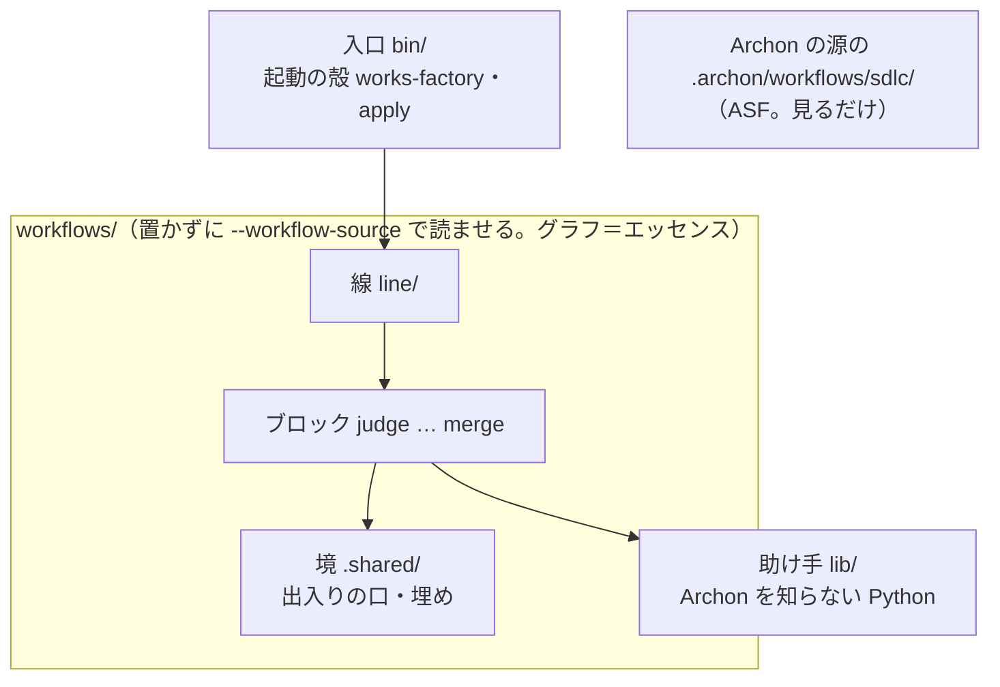
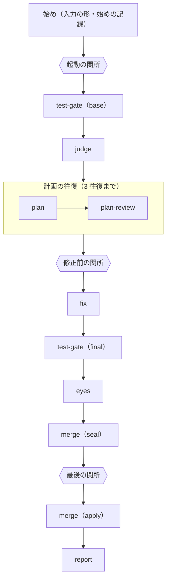

<!-- coldwrite:skip 設計の正本。語は冒頭の「語」の節で定義 -->
# works-factory の設計

状態: 2026-10-11 の初版。持ち主の決め（`docs/owner-decisions.md` の 2026-10-11 の行）から起こした。コードはまだ無い。

## 語

- Archon: AI の工程を YAML で書き、機械が順に回す道具。土台は止めた Archon（下）。
- ASF（AI software factory）: Archon の作者が作った、作業の受け付けから merge までの工程の束（`coleam00/Archon` の枝 `factory/sdlc-on-dev` の `.archon/workflows/sdlc/`）。見る版は止めた Archon と同じ。
- 止めた Archon: ASF の取り付け命令が置いた `factory/pack.json` の `repository` を、`integration_revision_required` の commit（今は `d97d00ef`）で取った Archon の源。ASF と同じ開発中の源で、Archon の本体と ASF の工程の両方をここから取り、`bun` で起こす（持ち主の決め `archon-same-as-asf`。読み方は「pack.json」の節）。
- 今の works: raiki61/claude-plugins の `works/`。工場 darkfactory を持つ。棚卸しは origin/main の 2026-10-11 の姿（commit `ab9b9f17` まで）。
- review-graph: graphloops プラグインのレビューと修正の輪（`works/.shared/core/graphloops/graphs/review-loop.json`）。今の works の元。
- 線: ブロックを順に並べた 1 本の工程（`workflows/line/`）。
- ブロック: 線に `include:` で差し込む部品（`workflows/<名>/`）。ほかのブロックを知らない。
- 節: Archon の YAML の 1 つの node。
- 役: AI を起こす節。
- 人の関所: 人に答えを聞いて止まる節（Archon の承認の節）。
- 単位: 判定役が切った 1 つの欠陥。直す・拒む・諦めるの数え方の単位。
- 組: 判定の単位か計画の項目を共にする単位のまとまり。組は分けない。組ごとに別の作業ツリーで並べて直す。
- エッセンス: 持ち主のグラフ（`workflows/`）。どの確かめと役が在り、各々が何をし、どの順でどうつながり、どこで人に聞くか。Archon の書き方（線とブロックの YAML・役の指示書 `commands/`・節の script `scripts/`）で書く。持ち主の言葉「で、私がエッセンスって呼んでるのはグラフの内容やグラフ全体の形かな。」（2026-10-11）
- lib: Archon を知らない Python の助け手（`lib/`）。script の節が呼ぶ（引用の照らし・TDD の赤の判定・元から赤の見分け・範囲の照らしなど）。エッセンスそのものではない。
- 境: Archon との出入りの口と、Archon に無い物を補う埋め（`workflows/.shared/`）。
- 埋め（polyfill）: Archon に無い物を外から補う部品。名簿は `docs/polyfills.md`。
- 指し札: Archon の `{type: archon_artifact, run_id, path}`。run の置き場の中のファイルを指す。
- 型つきの成果物: 節の `output_type` で型の名を付けた出力。受け手は `$TYPED_ARTIFACTS_FILE` の一覧から型で引く。

## 目的

持ち主の自分版の工場を持つ。今の works の能力を 1 つも落とさず、作りは Archon と ASF に寄せて簡単にする。

- 持ち主の言葉（2026-10-11）: 「作りをASF参考にArchonに寄せたほうがいいのでは。確かめの中身とかはようはその上に載るエッセンスってことでしょ」
- 簡単にする訳: 「じゃないと後続がこうやって変換すればいいやって思っちゃうかもしれないでしょ」。だから YAML は変換しない（`workflows/AGENTS.md` の E1）。
- 今の works を直して寄せるのでなく、横に新しく作る（「横に自分のグラフつくりはじめるかんじでいいのではって思ってた」）。
- 最新の ASF を横に並べて見られる形にする（「その最新のソフト自動出荷工場を横目に見れる形じゃないとダメなのではという気がしてる」）。

## 4 つの層

| 層 | 置き場 | 持つ物 | 知ってよい物 |
| --- | --- | --- | --- |
| 入口 | `bin/` | 起動の殻（認証と隔離を整えて Archon を起こす。人は Archon の命令をそのまま打つ）・Archon の源の取り寄せと起こし方・`apply`・埋めの一部 | `pack.json`・`factory/pack.json`・Archon の CLI |
| グラフ（エッセンス） | `workflows/` | 線とブロックの YAML・役の指示書・節の script・ブロックの間で渡す物の型（`output_format`） | 境の口・lib |
| 境 | `workflows/.shared/` | Archon の入出力の口 1 つ・埋め | Archon の変数と型 |
| 助け手 | `lib/` | Archon を知らない Python のモジュール | Python のパッケージ（標準と外の物） |

- 言語は Python 3.12 以上（`lib/`・境・ブロックの script・`bin/`・試験）。訳: 今の works の確かめが Python で書かれていて、移すだけで済む。下限は持ち主の決め `py-floor`。外のパッケージは使ってよい（持ち主の決め `outside-packages-ok`）。自前で書く前に既製の物を当たり、版を止める。Archon は `script:` の節を `runtime: uv` で Python として走らせる（`guides/script-nodes.md`「`runtime` | `'bun'` \| `'uv'`」）。ASF は TypeScript だが、コードを写さないので言語を揃える訳が無い。
- 層を足す時は `AGENTS.md` の E10。
- 別の実行の道具へ移る時（Archon の競合に移る危うさへの備え）: グラフをその道具の書き方で `docs/design.md` から書き直す。役の指示書（指示書の中の Archon の変数だけ書き換える）と `lib/` はそのまま持っていける。ブロックの間の入出力は、その時に `output_format` から取り出す（持ち主の決め `io-in-output-format`）。

## Archon・ASF・今の works との関係

- Archon: 土台。中は直さない。足りない所は埋め（`docs/polyfills.md`）。開発元には連絡しない。
- ASF: 横に並べて見るだけ。ASF の工程は `bin/` が取った Archon の源の `.archon/workflows/sdlc/` に在り、工程の名（`archon-*` と `works-factory-*`）で選び分ける。ASF の工程を回す時は `--workflow-source` に源を渡す（ASF の `factory/consumer.py` と同じ）。採った型は `docs/asf-notes.md`。
- 今の works: 能力の正本。置き換えるまでは今の works が本番。能力を 1 つずつブロックと `lib/` へ移し、「能力の棚卸し」の表で追う。置き換えた後、claude-plugins の `works/` は `/works` の薄いスキルだけを残し、`bin/` を呼ぶ。

## pack.json

版の止めの正本。ただし Archon の版は書かない。

- Archon の版: ASF の取り付け命令が置いた `factory/pack.json` の `repository`・`integration_revision_required`（40 字の hash）・`source_directory`（源の中の ASF の工程のフォルダ）が正本。`bin/_lib/pack.py` の `load` がこれを読み、`archon.repo`・`archon.commit`・`asf.folder` として渡す。ASF の取り付け命令が `factory/pack.json` の版を進めれば、自分の工程を回す Archon も同じ版になる（持ち主の決め `archon-same-as-asf`）。Archon の本体と ASF の工程の両方をこの源から取る。ただし ASF の consumer（`factory/consumer.py`）が走らせて照らすのはこの値ではなく、`factory init --revision` が `.factory/consumer.json`（git に入れない）に書いた `revision` で、2 つを照らし合わせる物は無い。2026-10-11 にはどちらも `d97d00ef`。
- `asf`: `committed_here: false` は、ASF の工程をこのリポジトリに入れないこと（LICENSE が無い）。
- `ours`: 自分の工程のフォルダ・Archon に読ませる pack の名（`works-factory`）・名の頭（`works-factory-`）・線の名。

`bin/`（`bin/_lib/place.py`）は run の時に次を行う。Archon の家（`$ARCHON_HOME/workflows` など）には何も置かない。

1. Archon の源をその commit で 1 度だけ `<キャッシュ>/archon/<commit>/` に取り、`bun install --frozen-lockfile` で依存を入れる。bun が無ければ取る前に止まる。取り置いた源は使う前に照らす（HEAD がその commit・`git status` が空・`node_modules` が在る。ASF の `factory/consumer.py` の `verify_source` と同じ）。合わなければ消して取り直す案内で止まる。
2. Archon は `bun <源>/packages/cli/src/cli.ts` で起こす（ASF の `factory/consumer.py` の `cli()` と同じ形）。
3. 自分の工程は `archon workflow run --cwd <対象> --workflow-source <置き場>` で起こす。Archon は `--workflow-source` の `<置き場>/.archon/workflows/` を読むので、その中の `.archon/workflows/<pack>/`（`pack` は `pack.json` の `ours.pack`。`works-factory`）がリポジトリの `workflows/` を指す小さな置き場をキャッシュ（`${XDG_CACHE_HOME:-$HOME/.cache}/works-factory`。`place.cache_dir`）に作る（埋めの P3）。pack の形にするのは、止めた Archon が名前で指す script を pack の形の工程の時だけ工程のフォルダの `scripts/` から探し、pack の部品を `<pack>/.shared/` から読むため（`guides/script-nodes.md` の「Named Script Resolution」・`script-discovery.ts` 151-222 行）。前の形の置き場（`.archon/workflows` が直に `workflows/` を指す symlink）が在れば、消して回し直す案内で止まる。Archon は run の始めにその中身を run の物として写し取り、その run は写しだけを走らせる（Archon の `packages/workflows/src/workflow-source.ts`）。

## 線

### 順と関所

1. 始め（線の節）: 入口の入力を 1 つの形にそろえ、始めの記録を書く。差分も依頼の行も無ければ AI を起こす前に止める。
2. 起動の関所（人）: 何を始めるかを見せて止まる。
3. test-gate（base）: テストの走らせ方を見つけ、直す前の結末（元から赤のテスト）を控える。
4. judge: 前提・目的・定石・素材・判定。`--spec` の時は中に仕様の関所（人）を持つ。
5. 計画の往復: plan → plan-review を 3 往復まで。同じ所で 2 度続けて止められたら止める。
6. 修正前の関所（人）: 事前審査の 4 つの軸（自明・世界の解・汚くない・やりすぎでない）で人に聞く物がある時だけ開く。
7. fix: 組ごとの並べ（`fan_out:`）・TDD の輪・修正役・裁定・差分の審査と手直し。裁定が計画の項目の誤りとした時は、1 run に 1 度だけ plan と plan-review をもう一度差し込み、案の直しの関所（人）を通る。2 度目の修正が走らなかった時（関所の stop・無人の止め・直した案ができなかった）は、1 回目の修正の差分も試験の関門から先へ進めない。修正役の異議は judge を再審の入力でもう一度差し込む（1 度）。
8. test-gate（final）: テスト一式と CI。緑を作業ツリーの指紋つきで認証する。
9. eyes: 独立の目 R1〜R4 と、直した後の構造の実測、守りのパスの当たり。
10. merge（seal）: 人に見せる差分を封じる（hash）。
11. 最後の関所（人）: 封じた差分の hash・R4 の問い・守りのパスの当たり（確かめられなかった時も）・許したテストの変更・人に回した申し出・考えの住処の柵の増え・判定の役が保留にしたままの問い（今の works の `gatemarks.held_lines` と同じく、人に聞く状態の問いのうち、依頼の answers も修正前の関所で通した答えも当たらない物。関所に載せなかった問いと、一言の「保留: <key>」で名指した問いは答えていない。見せるが開ける理由に数えない）を並べる。保留の問いと柵の増えの控えを読めなければ、読めなかった訳を並べる。申し出は人に回した行だけで数える絞り（行の `ruling`）をまだ持たず、申し出の控えが在れば開く（`lib/conflict` が fix のブロックで置かれた後に戻す）。開くかは無人の方針（`final_gate`: always・when_needed・protected_only と `unattended`）で決まる。
12. merge（apply）: 封じた hash を照らしてから、外へ 1 度だけ書く（既定は差分を run の置き場に置き、人が `bin/apply` で当てる。今の works と同じ）。
13. report: いつも走る（前の段が落ちても。ブロックの返す節そのものが落ちた時も、受け皿 `<include の id>-out` が飛ばされ、collect はその返りを null で受ける）。結末の語・報告・次の run への持ち越し。

- 止めは人の関所の `stop`（後ろを `when:` で飛ばして report へ進む。結末は `stopped_by_human`）。関所の間で走っている run を外から止める札（止め札）は持ち主の答え待ち（Archon に報告つきで止める口が無い。「能力の棚卸し」の「止め札」の行）。
- 単位がどれも軽量なら（深さの決め）、差分の審査と R1〜R4 を省く。直した後に標準へ上げ直す決めも線が持つ。
- 周の鎖（頼まれたら run を何周もつなぐ）の置き先は「能力の棚卸し」の「線と入口」の「周の鎖」の行。

### 線が運ぶ物

型の正本は、出すブロックの返す節の `output_format` と線の `with:` だけ（持ち主の決め `io-in-output-format`）。下の表は何が渡るかの目録で、型の写しではない。

- 始めの記録（入口の入力の形を含む）: 線の始めの節が出す → 全部（script が `INPUTS_<名>` を字のまま読む）
- 直す前の結末: test-gate（base）→ fix・test-gate（final）
- 判定（単位の目録・判定の指し札・定石の行の指し札）: judge → plan・plan-review・fix・eyes
- 計画（修正案の指し札・波及の指し札・単位ごとの深さ）: plan → plan-review・fix・eyes
- 事前審査（止めか通しか・4 つの軸・人への問い）: plan-review → 線（関所と往復）・plan
- 修正（単位ごとの結末・申し出・諦めた単位・差分の指し札。組ごとの結果は `fan_out:` が入力の順に集めた `$<id>.output`）と型つきの成果物 `tdd-unit`: fix → test-gate・eyes・report
- 緑の認証（緑・赤の原因・作業ツリーの指紋）: test-gate（final）→ eyes・merge
- 独立の目と型つきの成果物 `eye-verdict`: eyes → merge・report
- 封じた差分（hash・守りのパスの当たり）: merge（seal）→ 最後の関所・merge（apply）
- 報告（結末の語・報告の指し札・持ち越しの指し札）: report → 線の返り（人は `bin/works-factory workflow get <run>` で見る）

受け渡しの決まりは `workflows/AGENTS.md` の E4・E5。

### 繰り返し

- 判定の受け付けが拒めば、判定役に 3 回まで出し直させる（judge の中の `loop:`）。
- 計画の往復は線の `loop_group` の `plan-rounds`（plan と plan-review の 2 つの include と、終わりの返しの節 `plan-out`）で 3 回まで。`loop_group` の中の節は外から見えないので、外の節は `plan-out` が返し直した `$plan-rounds.output.<欄>` を読む（U4）。ただし `collect` は往復の後ろの受け皿 `plan-rounds-out` から読む（往復の中の節が落ちると `$plan-rounds.output` は読めず、`collect` も落ちるため）。`plan-out` の `done` が 3 周目の終わりで必ず真になるので、往復は上限に当たって落ちずに修正前の関所へ回る。
- 並べ: 単位を組にし（組は分けない）、fix は組ごとに `fan_out:` で並べる。幅は計画の組の数から run の時に決まり、並べの数の上限だけを持つ。固定の枝の数・待ちの列・錠は持たない（持ち主の決め `no-queue`。今の works の固定の 3 本と待ちの列（commit `ab9b9f17`）は持ち込まない）。結果は `fan_out:` が入力の順に集める。組の差分は決めた順に親の木へ戻し、戻せなかった組は理由つきで報告と次の run に回す。組ごとの作業ツリーの持ち方は未決 U8。
- 修正役が 3 回拒まれた単位は、その単位を始めた時の版に戻し、理由を残して裁定に回し、ほかの単位は先へ進む。
- 差分の審査 → 手直しは 2 往復まで。

## ブロックの返りの約束

8 つのブロックを並べて移すための、線との約束。ブロックごとに、返す節（`returns:`）・`outcome_field`・返りの欄・受ける入力（`with:`）を先に決める。欄の名は今の works（`blk-*/schemas/`・review-graph の節の schema・`report.py`）から採り、E5・E17 と持ち主の決めが求める所だけ変えた。

- 正本: YAML が書けたら、型の正本は返す節の `output_format` と線の `with:`（持ち主の決め `io-in-output-format`）。この節は並べて書く間に名・型・読み手を揃えるための約束。YAML と食い違ったら、どちらが正しいかを決めて両方を合わせる。
- 機械: 線の `with:` が読む `$<include の id>.output.<欄>` が、そのブロックの返す節の `output_format` に在るかは Archon の `validate`（`tests/layers/test_archon_validate.py`）が見る。`outcome_field` が `required` に在るかと、読み手の無い欄が無いかは E5 の機械（`tests/layers/test_block_returns.py`）が見る。下の「→」の読み手は、その試験を赤にしないための目録。
- 書き方の決め:
  - 欄は全部 `required` に入れる。値が無い時は欄を落とさず `null`・`[]`・`""` で表す。null を取るのは「null 可」と書いた欄だけ。
  - 指し札は `{type: "archon_artifact", run_id, path}`（E5）。下では型を「指し札」と書く。
  - 2 つの形を持つブロック（test-gate・merge）は、返す節を 1 つのまま `mode` の欄で形を返す。形に当たらない欄は null。
  - 「→ 線 N」は「線」の「順と関所」の N 番の段（関所の文か `when:`）が読む。「→ ブロック名」はそのブロックが `with:` で受ける。「→ 線の返り」は線の返す節 `result`（線の `returns: result`。report の返りを受けて返し直す）を通して、人（`bin/works-factory workflow get`）と、置いた後の周の鎖が読む。
  - 指し札の先のファイルの中身は、欄が名指す今の works の同じ名のファイルの形のまま（新しい入れ物の形を作らない）。今の works が別のファイルに持っていた物は、同じフォルダの隣のファイルに置き、作ったブロックの中だけで読む。ただし次の隣のファイルは約束の一部で、ほかのブロックもこの名で開く: `judgment`（`judgment.json`）の隣の `premises.json`（実測した制約 `constraints`）・`judge-verify.json`・`pr-excluded.json`・`materials.json`（`{<素材の名>: {status, …}}`）・`purpose-review.json`（目的の監査の役の受けた返答 `{verdict, reason, findings}`。監査が走らなかった時は `{}`。今の works の `record.process.purpose_review`）、`plan`（`plan-fields.json`）の隣の `p2.fix_plan.json`（修正案の役の返答。関所の決め手の欄つき）、`structure`（`structure-state.json`）の隣の `design.jsonl`、`review` の隣の `gate-passes.json`（修正前の関所が聞かずに通した行）、`design`（`design.json`）の隣の `design-premises.json`（独立設計の役に貼った物の控え `{node, given, withheld, seen, claims?}`。eyes が R2 の頭に独立設計の後に来た答えを分けて貼る）。judge は止めた時も隣のファイルを空の形で必ず書く。ただし `judgment` の隣の次の 4 つは、中身が無い run・段が走らなかった run では書かれないことがあり、読み手は無いファイルを「行が無い」と読む: `answer-ties.json`（依頼の答えと作り直しの行を今の判定の問い・単位に結んだ行。`{"rounds": {"1": [<行>, …]}}`、`lib/gatemarks.py` の `save_answer_ties` の形）・`local-review-lenses.json`（局所レビューで確かめられなかったレンズの控え。`lib/diverted.py` の `LENS_FILE`）・`pr-downgrades.json`（並行 PR の担当への申し送りの下書き `[{pr, files, note}]`。投稿しない）・`world-state.json`（世界の解の段の控え `{status, reason, world_file, classes, dropped}`。段が落ちた訳と落とした抜き書きの数。`lib/worldmark.py` の `STATE_FILE`。段が走らなかった run には無い）。この 4 つは判定の道（`judge` の差し込み）の置き場にだけ在り、再審（`rejudge`）の `judgment` の隣には無い。
  - 直す前の結末のファイル（test-gate の `baseline` の先）は必須の欄 `{suite, test_cmd, rev, exit, cases}`。`suite` は始めの記録の `tdd_suite` の実行ファイル（無ければ `""`）、`cases` は JUnit の 1 件ごとの結末の並び。読み書きは `lib/baseline_red.py` の口だけ。test-gate は自分の欄（`junit_steps` ほか）を足してよい。
  - fix の `conflicts` の先は `conflicts.json` = `{"items": [...]}`（今の works の `conflict.py` の形。行の欄 `unit_key`・`kind`・`between`・`ruling`（`decision`・`text`・`limits`）・`replan`）。
  - 型つきの成果物: `green-cert` は test-gate の返す節の出力そのもの。`tdd-unit` は fix の 1 回の差し込みに 1 つで、中身は組ごとの段の物 `[{group_id, ran, reason, suite, reused, units}]`（今の works の blk-fix の `tdd` の出口。走らなかった組も `ran: false` で載る）。`eye-verdict` は `{eye, status, reason}`（`eye` は `r1`・`r2`・`r3`・`r4`・`premise-check`）。
  - 人の関所（`approval:`）の `decisions` は `approve` を含む（Archon の決まり。`guides/approval-nodes.md`）。通す語は `approve`・`continue`、止める語は `stop`・`reject`（今の works の線の関所の語）。止め札は止める語で、文が `request:` で始まる物。ブロックの `stop_reason` は人の止めを `human:<所>`、止め札を `request:<所>` の形で返す。
  - 線が include に渡す値（`with:`）は、飛ばされうる節の返りを直に書かない。include の `with:` には `{from, if_skipped}` の束ねが書けない（埋め P2）ので、線の返しの節（`answer-*`・`collect`）が `{from, if_skipped: null}` で受けて返し直した欄を渡す。返しの節の `output_format` は受けた欄の名だけを書き、型は受けた元（ブロックの返す節の `output_format`）を正本とする（返しの節の `from` が読む欄は Archon の `validate` が照らす）。
  - ブロックが約束に無い入力を要る時は、YAML の `inputs:` に既定値（`""`・`"null"`・`"[]"`）つきで宣言し、線が渡す前も動く形にする。返りの欄は足さない。足す入力はこの節に書いてから線が渡す。
  - 返す節は落ちない。lib と境の口の import は返す節の `main` の中で読み、読めない時も標準ライブラリだけで偽の結末と指し札の先のファイルを書いて返す（merge・test-gate・eyes・plan・plan-review・report・judge・fix の返す節と同じ形）。中の誤りを全部捕まえ、そのブロックの偽の結末（`ok: false`・`ready: false`・`done: false`・`pass: false`）と訳を `output_format` に合う形で返す（線は落ちた返す節の先へ進めない。報告は受け皿を通して出るが、そのブロックの返りは null になる）。
  - 線はブロックごとに受け皿の節 `<include の id>-out`（`workflows/line/scripts/returned.py`）をブロックの後ろに既定の `trigger_rule` で置き、`collect` はブロックの返りを受け皿の出力 `{got, stop_reason}` からだけ読む。落ちた節の出力は `{from, if_skipped}` でも読めず（止めた Archon の `packages/workflows/src/dag-executor.ts` の `resolveBindingDirective`）、直に読むと `collect` も落ちて報告が出ない。受け皿は受ける節が落ちても飛ばされても飛ばされ、`collect` の `if_skipped: null` に落ちる。計画の往復も同じ形の `plan-rounds-out` で受ける。
- 線の中の id（`$<id>.output` の `<id>`。線を書く人とブロックを書く人がこの名で合わせる）:
  - 線の節: `start`（始めの節）・`answer-start`・`answer-before-fix`・`answer-replan`・`answer-final`（関所の答えの返しの節。`{go, answer, stop_reason}`。`answer-replan`（script `replan_answer`）は 2 度目の修正に渡す `fix_answers` も返す）・`ask-before-fix`・`ask-replan`・`ask-final`（関所を開くかと文を決める）・`plan-rounds`（計画の往復の `loop_group`）・`plan-out`（往復の終わりの返しの節）・`<include の id>-out` と `plan-rounds-out`（受け皿。ブロックと往復の返りを `{got, stop_reason}` に受け直す。`collect` だけが読む）・`after-fix`（案の直しと再審を差し込むか）・`judged`（judge か rejudge の単位と判定）・`fixed`（fix と refix の返りを合わせた物）・`redepth`（直した後の深さの上げ直し）・`collect`（報告へ渡す物を集める返しの節）・`result`（線の返す節）
  - 人の関所: `gate-start`・`gate-before-fix`・`gate-replan`・`gate-final`（仕様の関所は judge の中）。`decisions` は `approve`・`continue`・`stop`・`reject`（`reject` は `stop` と同じ。`decisions` に無いと、Archon は `reject` の答えを run の取り消しとして扱い、報告が出ない。止めた Archon の `packages/core/src/operations/workflow-operations.ts` 1633-1641 行）
  - include: `test-gate-base`・`judge`・`plan`・`plan-review`・`fix`・`rejudge`（judge の再審）・`replan`・`replan-review`（案の直し）・`refix`（案の直しの後の 2 回目の修正。fix のブロックを 1 度だけ差し込む）・`test-gate-final`・`eyes`・`merge-seal`・`merge-apply`・`report`
  - 同じブロックを 2 度差し込む所の返りは include の id ごとに分かれる（U2）。`rejudge`・`replan`・`replan-review`・`refix` の返りは差し込んだブロックと同じ形。後の段が fix の返りを読む所は `$fixed.output.<欄>`、judge の単位と判定を読む所は `$judged.output.<欄>`、plan と plan-review の返りを往復の外から読む所は `$plan-rounds.output.<欄>` を読む。
- 線の始めの節 `start` の返りのうち、ブロックが読むのは 2 つ:
  - `prior_failures`（指し札・null 可）: 前の run の持ち越しの前の失敗の行（始めの節が依頼から `lib/carry` で置く、今の works の `prior-failures-in.json`）。無ければ null → judge・plan
  - `record`（指し札）: 始めの記録。今の works の `start.json` の欄（`run_id`・`base_rev`（修正の前の HEAD。差分の根 `input.base.rev` とは別）・`test_cmd`・`tdd_suite`（TDD の輪と 1 件ごとの結末に使う実行ファイルのパス。入口の入力から。無ければ `""`）・`final_gate`・`unattended`・`policy`（人の方針の文書を run の始めに 1 度だけ固めた版 `{named, path, sha256, copy}`。`named` は入口の名指し `policy_md`、`path` は名指しの文書か、対象のリポジトリの git の共通の置き場の `graphloops/policy.md`。文書が無ければ `path` は `""`、`sha256` と `copy` は null。役に貼る本文は `copy` から読み、`policy_md` を生で読まない）・`spec` ほか）→ 全ブロック

### judge の返り

- 返す節 `verdict`・`outcome_field: ready`（ASF の `W/triage/archon-triage.yaml` の形）
- 入力（`with:`）:
  - `start` ← `$start.output.record`
  - `baseline` ← `$test-gate-base.output.baseline`
  - `objection` ← `$fix.output.objection`（`rejudge` の時だけ。`judge` では `""`）
  - `prior_failures` ← `$start.output.prior_failures`（前の run の持ち越しの前の失敗の行の指し札。始めの節が依頼から `lib/carry` で置く今の works の `prior-failures-in.json`。無ければ null）
- 返り:
  - `ready`（boolean）: 判定を受け付け、直す単位が 1 つ以上在る。false も正しい終わり → 線 5・report
  - `stop_reason`（string）: ready が false の訳（止めの理由の語 `lib/stop_reasons`）。ready なら `""` → report
  - `units`（array）: 単位の目録。項目は `{id, paths, summary}`（今の works の `structure-units`）→ plan・plan-review・fix・eyes
  - `judgment`（指し札）: 受け付けた判定の全体（今の works の `judgment.json`。review-graph の `p2.diagnose` の `units`・`questions`・`framing`・`one_shot`・`precedents` ほか）→ plan・plan-review・fix・eyes・線 7（再審の前後の単位の比べ）・線 11（保留にしたままの問い）
  - `purpose`（指し札）: 目的の固定（今の works の `purpose.json` と `purpose-means.json`）→ plan-review（R2 は目的の文だけから設計する）・eyes
  - `world`（指し札・null 可）: 定石の行（今の works の `world-row` の行の並び）。取れなかった時は null → plan・plan-review・eyes
  - `spec`（指し札・null 可）: 仕様（要件と受け入れテスト。review-graph の `spec.write`）。`--spec` でない時は null → plan
  - `out_of_purpose`（指し札・null 可）: 目的の外の所見 → report（次の run への持ち越し）
  - `rejudge_verdict`（string・null 可）: 再審の答え `採る`・`退ける`・`一部採る`（review-graph の `p2.rejudge`）。再審でない時は null → 線 7・report

### plan の返り

- 返す節 `plan`・`outcome_field: ready`（ASF の `W/plan/archon-plan.yaml`。ready が false も正しい終わり）
- 入力（`with:`）:
  - `start` ← `$start.output.record`
  - `units`・`judgment`・`world`・`spec` ← `$judge.output.<同じ名>`
  - `review` ← `$LOOP_PREV.plan-out.output.review`（往復の 2 回目から、前の周の plan-review の指摘。1 回目は空の字 `''`。Archon の `$LOOP_PREV` は 1 回目に空の字を渡す。`replan` では `''`）
  - `ruling` ← `$fix.output.replan_items`（`replan` の時だけ。`plan` では `[]`。形は `replan_items` の項目の番号の字）
  - `conflicts` ← `$fix.output.conflicts`（`replan` の時だけ。`plan` では null。裁定の文を案の直しの役に渡す）
- 返り:
  - `ready`（boolean）: 修正案ができた（受け付けを通った）。false は 3 つ: 受け付けが 3 回とも拒んだ時・直す義務の単位が無い時・行き止まりの単位が在る時。構造の目が「人に上げる」とした行は false にせず、`structure` で plan-review に渡り修正前の関所の問いになる（今の works と同じ）。返りに false の訳を分ける語は持たない（欄を足さない）: 3 回の拒否と行き止まりは report がどちらも `stopped_by_line` にし、義務の単位が無い時は report が judge の返り（`units` が空）から `no_fix_needed` にする → 線 5・report
  - `plan`（指し札）: 修正案。項目ごとの書いてよい範囲・受け入れテスト・定石と構造の行ごとの従うか外れの訳（今の works の `plan-fields.json`）→ plan-review・fix・eyes
  - `structure`（指し札）: 構造の目の行（今の works の `design-row` の形）→ plan-review
  - `ripple`（指し札）: 波及の一覧（今の works の `ripple.json`）→ plan-review・fix・eyes
  - `depth`（array）: 単位ごとの深さ。項目は `{unit_id, depth, why}`、depth は `軽量`・`標準`（今の works の `lib/depth`）→ 線（深さの決め）・fix
  - `round`（integer）: 何回目の案か（往復と案の直しを通して数える）→ report

### plan-review の返り

- 返す節 `review`・`outcome_field: pass`
- 入力（`with:`）:
  - `units`・`judgment`・`purpose`・`world` ← `$judge.output.<同じ名>`
  - `plan`・`structure`・`ripple` ← `$plan.output.<同じ名>`
  - `start` ← `$start.output.record`（無人の印・設計だけ・依頼のファイル・方針の文書・事前審査の木の既定・固めた版。関所の材料と R2 の名指しの節が読む）
  - `answers` ← `$answer-start.output.answer`（R2 に貼る人の関所の答え `{decision, text}`。起動の関所が開かなかった run は null）
  - `ruling` ← `$fix.output.replan_items`（`replan-review` の時だけ。`plan-review` では `[]`。裁かれた項目（`replan_items` と同じ番号の字）だけを審査する。番号でない行と案の外の番号は拒む）
  - `conflicts` ← `$fix.output.conflicts`（`replan-review` の時だけ。`plan-review` では null。裁かれた項目ごとに申し出と裁定の文を事前審査に貼る）
  - `gate_answers` ← 修正前の関所の答え `{decision, text, asked}`（`asked` は人が見た `questions` の行。無ければ null）。通した行を次の差し込みで聞き直さず、方針の文書の変化を通したらその版を固め直す。線はまだ渡さない（既定 null）
- 返り:
  - `pass`（boolean）: 止める指摘が無い（通し）→ 線 5（往復を抜ける）
  - `stalled`（boolean）: 同じ所で 2 度続けて止めた（`lib/converge`）→ 線 5（往復を止める）・report
  - `review`（指し札）: 項目ごとの指摘（review-graph の `p2.plan_review` の `faces`・`shrink`・`reason`）→ plan（次の周）・report
  - `design`（指し札）: 独立設計 R2（review-graph の `r2.design` の `question_stands`・`design`。今の works の `design.json`）→ eyes（R2 の比較）
  - `gate_axes`（object）: 4 つの軸。鍵は `obvious`（自明）・`world`（世界の解）・`clean`（汚くない）・`not_overkill`（やりすぎでない）、各 `{ok: boolean, note: string}` → 線 6
  - `ask_human`（boolean）: 修正前の関所を開くか → 線 6
  - `questions`（array of string）: 人への問い → 線 6・eyes

### fix の返り

- 返す節 `fix`・`outcome_field: done`
- 組ごとの並べ（`fan_out:`）は fix の中に置く。組は `lib/groups` が単位と計画から作り、返りは組を集めた後の 1 つ。
- 入力（`with:`）:
  - `start` ← `$start.output.record`
  - `baseline` ← `$test-gate-base.output.baseline`
  - `units`・`judgment`・`world` ← `$judge.output.<同じ名>`
  - `plan`・`ripple`・`depth` ← `$plan-rounds.output.<同じ名>`
  - `answers` ← `$answer-before-fix.output.answer`（修正前の関所の答え `{decision, text}`。関所が開かなかった run は null）
- `refix` の時: `only_items` ← `$fix.output.replan_items`（直す計画の項目の番号。`replan_items` と同じ形。fix はその項目に載る単位だけを直す）、`plan`・`ripple`・`depth` ← `$replan.output.<同じ名>`、`answers` ← `$answer-replan.output.fix_answers`（修正前の関所の答えの条件と案の直しの関所の一言を見出しの下に並べた `{decision, text}`。今の works の `replan._notes` と同じく、人が修正前の関所で通した範囲と条件を 2 度目の修正も守る。どちらの関所も開かなかった run は null）、ほかは `fix` と同じ。fix は include の名ごとに run の置き場の下の別のフォルダを使うので、`refix` は `fix` の控えを上書きしない。返りは fix と同じ形で、線の節 `fixed` が `fix` と `refix` の返りをまとめて後の段に渡す。
- 約束に無い入力（線は渡さない。既定 `""`）: `only_items`（`fix` では空）・`mode`（`""` はブロック、`group` は組ごとの子の run）・`group`（組 1 つの JSON）・`from_tree`（親の作業ツリーの姿の木の sha）・`out_dir`（子が結果を書く、親の run の置き場の中の絶対パス）。fix は組ごとの並べのために自分（pack `works-factory` の `works-factory-fix`）を `workflow:` と `fan_out:` で子の run として起こす（未決 U8）。
- 返り:
  - `done`（boolean）: 直しを作業ツリーに入れ終え、差分の審査を通した。諦めた単位が在っても true → 線 8・report
  - `units`（array）: 単位ごとの結末。項目は `{unit_id, group_id, status, reason}`、status は `fixed`・`given_up`・`not_done` → eyes・report
  - `groups`（array）: 組ごとの結果。項目は `{group_id, unit_ids, returned, reason}`（returned は親の木へ戻せたか）→ report
  - `conflicts`（指し札・null 可）: 申し出と裁定（`lib/conflict` の形）。無ければ null → 線 11・plan（replan）・report
  - `replan_items`（array of string）: 裁定が誤りとした計画の項目の番号（承認済みの修正案の `plan[]` の 1 から数えた位置を 10 進の字にした物。例 `["2"]`。重ねない・現れた順）。空でなければ線が案の直しを 1 度差し込む → 線 7・plan
  - `objection`（string）: 修正役の異議。空でなければ線が再審を 1 度差し込む → 線 7・judge
  - `diff`（指し札）: 累積差分（run の始めの版から）→ eyes・merge
  - `allowed_test_changes`（array of string）: 許したテストの変更のパス → 線 11
  - `changed`（object）: review-graph の `p3.fix` の印。`mechanism_changed`・`premise_drift`・`gates_changed`・`seams_changed`・`security_surface_changed`・`path_changed`（どれも boolean）→ eyes（R4・前提の検算）
  - `delta_review`（object）: 差分の審査 `{rounds: integer, pass: boolean}`。軽量で省いた時は `{rounds: 0, pass: true}` → report
- 型つきの成果物: 単位ごとに `output_type: tdd-unit`（返りではない。report だけが一覧から読む。E5）

### test-gate の返り

- 返す節 `result`・`outcome_field: ok`（ASF の `W/validate/archon-validate.yaml` の `result` の形）
- 入力（`with:`）:
  - `mode`: `base`（`test-gate-base`）・`final`（`test-gate-final`）
  - `start` ← `$start.output.record`
  - `baseline` ← `$test-gate-base.output.baseline`（final だけ。base は null）
- 返り:
  - `mode`（string）: `base`・`final` → report
  - `ok`（boolean）: base は直す前の結末を控えられた。final は緑を認証した（`green` で、指紋が今の作業ツリーと合う）→ 線 4（base）・線 9（final）・merge
  - `green`（boolean）: テスト一式（final は CI も）が緑。base で赤でも `ok` は true になりうる → report
  - `red_cause`（string）: 赤の原因 `introduced`・`inherited`・`environment`・`interaction`・`incomplete`・`""`（ASF の enum。緑なら `""`）→ report
  - `baseline`（指し札・null 可）: 直す前の結末（テストの走らせ方と元から赤のテスト）。base だけ → judge・fix・test-gate（final）
  - `fingerprint`（object・null 可）: 作業ツリーの指紋 `{head, diff_hash}`。final だけ → merge（seal が照らす）
  - `evidence`（指し札）: 走らせた記録 → report
- 型つきの成果物: 返す節に `output_type: green-cert`（report が全部の周の認証を一覧から拾う。E5）

### eyes の返り

- 返す節 `verdict`・`outcome_field: ok`（今の works の `eyes-exit.ok`）
- 入力（`with:`）:
  - `units`・`judgment`・`purpose`・`world` ← `$judged.output.<同じ名>`（再審が走ればその返り）
  - `plan`・`ripple` ← `$plan-rounds.output.<同じ名>`
  - `depth` ← `$redepth.output.depth`（plan の深さを直した後に上げ直した物）
  - `design` ← `$plan-rounds.output.design`
  - `diff`・`changed` ← `$fixed.output.<同じ名>`、`fix_units` ← `$fixed.output.units`
  - `green_ok` ← `$test-gate-final.output.ok`
  - `start` ← `$start.output.record`（直した後の実測の数える版・守りのパスの当たり・方針の文書の置き場）
  - `plan_questions` ← `$plan-rounds.output.questions`、`answers` ← `$answer-before-fix.output.answer`（修正前の関所で人が通した行を R4 に渡し、同じ行を聞き直さない。持ち主の決め `decision-records`）
- 返り:
  - `ok`（boolean）: R1〜R4 が全部 pass。深さで省いた目は数えない → 線 10・merge
  - `r1`・`r2`・`r3`・`r4`（object・null 可）: 目ごとの `{status, reason}`。status は `pass`・`redesign-needed`・`unverifiable`（review-graph の `r1.minimality` ほか。R2 の `unverifiable` は、比べの節が落ちた・独立設計が無い時と、独立設計と比べなかった時（目的の文が空・独立設計の返答に問いが立つかの欄 `question_stands` が無い。訳の頭は `独立設計と比べなかった: `）。前提が崩れた時は `premise_check` にも載る）。省いた目は null → report
  - `questions`（array of string）: R4 の人への問い → 線 11
  - `premise_check`（object・null 可）: 前提の検算 `{verdict, reason}`、verdict は `resolved`・`escalate`（review-graph の `stop.premise_check`）。走らなければ null → 線 11・report
  - `structure_after`（指し札・null 可）: 直した後の構造の実測（今の works の `structure-after.json`）→ 線 11（考えの住処の柵の数が増えた）・report
  - `protected_hits`（array of string）: 差分が当たった守りのパス → report
- 型つきの成果物: 目ごとに `output_type: eye-verdict`

### merge の返り

- 返す節 `merge`・`outcome_field: ok`（ASF の `W/merge-queue/archon-merge-queue.yaml` の封印と読み戻し）
- 既定は E17: apply は封じた差分を run の置き場に置くだけ。対象のリポジトリへ当てるのは人（`bin/apply`）。
- 入力（`with:`）:
  - `mode`: `seal`（`merge-seal`）・`apply`（`merge-apply`）
  - `start` ← `$start.output.record`
  - `diff` ← `$fixed.output.diff`
  - `fingerprint` ← `$test-gate-final.output.fingerprint`、`green_ok` ← `$test-gate-final.output.ok`
  - `eyes_ok` ← `$eyes.output.ok`
  - `sealed_hash` ← `$merge-seal.output.hash`（apply だけ。seal は null）
  - `answer` ← `$answer-final.output.answer`（apply だけ。最後の関所が開かなかった run は null）
  - `r2` ← `$eyes.output.r2`（apply だけ。seal は渡さない）。R2 が `redesign-needed` なら人の答えに関わらず置かない（持ち主の決め `small-core`）。`unverifiable` とほかの目の阻害は人の通す語で置く
- 返り:
  - `mode`（string）: `seal`・`apply` → report
  - `ok`（boolean）: seal は差分を封じた。apply は封じた hash と今の差分が合い、置いて読み戻せた → 線 11（seal）・report
  - `hash`（string）: seal は封じた差分の sha256。apply は読み戻した差分の sha256 → 線 11・merge（apply が照らす）
  - `diff`（指し札・null 可）: seal は封じた差分。apply は置いた先（人が `bin/apply` で当てる物）。差分が空か組めない時は null（`ok` は false、`reason` に訳）→ report
  - `protected_hits`（array of string・null 可）: 守りのパスの当たり。seal だけ → 線 11
  - `reason`（string）: ok が false の訳（hash の食い違いなど）。ok なら `""` → report

### report の返り

- 返す節 `report`・`outcome_field: ok`（Archon の `outcome_field` は `required` の boolean だけを受けるので、結末の語 `outcome` とは別の欄にする。線は自分の返す節 `result` で report の返りを受けて返す）
- 入力（`with:`）: 全部 `$collect.output.<欄>`（線の返しの節 `collect` が、飛ばされうる全部の返りを `{from, if_skipped: null}` で欄ごとに受けて組み直した物。飛ばされた include は null）。欄は次の名:
  - `start`（始めの記録の指し札）・`prior_failures`（依頼の前の失敗の行の指し札）
  - ブロックの返り（include の id の `-` を `_` にした名。返りの欄の object か null）: `test_gate_base`・`judge`・`rejudge`・`plan`・`plan_review`・`replan`・`replan_review`・`fix`・`refix`・`test_gate_final`・`eyes`・`merge_seal`・`merge_apply`
  - 人の関所の答え `{decision, text}` か null: `gate_start`・`gate_before_fix`・`gate_replan`・`gate_final`
  - 線の節の物: `stop_reason`（線が止めた理由の語。入口の拒み `works:start-refused`・人の止め `human:<関所>`・無人の run の `works:needs-human`・線の script の例外 `works:line-script`。止まらなければ `""`）・`deferred_questions`（無人の run で関所に載せず報告へ回した問い）・`widened`（無人の run で聞かずに通した範囲を広げるだけの直し）・`final_reasons`（最後の関所を開ける理由）・`judged`（`rejudged`・`new_open_units`（再審の後に開いた単位）・`lowered`（block から下げた単位）・`unnamed_changed`（異議が名指さずに変わった単位）・`unread`（再審の前後の判定を読めなかった訳。読めれば `""`））・`fixed`（`conflicts`・`refixed`）・`redepth`（`depth`・`skip_optional`・`raised`）
  - 型つきの成果物の一覧（`tdd-unit`・`green-cert`・`eye-verdict`）は `with:` でなく report の中で `$TYPED_ARTIFACTS_FILE` から読む（E5）
- 返り:
  - `ok`（boolean）: `outcome` が `fixed`・`fixed_needs_check`・`no_fix_needed` の時 true → 線の返り
  - `outcome`（string）: 結末の語。enum は今の works の `report.py` の `OUTCOMES` の 10 語 `fixed`・`fixed_needs_check`・`no_fix_needed`・`round_limit`・`stopped_by_request`・`stopped_by_human`・`stopped_by_line`・`needs_human`・`record_invalid`・`interrupted` → 線の返り（周の鎖を置いたら、それが種を引く）
  - `stop_reason`（string）: 止めた段と理由の語（`lib/stop_reasons`）。止まらなければ `""` → 線の返り
  - `report`（指し札）: 機械の報告（今の works の `report.md`）→ 線の返り
  - `report_ai`（指し札・null 可）: AI の報告（今の works の `report-ai.md`）→ 線の返り
  - `next_request`（指し札・null 可）: 次の依頼（`lib/carry`。今の works の `next-request.json`）→ 線の返り
  - `prior_failures`（指し札・null 可）: 前の失敗の行（`lib/carry`。今の works の `prior-failures.json`）→ 線の返り

## ブロック

各ブロックのフォルダは `works-factory-<名>.yaml`（工程の名も同じ。ASF の `archon-<名>.yaml` と同じ形）・`commands/`（役の指示書の本文）・`scripts/`（`lib/` と境の口を呼ぶだけ）・`fixtures/`（Archon の筋書きの試験）を持つ。返りの型は `returns:` が名指す節の `output_format`。

### line（線）

- 目的: ブロックを並べ、関所・往復・止め札・深さ・無人の方針を持つ。
- ASF で読む物: `W/lifecycle/archon-lifecycle.yaml`（子の関所を子が持つ形・`returns: merge`）と `W/ship/archon-ship.yaml`（routes の合流と `trigger_rule: none_failed_min_one_success`、`if_skipped` で飛ばされた子を `null` で受ける `outcome`）。`W` は `.archon/workflows/sdlc`。
- 入力: 入口の入力。返り: 線の節 `result`（report の返りと、結末が `fixed`・`fixed_needs_check` の時に真の `fixed`。`outcome_field: fixed`）。
- lib: `entry_shape`・`depth`・`gate_policy`・`halt`・`converge`・`stop_reasons`（止めの理由の語）・`features`（機能の切り替えの語）。
- 埋め: P1（持ち主の居ない running）・P2（include に if_skipped を通せない）。
- 持ち主: 土台の持ち主だけ（守りのパス）。

### judge（判定）

- 目的: 依頼を根本の単位にまとめる。前提の実測・目的の固定・定石（世界の解）・並行 PR とのぶつかり・素材集め・根本の診断・判定の裏取り・再審・目的の外の所見の持ち越し。`--spec` の時は仕様（要件と受け入れテスト）と仕様の関所。
- ASF で読む物: `W/triage/archon-triage.yaml`（今の木と突き合わせてから道を決める・`returns: verdict`・`outcome_field: ready`）と `W/investigate/`（根の問い）。
- 入力: 始めの記録・直す前の結末。再審の時は修正役の異議。
- 役（`commands/`）: `premises`・`purpose`・`world-classes`・`world-judge`・`material-*`（11 本）・`diagnose`・`pr-check`・`spec`。
- lib: `judge_accept`・`premises`・`purpose`・`world`（定石の行の形も持つ）・`webget`・`parallel_pr`・`class_query`・`out_of_purpose`・`cite`・`reads`。
- 埋め: 無し。

### plan（計画）

- 目的: 構造の目（単位が名指すファイルを実測し、直し方が構造を汚すか）と修正案（項目ごとの書いてよい範囲・受け入れテスト・定石と構造の行ごとに従うか外れの訳）と波及の一覧。案の直し（裁定の後の 1 度）も同じブロックを差し込む。
- ASF で読む物: `W/plan/archon-plan.yaml`（`returns: plan`・`outcome_field: ready`・`ready: false` も正しい終わり）。
- 入力: 判定・事前審査の指摘（往復の 2 回目から）。
- 役（`commands/`）: `structure-eye`・`fix-plan`。
- lib: `plan_fields`（修正案の項目の欄の照らし）・`impact`。
- 埋め: 無し。

### plan-review（事前審査）

- 目的: 書く前に案を叩く。独立設計 R2（道具なし、目的の文だけから設計）を作り、案と比べ、写し・塞がない入口・契約のずれ・後退・方針とのぶつかりを予測する。修正前の関所の 4 つの軸を決める。
- ASF で読む物: `W/review/archon-review.yaml`（並べたレンズ → `synthesize` の形・レンズの `mutates_checkout: false`・`output_type: review-lens`）。
- 入力: 判定・計画。
- 役（`commands/`）: `r2-design`・`plan-review`。
- lib: `gate_axes`・`converge`・`policy`。
- 埋め: 無し。

### fix（修正）

- 目的: 単位ごとに直す。TDD の輪（名指しのテストが failure で落ち、直して通ることを JUnit の XML で機械が見る。役が引いた失敗の文が結末に在るかを照らす）・テストの凍結・修正案の範囲の照らしと相談・書き込みの出どころの突き合わせ・当たる試験の選び・3 回で諦める・食い違いの申し出と読むだけの裁定役・組ごとの並べ・後始末・差分の審査とレンズ（silent-failure-hunter）と手直し。
- 差分の審査と手直しを fix に置く訳: review-graph で同じ P3 の段（`p3.fix_delta`・`p3.delta_review`・`p3.delta_fix`）にあり、ブロックの中で輪が閉じる。ブロックの間の戻りを作らない。
- ASF で読む物: `W/implement/archon-implement.yaml`（`loop:` と `until_field: done`・`assert-changed` が `checkoutStart` と比べて本当に変わったかを見る・`outcome_field: green`）と `W/deliver/archon-deliver.yaml`（review → correct の輪）。
- 入力: 判定・計画・直す前の結末。型つきの成果物 `tdd-unit` も出す。
- 役（`commands/`）: `tdd`・`fix`（修正の決まりを含む）・`ruler`・`delta-review`・`lens`・`refix`。
- lib: `red_check`・`baseline_red`・`test_freeze`・`plan_scope`・`write_provenance`・`impact`・`test_files`・`give_up`・`groups`（組の作り）・`cite`・`conflict`（申し出の形）。
- 埋め: 無し。組ごとの作業ツリーは未決 U8。

### test-gate（試験の関門）

- 目的: 2 つの形で差し込む。base はテストの走らせ方を見つけ、直す前の結末を控える。final はテスト一式と CI を走らせ、赤の原因（今回入れた・元から・環境）を分け、緑を作業ツリーの指紋（HEAD と差分の hash）つきで認証する。機械で走らせられない時は任せ先の役が回す。
- ASF で読む物: `W/validate/archon-validate.yaml`（`mode`・`discover`・`run`・`classify`・`result`、`outcome_field: green`）と `W/deliver/scripts/gate-green.ts`（認証）と `W/.shared/validation-evidence.ts`（指紋）。
- 入力: 形（base・final）・始めの記録。
- 役（`commands/`）: `ci`。
- lib: `baseline_red`・`green_cert`・`declared_checks`（盤面なしの CI の関数と素材の型）・`checkscope`（範囲の宣言）・`graphloops/engine/declared`。
- 埋め: 無し。

### eyes（独立の目）

- 目的: 直しを作った役と別の新しい会話で、読むだけで確かめる。R1 最小性（コメントの削除候補 → 問いの台帳の監査 → 累積差分が最小か）・R2 独立設計との比較（道具は累積差分を読むだけ。前提が崩れたと言えば前提の検算）・R3 全体の整合（命名・規約・界面・文書の追従）・R4 見えていない範囲（運用・セキュリティ・データの横断の危うさと消えた能力。人への問い）。R1・R2・R3 を並べ、R4 は R1・R2 の後。直した後の構造の実測と、守りのパスの当たりも出す。
- ASF で読む物: `W/review/archon-review.yaml`（並べたレンズ・`coverage`・`synthesize` が include の頭と `loopGroupPath` で自分の分だけを数える）。
- 入力: 判定・計画・修正・緑の認証。型つきの成果物 `eye-verdict` も出す。
- 役（`commands/`）: `r1-comments`・`r1-minimality`・`r2-compare`・`r3-coherence`・`r4-scope`・`premise-check`・`structure-after`。
- lib: `protected`。
- 埋め: 無し。全部の役の節に `mutates_checkout: false`（E7）。

### report（報告）

- 目的: 結末の語（10 語）を決め、機械の報告と AI の報告を書き、段ごとの費用と時間を Archon の出来事の記録から作って載せ、文脈を持たない読み手に確かめさせる。次の run への持ち越し（次の依頼・前の失敗の行）を書く。人の関所の答えと TDD の単位の行（引用と理由）を載せる。
- ASF で読む物: `W/ship/scripts/outcome.ts`（どの道でも 1 つの返り）と `W/.shared/report.ts`（型つきの成果物の `errors` を注意として出す）。
- 入力: 全ブロックの返り（飛ばされた物は `null`）。
- 役（`commands/`）: `report`・`cold-check`。
- lib: `outcome`・`carry`。結末の 10 語は report の返す節の `output_format` の enum が正本で、`lib/outcome` は決め方だけを持つ。次の依頼と前の失敗の行の形（run をまたぐ控え）は `lib/carry` が持つ。
- 埋め: 無し。

### merge（取り込み）

- 目的: 2 つの形で差し込む。seal は人に見せる差分を封じ（hash）、守りのパスの当たりを出す。apply は封じた hash を今の差分と照らし、違えば止める。同じなら外へ 1 度だけ書き、読み戻す。既定の書き先は run の置き場の差分（人が `bin/apply` で当てる）。今の works には PR を出す口も main へ当てる口も無いので、それは置き換えの後の足し。
- ASF で読む物: `W/merge-queue/archon-merge-queue.yaml`（`path-policy`・`gate` の封印・`approval`・`refresh` → `execute`）と `W/merge-queue/scripts/merge-action.ts`（封印と読み戻し）。
- 入力: 修正・緑の認証・独立の目・始めの記録。
- lib: `seal`・`protected`。
- 埋め: 無し。

## 能力の棚卸し

今の works の能力ごとに、今の住処と新しい住処。パスは今の works は `works/` から。新しい方の `commands/<名>` は差し込むブロックの役の指示書、`lib/<名>` は助け手の能力の名。置くファイルは元の名（E18・持ち主の決め `lib-port-as-is`。例: `lib/stop_reasons` は `lib/stopby.py`）。盤面と Archon に届く関数は `lib/` に持ってこず、そのブロックの issue で扱う。

### 線と入口

- 入口の入力の形（差分の根・差分・依頼の行・PR。空なら止める）: `blk-entry`・`.shared/core/entryshape.py`・`startrec.py` → line・`lib/entry_shape`
- 単位ごとの深さと上げ直し: `darkfactory/lib/depth.py` → line・`lib/depth`
- 機能の切り替え: `.shared/core/entry.py` の `FEATURES` → line・`lib/features`
- 止め札: `.shared/core/halt.py` → line・`lib/halt`。人は関所で `bin/works-factory workflow respond <run> stop <一言>` と打つ（Archon の命令のまま。殻は何も足さない）。関所の間で走っている run を報告つきで止める口は Archon に無く、持ち主の答えを待つ（今は `workflow cancel` で止まり、報告は出ない）
- 人の関所と無人の方針: `.shared/core/gatepolicy.py` → line・`lib/gate_policy`
- 止めの理由の語: `.shared/core/stopby.py` → `lib/stop_reasons`
- 周の鎖: `.shared/core/chain.py`・`dev/use.sh` → 線の後ろ（推し。`workflow:` の節で次の周の線を起こせるかを段 3 で確かめ、起こせなければ置き先を決め直す）。殻には置かない（持ち主の言葉「自作部分はその認証の切り替えだけ」）。作るまでは Archon の `--adopt`・`--supersedes`
- 固定材料から始める・版の控え: `.shared/core/fixture.py`・`versions.py` → line（始め）。固定材料から始める道はまだ無く、start は入力 `fix_fixture` が空でなければ止める（fix のブロックが固定材料を受ける形を持つまで）。版の控えは始めの記録の `versions` に、止めた Archon の commit と Claude Code の版だけを置く（今の works の `versions.json` の pack の印・借りた物・模型・設定ほかは持たない）
- 部品の宣言と書き込みの照らし（manifest）: `.shared/core/scopes.py` → manifest は落とす。入出力の宣言は YAML の `with:`・`returns:` と型が持つ（E4・E5）。宣言の外の書き込みは、読むだけの節は `mutates_checkout: false`（E7。Archon が落とす）、書く役は書き込みの出どころの突き合わせ（fix）で落とす。読み手の無い返りの欄は層の試験で赤（持ち主の決め `declared-io`）
- 境の節（`h-*`）: `darkfactory/lib/line_edge.py` → line の `when:` と小さな script の節
- 工程の地図: `.shared/core/graphmap.py` → 落とす。Archon の YAML がそのまま地図
- AI の起こし方の包み（模型・effort・道具・隔離・返答の契約・system prompt の塊）: `.shared/core/adapter.py` ほか → 落とす。Archon の役の節の `model:`・`effort:`・`allowed_tools:`・`output_format:` で書く。包みが取っていた読んだ証拠と書き込みの記録をどこで取るかは未決（U6）
- 返答の足し欄: `.shared/core/marks.py` → `lib/marks.py`（planmarks・worldmark・converge などが頼るので依存として持ってくる。返りの欄は役の節の `output_format` に直に書き、掃除の段で見直す）
- graphloops の写し（engine・rules・検証器）: `.shared/core/graphloops/` → 線は Archon が回すので、engine の盤面・rules・検証器は持ってこない。lib の部品が頼る engine の小道具（`util`・`schema`・`pointers`・`render`）だけを `lib/graphloops/engine/` に置き、掃除の段で見直す

### judge

- 並行 PR とのぶつかり: `blk-pr`・`prcheck.py`・`forge.py`・`ghreads.py` → `lib/parallel_pr`・`commands/pr-check`
- 前提の実測: `blk-premises`・`premises.py` → `commands/premises`・`lib/premises`
- 目的の固定と解き方の分け: `blk-purpose`・`purpose.py` → `commands/purpose`・`lib/purpose`
- 定石（世界の解）と web の取得: `blk-world`・`worldmark.py`・`webget.py` → `commands/world-classes`・`commands/world-judge`・`lib/world`・`lib/webget`
- 素材集め 11 本: `blk-material` → `commands/material-*`
- 仕様の段: `blk-spec` → judge（`--spec` の時）・`commands/spec`
- 根本の診断と受け付け: `blk-judge`・`.shared/core/accept.py` → `commands/diagnose`・`lib/judge_accept`
- 判定の裏取り: `blk-judge/lib/judgeverify.py` → judge
- 欠陥の探し方の試しと数え直し: `querytest.py`・`recount.py` → `lib/class_query`
- 目的の外の所見: `outpurpose.py` → `lib/out_of_purpose`
- 再審: `blk-rejudge`・`rejudge.py` → judge（再審の入力）
- 名指しと引用の照らし: `.shared/core/cite.py` → `lib/cite`
- 読んだ証拠: `reads.py`・`record-read.py` → `lib/reads`

### plan・plan-review

- 構造の目: `blk-structure`・`structmark.py`・`concepthome.py` → plan・`commands/structure-eye`
- 修正案: `blk-plan`・`planmarks.py` → plan・`commands/fix-plan`・`lib/plan_fields`
- 波及の一覧: `blk-plan/lib/ripple.py`・`impact.py` → plan・`lib/impact`
- 案の直し: `replan.py` → plan（裁定の後の 1 度）
- 独立設計 R2: `blk-plan` の `r2-design-loop`・`design.py` → plan-review・`commands/r2-design`
- 事前審査（項目ごとの木）: `blk-plan` の `plan-review-loop`・`blk-plan/lib/planblk.py` の木の部分 → plan-review・`commands/plan-review`
- 壁打ちの往復: `converge.py` → line の往復・`lib/converge`
- 修正前の関所の 4 つの軸: `gatemarks.py` → `lib/gate_axes`
- 人の方針の文: `policy.py` → `lib/policy`

### fix

- TDD の輪と赤の判定: `blk-fix/lib/tddloop.py` → `lib/red_check`・`commands/tdd`
- 元から赤のテストの区別: `tddloop.py` → `lib/baseline_red`
- テストの凍結と許しの 1 本道: `conflict.py`・`fixgates.py` → `lib/test_freeze`
- 範囲の照らしと相談: `planrange.py`・`planscope.py`・`consult.py` → `lib/plan_scope`
- 書き込みの出どころ: `writes.py`・`record-write.py` → `lib/write_provenance`
- 当たる試験の選び: `impact.py` → `lib/impact`
- テストのファイルの見分け: `impact.py` の `is_test_file` → `lib/test_files`
- 3 回で諦める: `fixlanes.GIVE_UP_AFTER`・`parking.py` → `lib/give_up`
- 食い違いの申し出と裁定: `conflict.py`・`ruling.py` → `commands/ruler`・`lib/conflict`
- 並べの枝: `lanekit.py`・`fixlanes.py`・`tddlanes.py`・`unitlanes.py`・`unittrees.py` → fix の `fan_out:`（並べ・集め）と `lib/groups`（組の作り・戻す順の当て）。固定の枝の数・待ちの列・錠は持ち込まない（持ち主の決め `no-queue`）
- 後始末: `leftovers.py` → fix
- 修正の決まりと借りた superpowers の節: `seat.py`・`spseam.py`・`rulebook.py`・`blk-fix/rules/*.md` → `commands/fix-rules`
- 差分の審査・レンズ・手直し: `blk-delta`・`deltamarks.py`・`blk-lens`・`lens.py`・`blk-refix`・`refix.py`・`holeties.py` → fix・`commands/delta-review`・`commands/lens`

### test-gate・eyes・report・merge

- CI とテスト一式・任せ先の役: `blk-tests`・`blk-ci`・`ci_role.py` → test-gate・`commands/ci`
- 緑の認証（新）: 無し → test-gate・`lib/green_cert`（ASF の型 A3）
- 独立の目 R1〜R4 と前提の検算: `blk-eyes` → eyes・`commands/r1-*`・`r2-compare`・`r3-coherence`・`r4-scope`・`premise-check`
- 直した後の構造の実測: `blk-structure`（`measuring-after`）→ eyes
- 守りのパス: `protect.py` → `lib/protected`（eyes と merge）
- 結末の 10 語: `report.py` の `OUTCOMES` → `lib/outcome`（語は report の `output_format` の enum）
- 報告と初見の確かめ: `darkfactory` の `report` 節・`blk-report` → report・`commands/report`・`commands/cold-check`
- 持ち越し: `carry.py` → `lib/carry`
- 差分の封印と外への書き込み（新）: 今は人が `dev/use.sh apply` で当てる → merge・`lib/seal`・`bin/apply`

### 受け入れの一覧（review-graph と同じ能力）

持ち主の決め（`docs/owner-decisions.md` の `superset`）: works は review-graph の能力を 1 つも落とさない。works-factory も同じ。下の行は全部、置き換えの前に試験か筋書き（fixture）の名で証を書く。今の works は graph の全部の節を表 `darkfactory/nodes.json` で `by`（役・機械・Archon・無し）に当て、`absent` は理由を持つ。同じ表をこのリポジトリでも持つ（段 3）。

- [ ] `p0.base` 差分の根を決める。未追跡は載せる
- [ ] `p0.local_checks` CI を手元で走らせる。走らなければ人待ち（緑を仮定しない）
- [ ] `p0.premises` 目的と制約の数値を実測する
- [ ] `p0.purpose` 出典の優先順で目的を決め、最初の修正の前に固定する
- [ ] `p0.purpose_review` 目的を都合よく狭めていないか審査する
- [ ] `p0.parallel_pr` 並行 PR との交差を申し送る（今は報告に載せる形に下げている）
- [ ] `p0.prior_decisions` 決着済みの論点の一覧（禁: 局所の所見・ほかの採点の素材）
- [ ] `p1.worktree_before`・`p1.worktree_after` 作業ツリーの前後を機械が突き合わせる
- [ ] `p1.local_review` 所見を集めるだけで採点しない
- [ ] `p1.consistency_bypass` 横断の整合と標準の仕組みの迂回（禁: 局所の所見・固有規約・決着済みの論点）
- [ ] `p1.hygiene` 用途を知らない目で衛生違反（禁: 元の目的・機能名・説明・近傍のコード）
- [ ] `p1.external_standards` 問題の類を web の一次情報で裏取り（禁: 局所の所見）
- [ ] `p1.procedure_trace` 動かして確かめる。確かめられない所は未実測の仮説（禁: 局所の所見）
- [ ] `p1.gate_efficacy` 腕ごとに退行を入れて赤、壊さない写しで緑（対照）
- [ ] `p1.test_double_fidelity` テストの代役を実物の値で照らす
- [ ] `p1.main_path_observation` 主経路を 1 回動かして観測する
- [ ] `p1.provenance` 「正本は X」の X が差分の内側に無いか
- [ ] `p2.diagnose` 反証・出自・上へ 3 段・処方の木（書き手は覆せない。禁: 履歴・前の周の台帳と判定）
- [ ] `p2.history` 台帳の再燃・問いの再審・膨張（今は 1 周の run で absent。周の鎖で受けるかを段 3 で決める）
- [ ] `p2.fix_plan` 全部の単位を案に入れ、生まれる物・消す物・狭める能力を先に書く
- [ ] `p2.plan_review` 写し・塞がない入口・契約のずれ・後退・方針とのぶつかりを予測する
- [ ] `p2.human_gate` 狭め・後退・方針の穴があれば直す前に人に聞く
- [ ] `p2.rejudge` 判定役が新しい事実を自分で確かめ、採るか退けるか
- [ ] `p3.lane_merge` 枝の差分を重ね、当たらない物は次に見せる
- [ ] `p3.fix` 単位ごとに直す。不変条件を共にする箇所を全部挙げ、1 か所ずつ赤 → 緑。仕組みを新しく作ることになったら止める
- [ ] `p3.fix_delta`・`p3.delta_review`・`p3.delta_owed`・`p3.delta_fix` 修正だけの差分の審査と手直し
- [ ] `p3.fix_delta2`・`p3.delta_review2`・`p3.delta_owed2`・`p3.delta_fix2` 2 回目
- [ ] `p3.gates_cut` 周の版を固める
- [ ] `p3.delta_gates`・`p4.final_gates` 変異の検算（今の works は absent と宣言して落としている。works-factory で戻すかを段 3 で持ち主に聞く）
- [ ] `p4.ci` CI を走らせ直す。赤なら戻る（今は次の run の下書き）
- [ ] `p4.scalars`・`p4.assemble` 規模の数値と R1・R2 の再発火を機械が数える
- [ ] `p4.record`・`converge` 周の記録と検証器。阻害が 2 周続けて無く CI が緑の時だけ収束、上限 5 周
- [ ] `r1.comment_candidates`・`r1.minimality` R1
- [ ] `r2.design`（禁: 実装・リポジトリ・履歴・累積差分・決着済みの論点）・`r2.compare`（禁: 調査の経緯・判定の一覧）R2
- [ ] `r3.coherence` R3
- [ ] `r4.hidden_scope`・`r4.human_gate` R4
- [ ] `stop.premise_check` 前提の検算
- [ ] `report.human_items`・`report.cold_check`（禁: 周の経緯・記録・差分）・`report`
- [ ] `spec.write`・`spec.review`・`spec.revise`・`spec.approve`・`spec.freeze`・`spec.check` 受け入れテストを承認の時点で固め、後で hash を照らす

今の works の強みの 12（works `docs/keep-essence.md`）も同じ扱い: 赤緑の機械の判定・元から赤の区別・テストの凍結・3 回で諦める・書き込みの出どころ・当たる試験の選び・欠陥の探し方の数え直し・食い違いの申し出・独立設計・守りのファイルで最後の関所・単位ごとの記録が報告に届く・世界の解。

## Archon の分かっていること

2026-10-11 に公開版 v0.11.1 の binary とソースを読み、手元で確かめた事実。同じ日に、どの項目も止めた Archon（`d97d00ef`）で読み直し、在り処を書いた（パスは源の `packages/workflows/src/` からの相対。`cli.ts` は `packages/cli/src/`、文書は `packages/docs-web/src/content/docs/` から）。

- `include:` は読み込みの時に展開され、子の節の id は `<include の id>__<子の id>` になる（`include-expander.ts` 1-9 行）。
- `returns:` は 1 つの節の出力を `$<include の id>.output` として見せる。書かなければ定義の順で最初の終わりの節（`include-expander.ts` 14-19 行・857 行）。
- 型つきの成果物は、節の id と繰り返しの道（`loopGroupPath`）で鍵が付き、`$TYPED_ARTIFACTS_FILE` の一覧（`{runId, artifactsByType, errors}`）で引く（`artifacts-index.ts` 44-57 行・366-377 行）。
- `loop:` の出力は最後の回の出力。`output_format` を書いた `loop:` では、それが照らした JSON になる（`dag-executor.ts` 5322 行の `executeLoopNode` の `lastIterationOutput`・文書 `guides/loop-nodes.md` 338-341 行）。
- `if_skipped` は include の入力を通して運べない（埋め P2）。
- 指し札は同じ run の中だけ。パスは相対で、在って空でない普通のファイルだけ（`artifact-pointer.ts` 15-20 行・101 行・146-153 行）。
- `script:` の節の `output_format` は標準出力の約束で、Archon が照らす（`d97d00ef` の文書 `guides/script-nodes.md` 124 行「JSON Schema the node's stdout must satisfy」）。だからブロックの返りの型を自前で照らす口は要らない。
- `workflow:` の `fan_out:` の子が承認の関所で止まると、その子は取り消される（親は関所を 1 つしか持てない。関所を外して resume すればその子からやり直す。`dag-executor.ts` 7716-7719 行・7771-7790 行）。`include:` の `fan_out:` の中の関所と待ちは、読み込みの時に誤りになる（`include-expander.ts` 1148-1157 行）。関所は fan_out の前か後に置く。
- 持ち主の居ない `running` の run は `resume` できない（埋め P1）。
- 待ちは持ちこたえる（0.10.0 から）。`wait:` の節と承認の節の待ちは DB が持ち、process が再起動しても消えない（CHANGELOG [0.10.0]「The database owns suspension and resume claims, so process restarts … cannot reset a wait」）。server は期限の来た run を再開する（`d97d00ef` の CHANGELOG 244 行）。だから CI と人の長い待ちは `wait:` の節と承認の節で書く。
- `include:` の節に `fan_out:` を書ける（0.10.0、PR #2512・#2795）。「Load time resolves and validates the full static block…; runtime decides only its width」。並べの数に上限を付けられ、結果は入力の順に `$<id>.output` に集まる（`d97d00ef` の CHANGELOG 246 行）。
- `workflow:` の節に `fan_out:` を書くと、項目ごとに自分の run（「its own row, artifacts, cost line and gates」）を持つ子が起きる（同じ 246 行）。
- `$ARCHON_HOME/workflows` の工程は同じ名の同梱の工程を上書きし、`--workflow-source`（か `--cwd`）の `.archon/workflows/` の工程は両方を上書きする（`d97d00ef` の `workflow-discovery.ts` 1158-1186 行）。v0.11.1 で家に置いた ASF の束は 40 本が並び、`archon-merge-queue` は script のパスの警告を 2 つ出した。ASF の工程を走らせたことはまだ無い。
- `--workflow-source <置き場>` は `<置き場>/.archon/workflows/` を読む。その場所が symlink でも辿り、1 段下のフォルダまで探し、`fixtures/` は飛ばす（`d97d00ef` の `cli.ts` 805-825 行・`workflow-source.ts` 500-507 行・`command-validation.ts` 23 行・`workflow-discovery.ts` 216 行）。`--resume`・`--container` とは一緒に使えない。`archon validate workflows` は `--workflow-source` を受けず黙って捨て、`--cwd` は git の木しか受けない（`cli.ts` 500-575 行）。だから確かめる時は `.archon/workflows/works-factory/` に工程のフォルダと `.shared/` を写した使い捨ての git の木を `--cwd` に渡す（`tests/archon.py` の `tree`）。`workflow run --dry-run` は git の木でなくても `--workflow-source` で読む。
- 作りの規則は Archon の源の `.archon/workflow-language-constitution.md`（「YAML coordinates. Code computes. Agents judge.」。`d97d00ef` でも同じ）。
- `outcome_field:` は返す節の `output_format` の `required` に在る boolean の欄しか受けず、ほかは工程の読み込みで落ちる（止めた Archon の `packages/workflows/src/loader.ts` の `validateWorkflowOutcomeDeclaration`）。

### 未決（歩く骨組みで決める）

- U1 `resume` の後の run の id は同じか。持ち越しと指し札（同じ run の中だけ）に効く。
- U2（分かった）同じブロックを 2 度差し込んだ返りは include の id ごとに分かれる（子の節の id が `<include の id>__<子の id>` になり、`$<include の id>.output` はその include の返す節。`include-expander.ts` 1-19 行）。型つきの成果物の分かれは report ブロックの issue に残す。
- U3（分かった）`archon workflow test` の筋書きは使える（線の 19 本を `tests/e2e/test_line_scenarios.py` が回す）。制約: 関所はいつも `approved` の字で通り stub も答えも置けない（`dry-run.ts` 1179-1204 行。関所の答えは返しの節の stub で差す）。`loop_group` は 1 周で終わったものとされ `until_bash` は走らない（`dry-run.ts` 849-890 行）。include の入力は名前の script には渡らない（`dry-run.ts` の `executeCodeNode`）。
- U4（分かった）`loop_group` の中に `include:` は書ける（`schemas/dag-node.ts` 513-529 行・文書 `guides/loop-nodes.md`「`include:` is valid in a `loop_group` body」）が、中の節は外から見えない（外から見えるのは `$<loop_group>.output` だけ）ので、本体の終わりに返しの節を置く（線の `plan-out`）。`include:` の id を `$LOOP_PREV` に書いても返す節に書き換わらない（`include-expander.ts` 1244-1247 行）ので、前の周の値も返しの節から読む。
- U5（決めた）ブロックの script が `lib/` をどのパスで見つけるか。Archon は run の始めに `workflows/` を写し取り、script はその写しから走るので、リポジトリからの相対では届かない。決め: 入口の殻 `bin/works-factory`（`bin/_lib/launcher.py`）が Archon の子の環境変数 `WORKS_FACTORY_ROOT` にリポジトリの根を渡し、境の口の `boundary.lib_root()` がその `lib/` を返す（無ければ自分の置き場から辿った `lib/`）。Archon は host で走る script の節に起こした時の環境変数を渡す（`dag-executor.ts` の `process.env` の重ね）。止めた Archon で script の節を回して確かめる試験は `tests/shared/test_boundary.py` の `test_script_run_by_archon_finds_repository_lib`。Archon の `runtime: uv` の節の `deps:` の引き方（`lib/AGENTS.md` の E3）はこの決めに含まない（未決のまま）。
- U6 今の works の包みが取っていた読んだ証拠と書き込みの記録を、Archon の役の節で取れるか（Archon の出来事の記録か、節の hooks か）。取れなければ埋めの行にする。
- U7 ASF の lifecycle を段 2 で使う時、必須の入力 `scenario`（動かして確かめる筋書き）に何を渡すか。
- U8（分かった）組ごとに別の作業ツリーを持てる。`workflow:` + `fan_out:` + `isolation: worktree` の子の run は組ごとに作業ツリーを持つ。親の姿は木の sha（fix の入力 `from_tree`）で渡して子が写し（`groups.adopt_tree`）、子の差分は木の sha と `out_dir` のファイルで戻す（fix の `join`）。remote の無い対象では子の作業ツリーが切れないので、fix は 1 つずつ回す（`docs/polyfills.md` の「fan_out の子ごとの作業ツリー」）。PR #94 の実測（2026-10-12）。

U1〜U3 は持ち主の挙げた物、U4〜U8 はこの文書を書く中で出た物。

## 作りの順

### 段 0 土台（土台の持ち主 1 人）

`pack.json`・`bin/`・境 `workflows/.shared/`・線の骨組み（ブロックの返す節の `output_format` を含む）・層の試験。手順は `docs/plans/2026-10-11-foundation.md`。

### 段 1 歩く骨組み

全部のブロックを中身の薄い形（型に合う返りを返すだけ）で線に並べ、小さな対象のリポジトリ（`tests/e2e/` の種）に 1 つの依頼を通しで回す。人の関所は `bin/works-factory workflow respond` で答える。U1〜U7 を決め、結果を この文書と `docs/polyfills.md` に書く。

### 段 2 ブロックごとの issue を並べて回す

- 持ち主の決め `overnight-speed` により、段 1 の歩く骨組みを待たずに回す。未決は、U4 は Archon の文書で決着（`guides/loop-nodes.md`「`include:` is valid in a `loop_group` body」）、U5 は土台の足し P0（issue #47）、U8 は fix の issue の実測で決める。回すのは archon-ship（段 1 の通しが無い間は lifecycle の筋書きの確かめが通らないため。2026-10-11 の決めから導いた事の「段 0〜1 を回す ASF の工程」）。
- 1 つのフォルダに 1 つの issue。中身は「グラフのブロック 1 つ（YAML・役の指示書・script）と、それが呼ぶ `lib/` のモジュールを移す。筋書き（fixture）と `lib/` の試験を先に書く」。
- 回すのは最新の ASF の lifecycle（`archon-lifecycle`。1 run で 1 issue）。並べは issue ごとに run を起こして作る（lifecycle は自分では並べない）。
- 共有のファイル（`workflows/.shared/`・`workflows/line/`・各階層の `AGENTS.md`・`engineering.md`・`MISSION.md`・`pack.json`）は土台の持ち主だけが変える。lifecycle の入力 `protected_paths` にこれらを渡し、ASF の merge が人の手に残す（ASF の型 A7）。issue の中で共有のファイルの変更が要ると分かったら、止めて土台の持ち主に issue で頼む。

issue の一覧（受け入れの条件はどれも共通の 5 つ + 個別）:

共通:
1. 筋書き（`workflows/<名>/fixtures/`）と `lib/` の試験（`lib/tests/`）が先に赤で入り、後で緑。
2. 返す節の `output_format` を段 0 の骨組みの欄から狭めずに中身を入れ、線の `with:` が読む欄が全部在る（`tests/layers/test_block_returns.py`）。欄を足す・変えるのは線との約束を変えることなので、土台の持ち主に issue で頼む。
3. 層の試験（`tests/layers/`）と、自分のブロックだけを置いた使い捨ての木で（`tests/archon.py` の助けで）回す `archon validate workflows` が緑。
4. 採った ASF の型（`docs/asf-notes.md` の書き方の 4 行の形）と、使いたい埋めを PR の本文に書く。土台の持ち主が `docs/asf-notes.md`・`docs/polyfills.md` に写す。
5. 「能力の棚卸し」と「受け入れの一覧」のこのブロックの行ごとの証の試験か筋書きの名を PR の本文に書く。土台の持ち主が `docs/design.md` に写す。

個別:

- `judge`: 前提・目的・定石・素材 11 本・診断・裏取り・再審・仕様の段が動く。受け付けが拒めば 3 回まで出し直す。定石の抜き書きが出どころに在ることを機械が照らす。目的の外の所見が持ち越しの行になる。
- `plan`: 構造の目と修正案と波及の一覧。項目ごとに書いてよい範囲・受け入れテスト・定石と構造の行への従うか外れの訳が無ければ受け付けが拒む。案の直しの入力で 2 度目を差し込める。
- `plan-review`: R2 の独立設計は道具なしで目的の文だけを受ける（禁じた入力が届かないことを試験で縛る）。4 つの軸と人への問いを返す。往復の止め（3 回・同じ止めが 2 度）が働く。
- `fix`: 赤緑の機械の判定・元から赤の区別・凍結・範囲の照らしと相談・書き込みの出どころ・3 回で諦める・申し出と裁定・差分の審査と手直し 2 往復。組は `fan_out:` で並べ、幅は計画（組の数）から決まり、組は分けない。並べの数の上限は持つが、固定の枝の数・待ちの列・錠は持たない。
- `test-gate`: base と final の 2 つの形。赤の原因を 3 つに分け、今回入れた赤と原因の無い赤を拒む。緑の認証に作業ツリーの指紋が入り、木が変われば認証が使えない。
- `eyes`: R1〜R4 と前提の検算と直した後の構造の実測。全部の役が `mutates_checkout: false`。R2 の禁じた入力が届かない。R4 の問いと守りのパスの当たりが返りに載る。型つきの成果物 `eye-verdict`（`{eye, status, reason}`）を目ごとに出す。返す節は自分の目の返りを `with:` で受けてまとめ、型つきの成果物の一覧は読まない（読むのは report だけ。E5）。
- `report`: 結末の 10 語・機械の報告・AI の報告・初見の確かめ・持ち越し。前の段が落ちても飛ばされても走り、`errors` を注意として載せる。
- `merge`: seal と apply の 2 つの形。封じた hash と今の差分が違えば apply は止まる。外への書き込みは 1 つの script の節で、書いた後に読み戻す。守りのパスの当たりは人に回す。

### 段 3 合わせと同じ能力の確かめ

1. 線に全部の本物のブロックを並べ、`tests/e2e/` を通す。
2. 受け入れの一覧の全部の行に証を書く。graph の節の表（`by` と `absent` の理由）をこのリポジトリにも置き、試験で縛る。
3. 欠陥を仕込んだ較正（`tests/calibration/`）: 仕込んだ欠陥を、今の works と works-factory の両方が見つけるか比べる。
4. 同じ依頼を今の works と works-factory に回し、結末・単位・人への問い・費用を並べて比べる。違いは 1 行ずつ理由を書く。
5. 変異の検算（`p3.delta_gates`・`p4.final_gates`）と周の記録（`p2.history`）を戻すかを持ち主に聞く。

### 段 4 切り替え

1. claude-plugins の `works/` の `/works` を、works-factory の `bin/` を呼ぶ薄いスキルに替える。
2. 今の works の pack を退ける（消す前に、段 3 の比べの記録をこのリポジトリに残す）。
